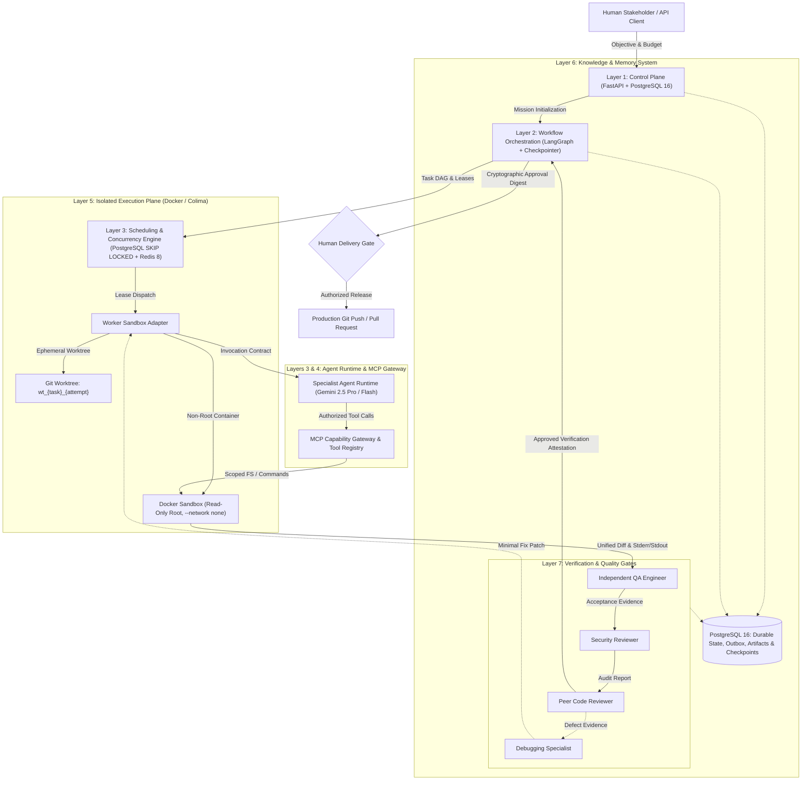
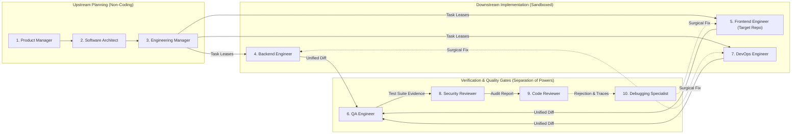
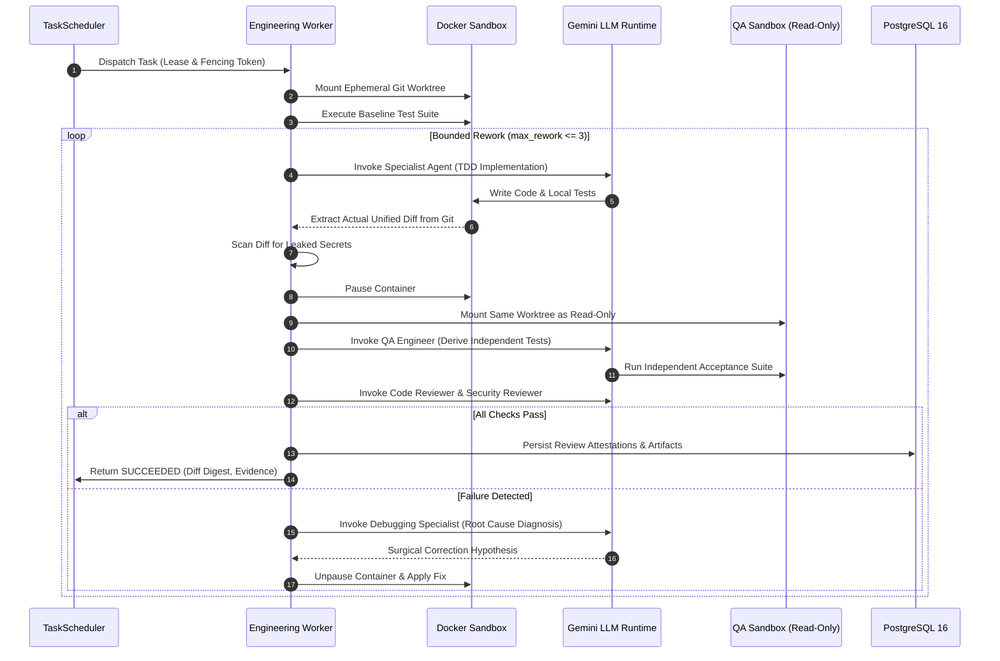

# SYNTRA

**Synchronized Intelligence for Autonomous Software Engineering**

> *One Vision. Multiple Specialized AI Agents. Autonomous, Contract-Governed Software Engineering.*

---

## 1. Executive Summary & Philosophy

**SYNTRA** is an enterprise-grade autonomous software engineering organization. Unlike conversational agent frameworks that simulate social chat rooms or free-form LLM discussions, SYNTRA operates as an **evidence-driven, contract-governed, distributed multi-agent system**.

SYNTRA coordinates a synchronized team of specialized engineering personas powered by Google Gemini (via the official `google-genai` SDK) to autonomously ingest high-level problem statements, author structured requirements, formulate technical architectures, compute cycle-free dependency task graphs, implement type-safe code inside isolated Docker sandboxes, run independent QA verification suites, perform static and dynamic security audits, conduct peer code reviews, and deliver cryptographically verified release artifacts.

### Core Architectural Invariants

1. **Role Invocations, Not Chatbots**: Agents are stateless role configurations invoked by deterministic orchestrators with explicit typed contracts, budget ceilings, and capability grants. They do not maintain informal, unlogged back-channel chat.
2. **Authoritative Application State**: Durable system state is held exclusively in PostgreSQL 16 with ACID guarantees, row-level locking, and transactional outbox patterns.
3. **Immutable Artifact Handoffs**: All cross-agent communication occurs through cryptographically hashed (SHA-256), schema-validated artifacts (PRDs, ADRs, Task Plans, Unified Diffs, Verification Runs).
4. **Separation of Powers & Anti-Collusion**: No agent may review, approve, or verify its own output. Implementing roles are cryptographically barred from acting as QA, Security Reviewer, or Code Reviewer for their own patches.
5. **Human-in-the-Loop Governance**: Autonomous execution is bounded by explicit cryptographic delivery gates. No agent possesses the authority to perform external Git pushes or production releases without human authorization.
6. **Headless-First & Backend-Only**: SYNTRA is strictly a headless platform operable via FastAPI REST/WebSocket endpoints and the `syntra` CLI. SYNTRA never generates UI for itself; target UI development is strictly confined to target repositories.

---

## 2. System Architecture

SYNTRA is structured as a **7-Layer Modular Architecture** ensuring strict isolation between governance, workflow state, model reasoning, and code execution.



### Detailed Layer Responsibilities

| Layer | Component | Core Responsibilities & Technologies |
|---|---|---|
| **Layer 1** | **Control Plane** | FastAPI REST endpoints, WebSocket event streams, tenant isolation (`org_id`, `project_id`), RBAC, token & cost budget reservations, and cryptographic approval digests. |
| **Layer 2** | **Workflow Orchestration** | LangGraph 13-stage deterministic state graph. Manages macro mission lifecycle, human-in-the-loop interruption gates, and PostgreSQL-backed durable checkpointing. |
| **Layer 3** | **Scheduling & Concurrency** | Deterministic DAG engine (`TaskDAGEngine`), atomic PostgreSQL task claiming (`FOR UPDATE SKIP LOCKED`), worker leases with fencing tokens, Transactional Outbox relay, and Redis 8 Streams dispatch. |
| **Layer 4** | **MCP & Tool Control** | Model Context Protocol client/server gateway, dynamic capability policies, tool result sanitization, and automated credential scrubbing. |
| **Layer 5** | **Isolated Execution Plane** | Ephemeral Git worktrees (`.syntra/sandboxes/wt_*`), non-root Docker execution (`UID 1000`), read-only root filesystems, `--network none` isolation, and unified diff extraction. |
| **Layer 6** | **Knowledge & Memory** | Execution memory (attempts, leases, telemetry), project memory (ADRs, schemas, PRDs), and SHA-256 content-addressed immutable artifact storage. |
| **Layer 7** | **Verification & Governance** | Independent QA test runner, AST-based static analysis, secret leakage scanners, peer review attestations, and bounded debugging/remediation loops. |

---

## 3. The 10 Planned & Implemented Engineering Personas

SYNTRA defines 10 specialized engineering roles. Each persona operates under an explicit system prompt, a strict set of permitted tools, bounded token and financial budgets, and typed Pydantic v2 input/output schemas.



### 1. Product Manager (PM)
* **Role Mandate**: Transform ambiguous user objectives into structured, exhaustive Product Requirements Documents (PRDs).
* **Core Responsibilities**:
  * Ingest user problem statements and existing repository context.
  * Formulate functional and non-functional requirements.
  * Define acceptance criteria in Given-When-Then format.
  * Maintain an explicit ambiguity log with recorded assumptions.
* **Allowed Capabilities**: `workspace_search`, `read_file`, `list_directory`.
* **Output Schema**: `RequirementsAnalysis` (`PRDDocument` artifact with YAML frontmatter).
* **Forbidden Actions**: Must never modify source code, execute bash commands, or approve pull requests.

### 2. Software Architect
* **Role Mandate**: Define modular system boundaries, component contracts, and technical tradeoffs.
* **Core Responsibilities**:
  * Produce Architecture Decision Records (ADRs).
  * Define inter-module dependency directions, interface contracts, and database models.
  * Enforce non-functional architectural invariants (security, latency, scalability).
* **Allowed Capabilities**: `workspace_search`, `read_file`, `list_directory`.
* **Output Schema**: `ArchitectureProposal` (`ArchitectureSpecification` and `ADR` artifacts).
* **Forbidden Actions**: Must never write implementation code or execute unverified shell scripts.

### 3. Engineering Manager (EM)
* **Role Mandate**: Decompose architectural blueprints into a validated, cycle-free Directed Acyclic Graph (DAG) of actionable engineering tasks.
* **Core Responsibilities**:
  * Enforce atomic task boundaries (one verifiable outcome per task).
  * Validate topological order and reject circular dependencies using `TaskDAGEngine`.
  * Calculate critical paths, token/cost budget reservations, and worker concurrency limits.
  * Assign tasks to specialized implementation roles with explicit acceptance criteria.
* **Allowed Capabilities**: `workspace_search`, `read_file`, `validate_dag`.
* **Output Schema**: `TaskPlanProposal` (DAG of `Task` records with dependencies and estimated budgets).
* **Forbidden Actions**: Must never execute tasks, write code, or bypass capability grants.

### 4. Backend Engineer
* **Role Mandate**: Implement backend APIs, database models, and pure domain business services.
* **Core Responsibilities**:
  * Execute assigned tasks inside isolated sandbox environments.
  * Follow Test-Driven Development (TDD) (write regression and unit tests before business logic).
  * Produce type-safe, validated FastAPI/Python code and SQLAlchemy models.
* **Allowed Capabilities**: `read_file`, `write_file`, `run_command` (scoped strictly to worker sandbox).
* **Output Schema**: `AgentFinalResult` containing unified diff patch, command execution logs, and local test evidence.
* **Forbidden Actions**: Must never access the host filesystem, host environment variables, or production databases.

### 5. Frontend Engineer (Target Repositories Only)
* **Role Mandate**: Implement client-side code and user interfaces *exclusively inside target repositories*.
* **Critical Platform Policy**: SYNTRA itself is strictly backend-only. The Frontend Engineer agent never modifies or creates UI components for the SYNTRA platform.
* **Core Responsibilities**:
  * Build UI components, state management, and API clients within target project repositories (e.g., Next.js, React, Tailwind).
  * Implement client-side validation and automated component tests.
* **Allowed Capabilities**: `read_file`, `write_file`, `run_command` (scoped strictly to target repo sandbox).
* **Output Schema**: Target repository unified diff patch, client test logs.
* **Forbidden Actions**: Must never alter SYNTRA core platform code or bypass sandbox security rules.

### 6. QA Engineer
* **Role Mandate**: Formulate independent acceptance test suites and verify functional completeness.
* **Core Responsibilities**:
  * Author acceptance and integration tests based directly on PRD Given-When-Then criteria.
  * Execute regression test suites inside clean, read-only sandboxes.
  * Detect API contract drift and boundary condition regressions.
* **Allowed Capabilities**: `read_file`, `write_file`, `run_command` (test runner).
* **Output Schema**: `QAProposal` and `VerificationRun` record with test execution logs and coverage metrics.
* **Forbidden Actions**: Must never modify production source code to make tests pass artificially.

### 7. DevOps Engineer
* **Role Mandate**: Build container definitions, CI/CD automation, and deployment configurations.
* **Core Responsibilities**:
  * Author reproducible `Dockerfile`, `compose.yaml`, and GitHub Actions workflows.
  * Configure health check probes, container security baselines (non-root execution), and multi-stage builds.
  * Manage Git worktrees and patch application mechanics.
* **Allowed Capabilities**: `read_file`, `write_file`, `run_command` (build verification).
* **Output Schema**: CI/CD pipeline definitions, container manifests, build logs.
* **Forbidden Actions**: Must never deploy to production without explicit human authorization.

### 8. Security Reviewer
* **Role Mandate**: Perform static and dynamic security auditing of all code diffs and dependencies.
* **Core Responsibilities**:
  * Inspect diffs for OWASP Top 10 vulnerabilities (SQLi, SSRF, command injection, path traversal).
  * Scan for hardcoded credentials, secret leakage, or high-entropy tokens.
  * Audit third-party dependency updates against known CVE advisories.
* **Allowed Capabilities**: `read_file`, `workspace_search`, `security_scan`.
* **Output Schema**: `SecurityReport` (PASS / FAIL with line-level findings, severities, and remediations).
* **Forbidden Actions**: Cannot approve patches containing unresolved critical or high severity findings.

### 9. Code Reviewer
* **Role Mandate**: Conduct independent peer review of proposed unified diffs for quality, style, and architectural alignment.
* **Core Responsibilities**:
  * Verify that implementation satisfies task acceptance criteria without scope creep.
  * Ensure code adheres to project formatting, typing, and naming conventions.
  * Inspect test coverage for modified logic.
* **Allowed Capabilities**: `read_file`, `workspace_search`.
* **Output Schema**: `CodeReviewProposal` (APPROVED / REJECTED with line-level comments).
* **Forbidden Actions**: May not review code authored by itself. May not modify source code directly.

### 10. Debugging Specialist
* **Role Mandate**: Systematically diagnose test failures, execution errors, and runtime crashes.
* **Core Responsibilities**:
  * Analyze stderr, traceback outputs, and execution logs from failed QA or sandbox runs.
  * Formulate testable root-cause hypotheses.
  * Construct a minimal reproducing automated test case.
  * Propose a minimal surgical fix patch back to the assigned engineering role.
* **Allowed Capabilities**: `read_file`, `write_file`, `run_command` (diagnostic sandbox).
* **Output Schema**: `FailureAnalysis` (`RootCauseAnalysisReport`, minimal reproducing test, proposed fix patch).
* **Forbidden Actions**: Must not disable or weaken existing test assertions to bypass failures.

---

## 4. Multi-Agent Lifecycle & Workflow Mechanics

SYNTRA coordinates work across two discrete workflow planes:

### Macro Lifecycle: LangGraph Mission State Machine
The mission lifecycle is governed by a 13-stage deterministic LangGraph state machine with PostgreSQL durable checkpointing:

1. **INTAKE**: Ingests user objective and initializes mission state.
2. **REQUIREMENTS_ANALYSIS**: Product Manager produces structured PRD.
3. **ARCHITECTURE_DESIGN**: Software Architect formulates architecture spec and ADRs.
4. **TASK_DECOMPOSITION**: Engineering Manager decomposes specs into cycle-free task DAG.
5. **HUMAN_PLAN_APPROVAL (Gate 1)**: Execution pauses. Requires cryptographic human approval digest before tasks can be scheduled.
6. **TASK_EXECUTION_FANOUT**: TaskScheduler claims ready tasks and dispatches to isolated workers via Redis Streams.
7. **INDEPENDENT_QA**: QA Engineer executes test suites in clean sandboxes.
8. **SECURITY_REVIEW**: Security Reviewer audits diffs and dependencies.
9. **CODE_REVIEW**: Peer Code Reviewer reviews code for style, typing, and acceptance.
10. **DEBUGGING_REMEDIATION (Conditional)**: If any gate rejects, Debugging Specialist diagnoses root cause and provides a surgical patch (up to bounded `max_rework` attempts).
11. **HUMAN_DELIVERY_APPROVAL (Gate 2)**: Final human checkpoint. Approves verified unified diff before release.
12. **RELEASE_DELIVERY**: Git worktree commit, release tag, and PR creation.
13. **COMPLETED / FAILED**: Mission reaches terminal state with finalized cost and token settlement.

### Micro Lifecycle: Sandboxed Engineering Task Loop
When an engineering worker claims a task, it executes an isolated 6-phase sub-loop inside a dedicated container:



---

## 5. Distributed Concurrency & Task Scheduling Plane

To guarantee that tasks are executed reliably without race conditions or orphaned work, SYNTRA implements a distributed scheduling engine:

* **Deterministic DAG Readiness**: Tasks are only eligible for scheduling when all upstream dependencies have transitioned to `SUCCEEDED`.
* **Atomic Task Claiming**: Schedulers claim pending tasks using PostgreSQL `FOR UPDATE SKIP LOCKED`. If multiple scheduler instances run concurrently, each acquires distinct task rows without lock contention or duplicate execution.
* **Worker Leases & Heartbeats**: When a task is claimed, a `task_leases` row is created with an expiration timestamp (`now() + lease_duration`). Workers send periodic heartbeats to maintain their lease.
* **Monotonic Fencing Tokens**: Every task attempt receives a strictly incrementing 64-bit integer fencing token. Late-arriving results from timed-out or superseded workers are rejected at the database boundary.
* **Transactional Outbox Relay**: State changes and Redis dispatch events are written atomically to an `outbox_events` table in the same PostgreSQL transaction. A dedicated outbox relay forwards events to Redis 8 Streams, ensuring at-least-once delivery with zero phantom tasks.
* **Reconciliation Loop**: A periodic background daemon detects expired worker leases, marks dead attempts as `TIMED_OUT`, releases reserved role capacities, and reschedules eligible tasks.

---

## 6. Sandbox Isolation & Security Architecture

SYNTRA treats all code generation and execution as untrusted. Sandboxed workers are guarded by multi-layered defensive controls:

```
+-------------------------------------------------------------------+
|                        Docker Host (Colima/macOS)                 |
|                                                                   |
|  +-------------------------------------------------------------+  |
|  |                 Docker Container Sandbox                    |  |
|  |                                                             |  |
|  |  [Security Profile]                                         |  |
|  |  - Non-Root User: UID 1000:1000                             |  |
|  |  - Root Filesystem: READ-ONLY (--read-only)                 |  |
|  |  - Network Policy: NONE (--network none)                    |  |
|  |  - Linux Capabilities: ALL DROPPED (--cap-drop ALL)         |  |
|  |  - Security Options: no-new-privileges:true                 |  |
|  |  - Temporary Writable: --tmpfs /tmp:rw,noexec,nosuid,size=64M|  |
|  |                                                             |  |
|  |  [Mounted Workspace]                                        |  |
|  |  /workspace <--- Bind Mount: .syntra/sandboxes/wt_{task}   |  |
|  |                  (Isolated Git Worktree per Attempt)        |  |
|  +-------------------------------------------------------------+  |
+-------------------------------------------------------------------+
```

### Defense-in-Depth Measures
1. **Ephemeral Git Worktrees**: Every execution attempt receives an isolated Git worktree branched off the target commit (`git worktree add`). Workers cannot corrupt other tasks or the primary repository.
2. **Authoritative Diff Extraction**: Diffs are never trusted from LLM conversational output. The system runs `git diff` directly against the worktree filesystem to produce the authoritative patch.
3. **Automated Secret Redaction**: All stderr/stdout logs, unified diffs, and context envelopes are filtered through high-entropy regex pattern scrubbers to prevent API keys or passwords from persisting in database records.
4. **Read-Only Verification Containers**: During QA and Review phases, the container volume is remounted strictly `read-only` (`workspace_read_only=True`). Reviewers cannot tamper with code to artificially force tests to pass.

---

## 7. Model Context Protocol (MCP) & Skills Registry

SYNTRA integrates tools and capabilities through standardized protocols:

* **Native MCP Gateway**: Operates both as an MCP server (`syntra`) exposing repo and task inspection tools, and as an MCP client connecting to external tool servers over stdio and HTTP SSE.
* **Capability Policy Grants**: Capabilities are granted at the database level per mission and role. The LLM cannot grant itself tool access or escalate privileges.
* **Versioned Skills Registry**: Reusable domain knowledge packages are located in `skills/<skill_name>/` containing `manifest.yaml` and `SKILL.md`.
* **Progressive Disclosure**: To prevent context window saturation, skills are loaded dynamically into agent prompts only when declared in the task specification.

---

## 8. Monorepo Structure

```
syntra/
|-- src/syntra/                 # Core Python platform package
|   |-- domain/                 # Pure domain entities, value objects, and enums
|   |-- contracts/              # Pydantic v2 schemas and validation contracts
|   |-- persistence/            # SQLAlchemy 2.x async models, UoW, and repositories
|   |-- llm/                    # Google Gen AI runtime, model router, and cost ledger
|   |-- orchestration/          # LangGraph mission state graph and checkpointing
|   |-- scheduling/             # Task DAG scheduler, outbox relay, and lease reconciler
|   |-- sandbox/                # Docker container manager, Git worktree isolation
|   |-- agents/                 # 10 Agent personas, handoff validators, and engineering worker
|   |-- mcp/                    # Model Context Protocol server and client gateway
|   |-- skills/                 # Skill package loader and profile definitions
|   |-- api/                    # FastAPI REST routes and WebSocket handlers
|
|-- skills/                     # 16 Versioned domain skill packages
|   |-- backend-api-development/
|   |-- system-architecture/
|   |-- test-driven-development/
|   |-- security-review/
|   |-- ...
|
|-- tests/                      # Exhaustive test suite (Unit, Integration, Security, E2E)
|-- docs/                       # Architectural specifications and phase documentation
|   |-- architecture/           # Layer designs, database ERD, security threat model
|   |-- phases/                 # Phase implementation roadmaps
|   |-- testing/                # Verification and independent audit reports
|
|-- compose.yaml                # PostgreSQL 16, Redis 8, MinIO S3 local stack
|-- Dockerfile.sandbox          # Minimal hardened Alpine container image for workers
|-- pyproject.toml              # Python project configuration (uv, ruff, mypy, pytest)
|-- Makefile                    # Standardized development workflows
```

---

## 9. Getting Started

### Prerequisites
* **Python**: `3.12+`
* **Package Manager**: `uv`
* **Container Runtime**: Docker or Colima (for isolated worker sandboxes)
* **Databases**: PostgreSQL 16+ and Redis 7/8+ (available via `compose.yaml`)
* **API Credentials**: `GEMINI_API_KEY` for Google Gemini models

### 1. Environment Setup
```bash
# Clone the repository
git clone https://github.com/thedeepakreddy/SYNTRA.git
cd SYNTRA

# Bootstrap dependencies with uv
uv sync --all-extras
```

### 2. Infrastructure Services
```bash
# Launch PostgreSQL 16, Redis 8, and MinIO S3
docker compose up -d

# Run database migrations
uv run alembic upgrade head
```

### 3. Build Worker Sandbox Image
```bash
# Build the hardened worker sandbox container
docker build -t syntra-sandbox:latest -f Dockerfile.sandbox .
```

### 4. Run the Verification Suite
```bash
# Run unit, integration, and security tests
uv run pytest

# Check code formatting and static typing
uv run ruff check .
uv run ruff format --check .
uv run mypy src
```

### 5. Launch the Control Plane API
```bash
# Start the FastAPI service
uv run uvicorn syntra.api.main:app --host 0.0.0.0 --port 8000 --reload
# Interactive API documentation: http://localhost:8000/docs
```

---

## 10. License

This project is licensed under the Apache 2.0 License.
