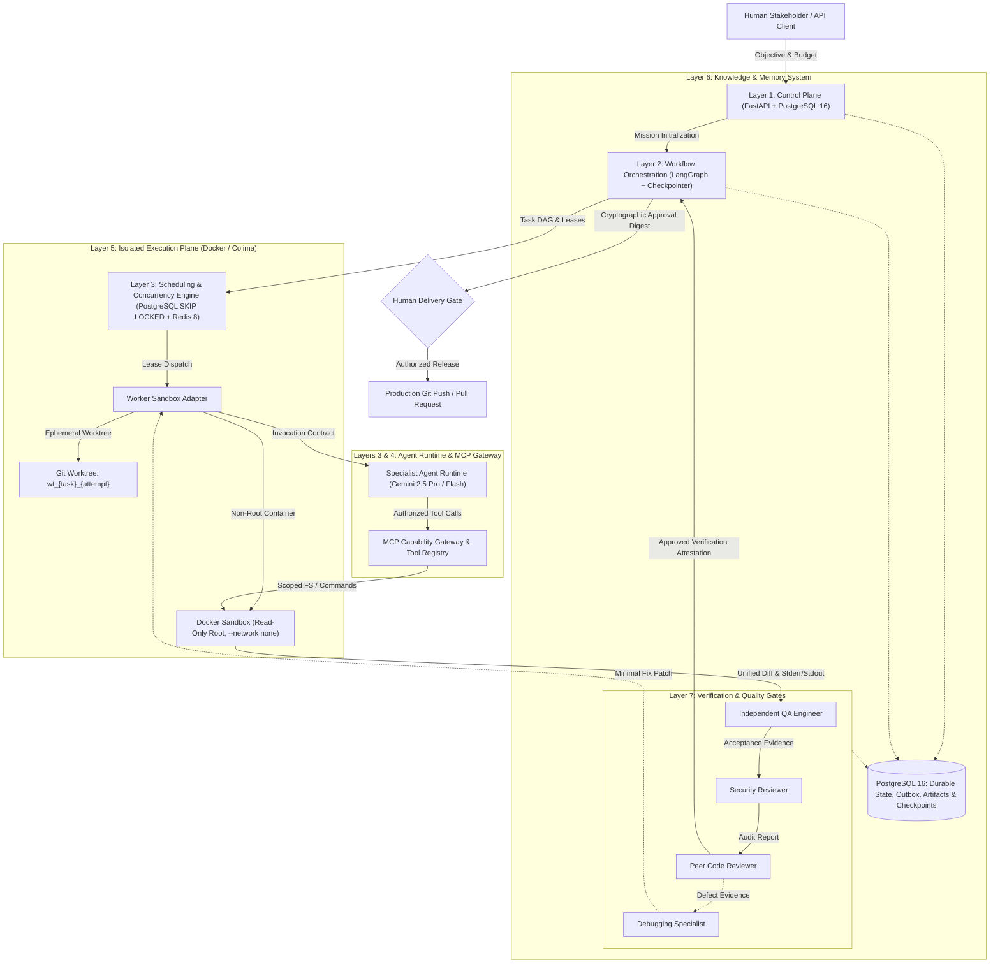
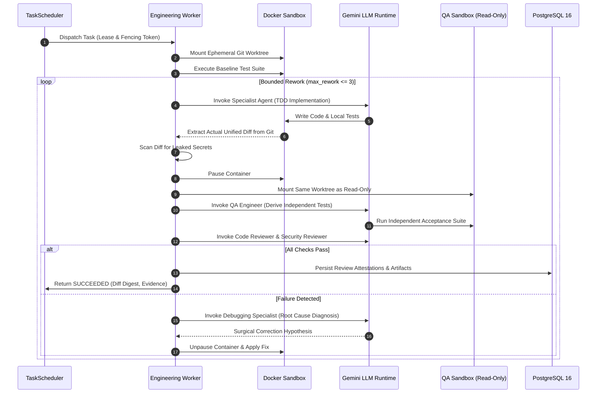
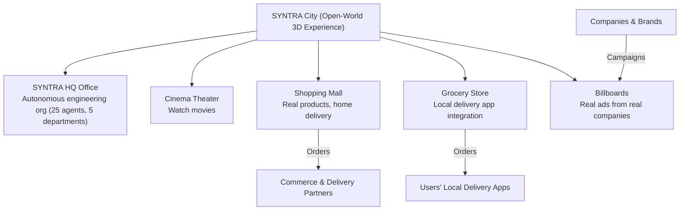
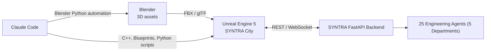

# SYNTRA

**Synchronized Intelligence for Autonomous Software Engineering**

> *One Vision. Multiple Specialized AI Agents. Autonomous, Contract-Governed Software Engineering.*

---

## 1. Executive Summary & Philosophy

**SYNTRA** is an enterprise-grade autonomous software engineering organization. Unlike conversational agent frameworks that simulate social chat rooms or free-form LLM discussions, SYNTRA operates as an **evidence-driven, contract-governed, distributed multi-agent system**.

SYNTRA coordinates a synchronized team of specialized engineering personas powered by Google Gemini (via the official `google-genai` SDK) to autonomously ingest high-level problem statements, author structured requirements, formulate technical architectures, compute cycle-free dependency task graphs, implement type-safe code inside isolated Docker sandboxes, run independent QA verification suites, perform static and dynamic security audits, conduct peer code reviews, and deliver cryptographically verified release artifacts.

### Core Architectural Invariants

1. **Role Invocations, Not Chatbots**: Agents are stateless role configurations invoked by deterministic orchestrators with explicit typed contracts, budget ceilings, and capability grants. They do not maintain informal, unlogged back-channel chat.
2. **Authoritative Application State**: Durable system state is held exclusively in PostgreSQL 16 with ACID guarantees, row-level locking, and transactional outbox patterns.
3. **Immutable Artifact Handoffs**: All cross-agent communication occurs through cryptographically hashed (SHA-256), schema-validated artifacts (PRDs, ADRs, Task Plans, Unified Diffs, Verification Runs).
4. **Separation of Powers & Anti-Collusion**: No agent may review, approve, or verify its own output. Implementing roles are cryptographically barred from acting as QA, Security Reviewer, or Code Reviewer for their own patches.
5. **Human-in-the-Loop Governance**: Autonomous execution is bounded by explicit cryptographic delivery gates. No agent possesses the authority to perform external Git pushes or production releases without human authorization.
6. **API-First Core with a Human Control Center**: Every capability is exposed through FastAPI REST/WebSocket endpoints and the `syntra` CLI. Humans operate the platform through the Control Center (`frontend/`), which is built and maintained by the platform team. Agents never modify SYNTRA's own UI: the Frontend Engineer agent works only inside target repositories.

---

## 2. System Architecture

SYNTRA is structured as a **7-Layer Modular Architecture** ensuring strict isolation between governance, workflow state, model reasoning, and code execution.



### Detailed Layer Responsibilities

| Layer | Component | Core Responsibilities & Technologies |
|---|---|---|
| **Layer 1** | **Control Plane** | FastAPI REST endpoints, WebSocket event streams, tenant isolation (`org_id`, `project_id`), RBAC, token & cost budget reservations, and cryptographic approval digests. |
| **Layer 2** | **Workflow Orchestration** | LangGraph 13-stage deterministic state graph. Manages macro mission lifecycle, human-in-the-loop interruption gates, and PostgreSQL-backed durable checkpointing. |
| **Layer 3** | **Scheduling & Concurrency** | Deterministic DAG engine (`TaskDAGEngine`), atomic PostgreSQL task claiming (`FOR UPDATE SKIP LOCKED`), worker leases with fencing tokens, Transactional Outbox relay, and Redis 8 Streams dispatch. |
| **Layer 4** | **MCP & Tool Control** | Model Context Protocol client/server gateway, dynamic capability policies, tool result sanitization, and automated credential scrubbing. |
| **Layer 5** | **Isolated Execution Plane** | Ephemeral Git worktrees (`.syntra/sandboxes/wt_*`), non-root Docker execution (`UID 1000`), read-only root filesystems, `--network none` isolation, and unified diff extraction. |
| **Layer 6** | **Knowledge & Memory** | Execution memory (attempts, leases, telemetry), project memory (ADRs, schemas, PRDs), and SHA-256 content-addressed immutable artifact storage. |
| **Layer 7** | **Verification & Governance** | Independent QA test runner, AST-based static analysis, secret leakage scanners, peer review attestations, and bounded debugging/remediation loops. |

---

## 3. The 25 Engineering Agents Across 5 Departments

SYNTRA runs **25 specialized engineering agents organized into 5 departments** of 5 roles each. Missions flow from Product & Design through Engineering, are checked independently by Quality & Assurance, and are shipped by Platform & Delivery. Specialist Engineering supports every stage. Each agent operates under an explicit system prompt, a strict set of permitted tools, bounded token and financial budgets, and typed Pydantic v2 input/output schemas.

| # | Department | Roles |
|---|---|---|
| 1 | **Product & Design** | Product Manager, Business Analyst, Software Architect, Engineering Manager, UI/UX Designer |
| 2 | **Engineering** | Backend Engineer, Frontend Engineer, Full-Stack Engineer, Database Engineer, Integration Engineer |
| 3 | **Quality & Assurance** | QA Engineer, Test Automation Engineer, Code Reviewer, Security Reviewer, Debugging Specialist |
| 4 | **Platform & Delivery** | DevOps Engineer, Cloud Engineer, Site Reliability Engineer (SRE), Release Engineer, Git Engineer |
| 5 | **Specialist Engineering** | AI/ML Engineer, Research Engineer, Performance Engineer, Documentation Engineer, Maintenance Engineer |

```mermaid
flowchart LR
    subgraph D1["1. Product & Design (Non-Coding)"]
        PM["Product Manager"] --> BA["Business Analyst"]
        BA --> Arch["Software Architect"]
        PM --> UX["UI/UX Designer"]
        Arch --> EM["Engineering Manager"]
        UX --> EM
    end

    subgraph D2["2. Engineering (Sandboxed)"]
        BE["Backend Engineer"]
        FE["Frontend Engineer"]
        FS["Full-Stack Engineer"]
        DBE["Database Engineer"]
        IE["Integration Engineer"]
    end

    subgraph D3["3. Quality & Assurance (Separation of Powers)"]
        QA["QA Engineer"] --> TA["Test Automation Engineer"]
        TA --> Sec["Security Reviewer"]
        Sec --> CR["Code Reviewer"]
        CR -.->|Rejection & Traces| Dbg["Debugging Specialist"]
    end

    subgraph D4["4. Platform & Delivery"]
        DO["DevOps Engineer"] --> Cloud["Cloud Engineer"]
        Cloud --> SRE["Site Reliability Engineer"]
        Git["Git Engineer"] --> Rel["Release Engineer"]
    end

    subgraph D5["5. Specialist Engineering (Supports All Stages)"]
        ML["AI/ML Engineer"]
        RE["Research Engineer"]
        Perf["Performance Engineer"]
        Doc["Documentation Engineer"]
        Mnt["Maintenance Engineer"]
    end

    EM -->|Task Leases| D2
    D2 -->|Unified Diff| QA
    Dbg -.->|Surgical Fix| D2
    CR -->|Approved Patch| Git
    Rel -->|Release Candidate| Gate{"Human Delivery Gate"}
```



---

### Department 1: Product & Design

#### 1. Product Manager (PM)
* **Role Mandate**: Transform ambiguous user objectives into structured, exhaustive Product Requirements Documents (PRDs).
* **Core Responsibilities**:
  * Ingest user problem statements and existing repository context.
  * Formulate functional and non-functional requirements.
  * Define acceptance criteria in Given-When-Then format.
  * Maintain an explicit ambiguity log with recorded assumptions.
* **Allowed Capabilities**: `workspace_search`, `read_file`, `list_directory`.
* **Output Schema**: `RequirementsAnalysis` (`PRDDocument` artifact with YAML frontmatter).
* **Forbidden Actions**: Must never modify source code, execute bash commands, or approve pull requests.

#### 2. Business Analyst
* **Role Mandate**: Turn the PRD into detailed business rules, user flows and data definitions that engineers can build from.
* **Core Responsibilities**:
  * Map user journeys, business processes and edge cases.
  * Define domain entities, field-level validation rules and business constraints.
  * Trace every requirement to an acceptance criterion so nothing is lost between PRD and task plan.
* **Allowed Capabilities**: `workspace_search`, `read_file`, `list_directory`.
* **Output Schema**: `BusinessAnalysis` (process flows, domain glossary, requirement traceability matrix).
* **Forbidden Actions**: Must never modify source code, execute bash commands, or change approved requirements without PM sign-off.

#### 3. Software Architect
* **Role Mandate**: Define modular system boundaries, component contracts, and technical tradeoffs.
* **Core Responsibilities**:
  * Produce Architecture Decision Records (ADRs).
  * Define inter-module dependency directions, interface contracts, and database models.
  * Enforce non-functional architectural invariants (security, latency, scalability).
* **Allowed Capabilities**: `workspace_search`, `read_file`, `list_directory`.
* **Output Schema**: `ArchitectureProposal` (`ArchitectureSpecification` and `ADR` artifacts).
* **Forbidden Actions**: Must never write implementation code or execute unverified shell scripts.

#### 4. Engineering Manager (EM)
* **Role Mandate**: Decompose architectural blueprints into a validated, cycle-free Directed Acyclic Graph (DAG) of actionable engineering tasks.
* **Core Responsibilities**:
  * Enforce atomic task boundaries (one verifiable outcome per task).
  * Validate topological order and reject circular dependencies using `TaskDAGEngine`.
  * Calculate critical paths, token/cost budget reservations, and worker concurrency limits.
  * Assign tasks to the right department and role with explicit acceptance criteria.
* **Allowed Capabilities**: `workspace_search`, `read_file`, `validate_dag`.
* **Output Schema**: `TaskPlanProposal` (DAG of `Task` records with dependencies and estimated budgets).
* **Forbidden Actions**: Must never execute tasks, write code, or bypass capability grants.

#### 5. UI/UX Designer
* **Role Mandate**: Design the user experience and visual interface for target applications before any frontend code is written.
* **Core Responsibilities**:
  * Produce user flows, wireframes, component inventories and design tokens (color, type, spacing).
  * Define responsive layouts, interaction states and accessibility requirements (WCAG).
  * Hand off a design specification the Frontend and Full-Stack Engineers implement against.
* **Allowed Capabilities**: `workspace_search`, `read_file`, `list_directory`.
* **Output Schema**: `DesignSpecification` (screens, component specs, design tokens, accessibility checklist).
* **Forbidden Actions**: Must never write production code or modify SYNTRA's own platform UI.

---

### Department 2: Engineering

#### 6. Backend Engineer
* **Role Mandate**: Implement backend APIs, database models, and pure domain business services.
* **Core Responsibilities**:
  * Execute assigned tasks inside isolated sandbox environments.
  * Follow Test-Driven Development (TDD) (write regression and unit tests before business logic).
  * Produce type-safe, validated FastAPI/Python code and SQLAlchemy models.
* **Allowed Capabilities**: `read_file`, `write_file`, `run_command` (scoped strictly to worker sandbox).
* **Output Schema**: `AgentFinalResult` containing unified diff patch, command execution logs, and local test evidence.
* **Forbidden Actions**: Must never access the host filesystem, host environment variables, or production databases.

#### 7. Frontend Engineer (Target Repositories Only)
* **Role Mandate**: Implement client-side code and user interfaces *exclusively inside target repositories*.
* **Critical Platform Policy**: The Frontend Engineer agent never modifies or creates UI components for the SYNTRA platform itself. SYNTRA's Control Center is built by the platform team; the agent works only inside target repositories.
* **Core Responsibilities**:
  * Build UI components, state management, and API clients from the UI/UX Designer's specification (e.g., Next.js, React, Tailwind).
  * Implement client-side validation and automated component tests.
* **Allowed Capabilities**: `read_file`, `write_file`, `run_command` (scoped strictly to target repo sandbox).
* **Output Schema**: Target repository unified diff patch, client test logs.
* **Forbidden Actions**: Must never alter SYNTRA core platform code or bypass sandbox security rules.

#### 8. Full-Stack Engineer
* **Role Mandate**: Deliver complete vertical features that span backend API, data layer and frontend in a target repository.
* **Core Responsibilities**:
  * Implement end-to-end features where one task touches both server and client code.
  * Keep API contracts and frontend clients in sync within a single patch.
  * Write unit and end-to-end tests covering the full request path.
* **Allowed Capabilities**: `read_file`, `write_file`, `run_command` (scoped strictly to worker sandbox).
* **Output Schema**: `AgentFinalResult` with a unified diff spanning backend and frontend, plus test evidence.
* **Forbidden Actions**: Must never alter SYNTRA core platform code, access production systems, or review its own patch.

#### 9. Database Engineer
* **Role Mandate**: Own data models, schema migrations, queries and data integrity.
* **Core Responsibilities**:
  * Design normalized schemas, indexes and constraints.
  * Write reversible Alembic migrations with upgrade and downgrade paths.
  * Optimize slow queries and verify transactional boundaries and locking behavior.
* **Allowed Capabilities**: `read_file`, `write_file`, `run_command` (sandbox database only).
* **Output Schema**: Migration scripts, schema diff, query plans, and migration test results.
* **Forbidden Actions**: Must never connect to production databases or run destructive migrations without human approval.

#### 10. Integration Engineer
* **Role Mandate**: Connect target applications to third-party APIs, webhooks, payment providers and MCP tools.
* **Core Responsibilities**:
  * Implement API clients with retries, timeouts, idempotency and error handling.
  * Build contract tests and mocks for every external dependency.
  * Keep credentials out of code by using environment configuration and secret managers.
* **Allowed Capabilities**: `read_file`, `write_file`, `run_command` (sandbox with mocked external endpoints).
* **Output Schema**: Integration patch, contract test suite, and interface documentation.
* **Forbidden Actions**: Must never hardcode credentials or call live third-party production endpoints from the sandbox.

---

### Department 3: Quality & Assurance

#### 11. QA Engineer
* **Role Mandate**: Formulate independent acceptance test suites and verify functional completeness.
* **Core Responsibilities**:
  * Author acceptance and integration tests based directly on PRD Given-When-Then criteria.
  * Execute regression test suites inside clean, read-only sandboxes.
  * Detect API contract drift and boundary condition regressions.
* **Allowed Capabilities**: `read_file`, `write_file`, `run_command` (test runner).
* **Output Schema**: `QAProposal` and `VerificationRun` record with test execution logs and coverage metrics.
* **Forbidden Actions**: Must never modify production source code to make tests pass artificially.

#### 12. Test Automation Engineer
* **Role Mandate**: Build and maintain the automated test infrastructure that QA and CI rely on.
* **Core Responsibilities**:
  * Create reusable test fixtures, factories and end-to-end browser test suites (e.g., Playwright).
  * Wire test suites into CI with parallelization and coverage reporting.
  * Detect and report flaky tests with reproducible evidence.
* **Allowed Capabilities**: `read_file`, `write_file`, `run_command` (test runner).
* **Output Schema**: Test framework patch, CI test configuration, coverage and flakiness reports.
* **Forbidden Actions**: Must never skip, disable or weaken tests to make a build pass, or modify production source code.

#### 13. Code Reviewer
* **Role Mandate**: Conduct independent peer review of proposed unified diffs for quality, style, and architectural alignment.
* **Core Responsibilities**:
  * Verify that implementation satisfies task acceptance criteria without scope creep.
  * Ensure code adheres to project formatting, typing, and naming conventions.
  * Inspect test coverage for modified logic.
* **Allowed Capabilities**: `read_file`, `workspace_search`.
* **Output Schema**: `CodeReviewProposal` (APPROVED / REJECTED with line-level comments).
* **Forbidden Actions**: May not review code authored by itself. May not modify source code directly.

#### 14. Security Reviewer
* **Role Mandate**: Perform static and dynamic security auditing of all code diffs and dependencies.
* **Core Responsibilities**:
  * Inspect diffs for OWASP Top 10 vulnerabilities (SQLi, SSRF, command injection, path traversal).
  * Scan for hardcoded credentials, secret leakage, or high-entropy tokens.
  * Audit third-party dependency updates against known CVE advisories.
* **Allowed Capabilities**: `read_file`, `workspace_search`, `security_scan`.
* **Output Schema**: `SecurityReport` (PASS / FAIL with line-level findings, severities, and remediations).
* **Forbidden Actions**: Cannot approve patches containing unresolved critical or high severity findings.

#### 15. Debugging Specialist
* **Role Mandate**: Systematically diagnose test failures, execution errors, and runtime crashes.
* **Core Responsibilities**:
  * Analyze stderr, traceback outputs, and execution logs from failed QA or sandbox runs.
  * Formulate testable root-cause hypotheses.
  * Construct a minimal reproducing automated test case.
  * Propose a minimal surgical fix patch back to the assigned engineering role.
* **Allowed Capabilities**: `read_file`, `write_file`, `run_command` (diagnostic sandbox).
* **Output Schema**: `FailureAnalysis` (`RootCauseAnalysisReport`, minimal reproducing test, proposed fix patch).
* **Forbidden Actions**: Must not disable or weaken existing test assertions to bypass failures.

---

### Department 4: Platform & Delivery

#### 16. DevOps Engineer
* **Role Mandate**: Build container definitions, CI/CD automation, and deployment configurations.
* **Core Responsibilities**:
  * Author reproducible `Dockerfile`, `compose.yaml`, and GitHub Actions workflows.
  * Configure health check probes, container security baselines (non-root execution), and multi-stage builds.
  * Verify that builds are reproducible from a clean checkout.
* **Allowed Capabilities**: `read_file`, `write_file`, `run_command` (build verification).
* **Output Schema**: CI/CD pipeline definitions, container manifests, build logs.
* **Forbidden Actions**: Must never deploy to production without explicit human authorization.

#### 17. Cloud Engineer
* **Role Mandate**: Define cloud infrastructure as code for target applications.
* **Core Responsibilities**:
  * Write Infrastructure-as-Code (e.g., Terraform, Pulumi) for networks, compute, storage and managed databases.
  * Apply least-privilege IAM policies and encryption at rest and in transit.
  * Estimate infrastructure cost for each environment.
* **Allowed Capabilities**: `read_file`, `write_file`, `run_command` (plan and validate only, no apply).
* **Output Schema**: IaC patch, `plan` output, cost estimate and IAM policy summary.
* **Forbidden Actions**: Must never apply infrastructure changes or hold live cloud credentials without human approval.

#### 18. Site Reliability Engineer (SRE)
* **Role Mandate**: Make target systems observable, reliable and recoverable.
* **Core Responsibilities**:
  * Define SLOs, SLIs, alerts and dashboards (OpenTelemetry, metrics, logs, traces).
  * Write runbooks and incident response procedures.
  * Design health checks, autoscaling, backups and disaster recovery plans.
* **Allowed Capabilities**: `read_file`, `write_file`, `run_command` (sandbox), read-only observability queries.
* **Output Schema**: `ReliabilityReport` (SLO definitions, alert rules, runbooks, recovery plan).
* **Forbidden Actions**: Must never change production systems or silence alerts without human approval.

#### 19. Release Engineer
* **Role Mandate**: Package verified changes into versioned, traceable release candidates.
* **Core Responsibilities**:
  * Apply semantic versioning and generate changelogs and release notes from approved patches.
  * Confirm every release candidate carries QA, Security and Code Review evidence.
  * Prepare rollback plans for every release.
* **Allowed Capabilities**: `read_file`, `write_file`, `workspace_search`.
* **Output Schema**: `ReleaseCandidate` (version, changelog, evidence bundle digest, rollback plan).
* **Forbidden Actions**: Must never publish a release or pass the Human Delivery Gate on its own authority.

#### 20. Git Engineer
* **Role Mandate**: Manage repository mechanics for every mission.
* **Core Responsibilities**:
  * Create and clean up ephemeral Git worktrees and task branches.
  * Apply approved unified diffs, resolve merge conflicts and keep a clean, conventional commit history.
  * Prepare pull requests with descriptions linked to task and verification evidence.
* **Allowed Capabilities**: `read_file`, `run_command` (local Git operations in the sandbox only).
* **Output Schema**: Branch and commit manifest, prepared pull request draft.
* **Forbidden Actions**: Must never push to remote repositories, merge pull requests or rewrite shared history without human approval.

---

### Department 5: Specialist Engineering

#### 21. AI/ML Engineer
* **Role Mandate**: Build AI and machine learning features in target applications.
* **Core Responsibilities**:
  * Integrate LLMs, embeddings, retrieval (RAG) and recommendation features.
  * Design prompts, evaluation datasets and quality metrics for AI behavior.
  * Track model cost, latency and safety guardrails.
* **Allowed Capabilities**: `read_file`, `write_file`, `run_command` (sandbox, offline or mocked models by default).
* **Output Schema**: ML feature patch, evaluation report, model cost and latency estimate.
* **Forbidden Actions**: Must never train on or send user data to external models without explicit approval.

#### 22. Research Engineer
* **Role Mandate**: Investigate unfamiliar technologies and de-risk technical decisions before implementation.
* **Core Responsibilities**:
  * Compare libraries, frameworks and approaches with evidence.
  * Build small throwaway prototypes and spikes to test feasibility.
  * Feed findings to the Software Architect as ADR inputs.
* **Allowed Capabilities**: `workspace_search`, `read_file`, `write_file`, `run_command` (isolated prototype sandbox).
* **Output Schema**: `ResearchReport` (options, tradeoffs, prototype results, recommendation).
* **Forbidden Actions**: Prototype code must never be merged directly into production branches.

#### 23. Performance Engineer
* **Role Mandate**: Measure and improve speed, scalability and resource usage.
* **Core Responsibilities**:
  * Write load tests and benchmarks, and profile CPU, memory and I/O.
  * Identify bottlenecks such as N+1 queries, slow endpoints and large frontend bundles.
  * Propose optimizations backed by before-and-after measurements.
* **Allowed Capabilities**: `read_file`, `write_file`, `run_command` (benchmark sandbox).
* **Output Schema**: `PerformanceReport` (benchmarks, profiles, regressions, optimization patch).
* **Forbidden Actions**: Must never load-test production systems or trade correctness for speed.

#### 24. Documentation Engineer
* **Role Mandate**: Keep every delivered project understandable and usable.
* **Core Responsibilities**:
  * Write and update READMEs, API references, architecture docs and user guides.
  * Generate OpenAPI documentation and code examples from the implemented contracts.
  * Keep documentation in sync with each approved patch.
* **Allowed Capabilities**: `read_file`, `write_file` (documentation files only), `workspace_search`.
* **Output Schema**: Documentation patch and docs coverage checklist.
* **Forbidden Actions**: Must never modify source code or document features that do not exist.

#### 25. Maintenance Engineer
* **Role Mandate**: Keep delivered projects healthy after release.
* **Core Responsibilities**:
  * Upgrade dependencies and patch known CVEs.
  * Pay down tech debt, remove dead code and refactor without changing behavior.
  * Triage incoming bugs and route them to the right role.
* **Allowed Capabilities**: `read_file`, `write_file`, `run_command` (sandbox).
* **Output Schema**: Maintenance patch, dependency upgrade report, tech-debt register updates.
* **Forbidden Actions**: Must never ship behavior changes disguised as maintenance or bypass QA and Security review.

---

## 4. Multi-Agent Lifecycle & Workflow Mechanics

SYNTRA coordinates work across two discrete workflow planes:

### Macro Lifecycle: LangGraph Mission State Machine
The mission lifecycle is governed by a 13-stage deterministic LangGraph state machine with PostgreSQL durable checkpointing:

1. **INTAKE**: Ingests user objective and initializes mission state.
2. **REQUIREMENTS_ANALYSIS**: Product Manager produces structured PRD.
3. **ARCHITECTURE_DESIGN**: Software Architect formulates architecture spec and ADRs.
4. **TASK_DECOMPOSITION**: Engineering Manager decomposes specs into cycle-free task DAG.
5. **HUMAN_PLAN_APPROVAL (Gate 1)**: Execution pauses. Requires cryptographic human approval digest before tasks can be scheduled.
6. **TASK_EXECUTION_FANOUT**: TaskScheduler claims ready tasks and dispatches to isolated workers via Redis Streams.
7. **INDEPENDENT_QA**: QA Engineer executes test suites in clean sandboxes.
8. **SECURITY_REVIEW**: Security Reviewer audits diffs and dependencies.
9. **CODE_REVIEW**: Peer Code Reviewer reviews code for style, typing, and acceptance.
10. **DEBUGGING_REMEDIATION (Conditional)**: If any gate rejects, Debugging Specialist diagnoses root cause and provides a surgical patch (up to bounded `max_rework` attempts).
11. **HUMAN_DELIVERY_APPROVAL (Gate 2)**: Final human checkpoint. Approves verified unified diff before release.
12. **RELEASE_DELIVERY**: Git worktree commit, release tag, and PR creation.
13. **COMPLETED / FAILED**: Mission reaches terminal state with finalized cost and token settlement.

### Micro Lifecycle: Sandboxed Engineering Task Loop
When an engineering worker claims a task, it executes an isolated 6-phase sub-loop inside a dedicated container:



---

## 5. Distributed Concurrency & Task Scheduling Plane

To guarantee that tasks are executed reliably without race conditions or orphaned work, SYNTRA implements a distributed scheduling engine:

* **Deterministic DAG Readiness**: Tasks are only eligible for scheduling when all upstream dependencies have transitioned to `SUCCEEDED`.
* **Atomic Task Claiming**: Schedulers claim pending tasks using PostgreSQL `FOR UPDATE SKIP LOCKED`. If multiple scheduler instances run concurrently, each acquires distinct task rows without lock contention or duplicate execution.
* **Worker Leases & Heartbeats**: When a task is claimed, a `task_leases` row is created with an expiration timestamp (`now() + lease_duration`). Workers send periodic heartbeats to maintain their lease.
* **Monotonic Fencing Tokens**: Every task attempt receives a strictly incrementing 64-bit integer fencing token. Late-arriving results from timed-out or superseded workers are rejected at the database boundary.
* **Transactional Outbox Relay**: State changes and Redis dispatch events are written atomically to an `outbox_events` table in the same PostgreSQL transaction. A dedicated outbox relay forwards events to Redis 8 Streams, ensuring at-least-once delivery with zero phantom tasks.
* **Reconciliation Loop**: A periodic background daemon detects expired worker leases, marks dead attempts as `TIMED_OUT`, releases reserved role capacities, and reschedules eligible tasks.

---

## 6. Sandbox Isolation & Security Architecture

SYNTRA treats all code generation and execution as untrusted. Sandboxed workers are guarded by multi-layered defensive controls:

```
+-------------------------------------------------------------------+
|                        Docker Host (Colima/macOS)                 |
|                                                                   |
|  +-------------------------------------------------------------+  |
|  |                 Docker Container Sandbox                    |  |
|  |                                                             |  |
|  |  [Security Profile]                                         |  |
|  |  - Non-Root User: UID 1000:1000                             |  |
|  |  - Root Filesystem: READ-ONLY (--read-only)                 |  |
|  |  - Network Policy: NONE (--network none)                    |  |
|  |  - Linux Capabilities: ALL DROPPED (--cap-drop ALL)         |  |
|  |  - Security Options: no-new-privileges:true                 |  |
|  |  - Temporary Writable: --tmpfs /tmp:rw,noexec,nosuid,size=64M|  |
|  |                                                             |  |
|  |  [Mounted Workspace]                                        |  |
|  |  /workspace <--- Bind Mount: .syntra/sandboxes/wt_{task}   |  |
|  |                  (Isolated Git Worktree per Attempt)        |  |
|  +-------------------------------------------------------------+  |
+-------------------------------------------------------------------+
```

### Defense-in-Depth Measures
1. **Ephemeral Git Worktrees**: Every execution attempt receives an isolated Git worktree branched off the target commit (`git worktree add`). Workers cannot corrupt other tasks or the primary repository.
2. **Authoritative Diff Extraction**: Diffs are never trusted from LLM conversational output. The system runs `git diff` directly against the worktree filesystem to produce the authoritative patch.
3. **Automated Secret Redaction**: All stderr/stdout logs, unified diffs, and context envelopes are filtered through high-entropy regex pattern scrubbers to prevent API keys or passwords from persisting in database records.
4. **Read-Only Verification Containers**: During QA and Review phases, the container volume is remounted strictly `read-only` (`workspace_read_only=True`). Reviewers cannot tamper with code to artificially force tests to pass.

---

## 7. Model Context Protocol (MCP) & Skills Registry

SYNTRA integrates tools and capabilities through standardized protocols:

* **Native MCP Gateway**: Operates both as an MCP server (`syntra`) exposing repo and task inspection tools, and as an MCP client connecting to external tool servers over stdio and HTTP SSE.
* **Capability Policy Grants**: Capabilities are granted at the database level per mission and role. The LLM cannot grant itself tool access or escalate privileges.
* **Versioned Skills Registry**: Reusable domain knowledge packages are located in `skills/<skill_name>/` containing `manifest.yaml` and `SKILL.md`.
* **Progressive Disclosure**: To prevent context window saturation, skills are loaded dynamically into agent prompts only when declared in the task specification.

---

## 8. Monorepo Structure

```
syntra/
|-- src/syntra/                 # Core Python platform package
|   |-- domain/                 # Pure domain entities, value objects, and enums
|   |-- contracts/              # Pydantic v2 schemas and validation contracts
|   |-- persistence/            # SQLAlchemy 2.x async models, UoW, and repositories
|   |-- llm/                    # Google Gen AI runtime, model router, and cost ledger
|   |-- orchestration/          # LangGraph mission state graph and checkpointing
|   |-- scheduling/             # Task DAG scheduler, outbox relay, and lease reconciler
|   |-- sandbox/                # Docker container manager, Git worktree isolation
|   |-- agents/                 # 25 agent roles (5 departments), handoff validators, and engineering worker
|   |-- mcp/                    # Model Context Protocol server and client gateway
|   |-- skills/                 # Skill package loader and profile definitions
|   |-- api/                    # FastAPI REST routes and WebSocket handlers
|
|-- apps/                       # Service entrypoints (api, orchestrator, scheduler, worker_controller, mcp_server)
|-- frontend/                   # Control Center (React 18 + TypeScript + Tailwind, Vite)
|-- skills/                     # 16 Versioned domain skill packages
|   |-- backend-api-development/
|   |-- system-architecture/
|   |-- test-driven-development/
|   |-- security-review/
|   |-- ...
|
|-- tests/                      # Exhaustive test suite (Unit, Integration, Security, E2E)
|-- docs/                       # Architectural specifications and phase documentation
|   |-- architecture/           # Layer designs, database ERD, security threat model
|   |-- phases/                 # Phase implementation roadmaps
|   |-- testing/                # Verification and independent audit reports
|
|-- compose.yaml                # PostgreSQL 16, Redis 8, MinIO S3 local stack
|-- Dockerfile.sandbox          # Minimal hardened Alpine container image for workers
|-- pyproject.toml              # Python project configuration (uv, ruff, mypy, pytest)
|-- Makefile                    # Standardized development workflows
```

---

## 9. Project Status & Phase Roadmap

**Current milestone: Phases 0–20 complete. All 25 agents across 5 departments are operational.** The latest regression run passed **612/612** pytest tests. Phases 0–14 have formal verification reports in [`docs/phases/progress.md`](docs/phases/progress.md). Phases 15–20 cover the Control Center pipeline work that followed Phase 14.

| Phase | Title | Status | Key Deliverables |
|---|---|---|---|
| 0 | System Architecture & Technical Planning | ✅ Complete | Architecture docs, ADR-001..007, contracts index, roadmap |
| 1 | Project Initialization | ✅ Complete | Monorepo layout, Compose stack (Postgres/Redis/MinIO), health probes |
| 2 | Database & Domain Foundation | ✅ Complete | 30 SQLAlchemy models, Alembic migrations, Unit of Work, outbox |
| 3 | API, Auth & Governance | ✅ Complete | `/v1/` REST control plane, approvals, budgets |
| 4 | MCP Infrastructure | ✅ Complete | MCP 2.x gateway, capability policy engine, SYNTRA MCP server |
| 5 | Skills & Capability Registry | ✅ Complete | 16 versioned skills, 10 capability profiles, progressive disclosure |
| 6 | Model Runtime & Gemini Integration | ✅ Complete | `google-genai` adapter, model router, cost ledger |
| 7 | LangGraph Workflow Engine | ✅ Complete | 13-phase mission graph, checkpointing, human interrupt gates |
| 8 | Task Scheduler & Leases | ✅ Complete | DAG scheduler, `SKIP LOCKED` leases, fencing tokens |
| 9 | Sandbox Execution | ✅ Complete | Isolated Docker sandboxes, ephemeral Git worktrees |
| 10 | Autonomous Engineering Organization | ✅ Complete | 10 specialist personas with separation of powers |
| 11 | Memory & Self-Correction | ✅ Complete | Tiered memory, failure reflection, bounded replanning |
| 12 | Verification, Security & Observability | ✅ Complete | Independent verifier, secret scrubbing, OpenTelemetry, audit log |
| 13 | End-to-End Integration & Benchmark | ✅ Complete | Benchmark runner (Modes A/B/D), worker SIGKILL recovery |
| 14 | Control Center & Product Integration | ✅ Complete | React 18 / TypeScript Control Center (`frontend/`), model routing simulator |
| 15 | Live Mission Execution | ✅ Complete | `POST /v1/missions/{id}/run`, auto-generated 7-stage persona DAG, real Gemini multi-agent execution with live polling and artifact streaming |
| 16 | Artifact Inspection & Approval Actions | ✅ Complete | Interactive artifact document inspector, delivery-gate approval resolution, direct approval actions |
| 17 | Autonomous Application Generation | ✅ Complete | End-to-end application synthesis with live in-dashboard preview, Gemini model-pool failover, mission-tailored synthesis |
| 18 | Liquid Glass Control Center & Live App Simulator | ✅ Complete | Redesign of all 13 Control Center pages, Safari-style Live App deck with desktop and iPhone chassis, source inspector |
| **19** | **Full-Stack Solution Generation & Level-4 Delivery Gate** | ✅ **Complete** | Autonomous full-stack generation (backend + UI), level-4 delivery-gate approval workflow, mission re-run support, hermetic backend imports |
| **20** | **Universal Domain Extraction, Project Rebuild & Orchestration Hardening** | ✅ **Complete** | Universal domain schema extractor (11 domains + noun fallback), `POST /v1/missions/{id}/rebuild` and `POST /v1/projects/{id}/rebuild` with UI buttons, domain-classifier fixes, P2P/WebRTC domain, 32k-token SPA generation to stop truncation, PRD/architecture context routed into agent prompts, retired-model remapping |

### Planned Phases

| Phase | Title | Status | Scope |
|---|---|---|---|
| 21 | SYNTRA City UI/UX | 🛠️ Next | Replace the Control Center with an open-world, cinematic 3D city interface built in Unreal Engine 5, with Blender assets. SYNTRA's engineering organization becomes one office building in the city. |
| 22 | City Cinema | 📋 Planned | Movie theater where users watch films |
| 23 | Shopping Mall | 📋 Planned | Buy real products and get them delivered to your home |
| 24 | Grocery Store | 📋 Planned | Grocery shopping through the user's local delivery apps |
| 25 | City Billboards & Advertising | 📋 Planned | Billboards that show real ads, with a self-serve platform for advertisers |

---

## 10. Future Vision: SYNTRA City

SYNTRA's long-term plan is to grow from one autonomous engineering office into a **living, open-world city**: a cinematic, AAA-quality 3D place where users explore, work, shop and are entertained. The SYNTRA engineering organization is **one office building in that city**.



### 10.1 Open-World City UI/UX
- **Look and feel**: a cinematic, photoreal open-world city in the style of modern AAA open-world games: day/night cycle, weather, dense streets, neon signs, and smooth third-person or drone-camera movement.
- **SYNTRA HQ office**: the current Control Center becomes the inside of the SYNTRA office. The 5 departments each have their own floor, and each of the 25 agents works at its own station. Missions, task DAGs, approvals and the human delivery gate appear as in-world screens and interactions.
- **City navigation**: a minimap, fast travel between locations, and HUD-style overlays for missions, notifications and orders.

### 10.2 Cinema Theater
- Users walk into the theater and watch movies on in-world screens.
- Content would come from licensed streaming and content partners.

### 10.3 Shopping Mall
- Storefronts sell **real products**. Orders placed in the city are paid for and **delivered to the user's real home address**.
- Built on real commerce, payment and fulfillment partners.

### 10.4 Grocery Store
- A city grocery store **connected to the user's local delivery apps**, so groceries picked in the city arrive at home through services already available in the user's area.

### 10.5 Billboards & Advertising Platform
- Billboards across the city display **real ads**.
- Companies advertise new products of any kind (cars, clothing, gadgets and more) as part of the visual experience, for example by placing a new car model on the streets or showing a clothing line in the mall.
- A self-serve advertiser portal for campaigns, placement, scheduling and analytics.

### 10.6 Technology Stack

| Tool | Role in SYNTRA City |
|---|---|
| **Unreal Engine 5** | The game engine for the city. Nanite handles high-detail geometry, Lumen handles real-time lighting, and World Partition streams the open world. Gameplay is written in C++ and Blueprints. |
| **Blender** | 3D modeling, texturing, rigging and animation for buildings, vehicles, characters, props and storefronts. Assets are exported to Unreal as FBX or glTF. |
| **Claude Code** | Development partner for the whole project: writes Unreal C++ and Blueprint logic, Unreal editor Python scripts, Blender Python automation, and the integration code between the city and the SYNTRA backend. |
| **SYNTRA backend (FastAPI)** | The existing platform API. The city calls the REST/WebSocket endpoints to drive the HQ office (missions, agents, approvals, delivery gate) and, later, the cinema, commerce and advertising services. |



### 10.7 Guiding Principles for the City
- **SYNTRA's engineering invariants still apply**: separation of powers, independent verification, and human approval gates for anything that spends money or ships to production.
- **Real money and real deliveries need extra safeguards**: secure payments, explicit user confirmation on every purchase, privacy-safe handling of addresses, and clear labeling of paid advertising.

---

## 11. Getting Started

### Prerequisites
* **Python**: `3.12+`
* **Package Manager**: `uv`
* **Container Runtime**: Docker or Colima (for isolated worker sandboxes)
* **Databases**: PostgreSQL 16+ and Redis 7/8+ (available via `compose.yaml`)
* **API Credentials**: `GEMINI_API_KEY` for Google Gemini models

### 1. Environment Setup
```bash
# Clone the repository
git clone https://github.com/thedeepakreddy/SYNTRA.git
cd SYNTRA

# Bootstrap dependencies with uv
uv sync --all-extras
```

### 2. Infrastructure Services
```bash
# Launch PostgreSQL 16, Redis 8, and MinIO S3
docker compose up -d

# Run database migrations
uv run alembic upgrade head
```

### 3. Build Worker Sandbox Image
```bash
# Build the hardened worker sandbox container
docker build -t syntra-sandbox:latest -f Dockerfile.sandbox .
```

### 4. Run the Verification Suite
```bash
# Run unit, integration, and security tests
uv run pytest

# Check code formatting and static typing
uv run ruff check .
uv run ruff format --check .
uv run mypy src
```

### 5. Launch the Control Plane API
```bash
# Start the FastAPI service
uv run uvicorn syntra.api.main:app --host 0.0.0.0 --port 8000 --reload
# Interactive API documentation: http://localhost:8000/docs
```

---

## 12. License

This project is licensed under the Apache 2.0 License.
