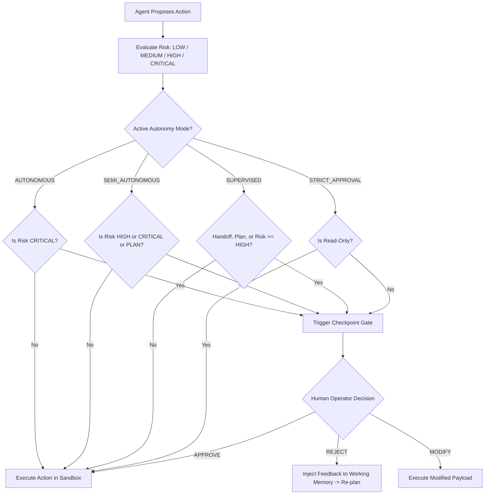

# DevSwarm Hybrid Autonomy & Checkpoint Governance

## 1. Philosophy: Human-in-the-Loop Safety
DevSwarm combines full autonomous execution with enterprise safety gates through a 4-tier Hybrid Autonomy Model. Rather than requiring human confirmation for every trivial read operation or leaving dangerous operations unchecked, DevSwarm evaluates actions based on risk and operational policy.



---

## 2. Autonomy Modes

| Autonomy Mode | Description | Permitted Automatically | Checkpoint Gates Triggered |
|---|---|---|---|
| `autonomous` | Full autonomy for trusted batch tasks or sandbox experiments. | All reads, file writes, tests, standard shell commands. | Only `CRITICAL` actions (e.g. `git push`, remote deploy). |
| `semi_autonomous` (Default) | Production balance of speed and safety. | Reads, searches, test runs, non-destructive file writes. | High-risk shell commands (e.g. `rm`, `alembic downgrade`, `git reset --hard`), architectural plan approvals. |
| `supervised` | Interactive engineering workflow. | Read-only operations. | Every role handoff (e.g. Architect -> Planner -> Coder), plan approval, and modifying actions. |
| `strict_approval` | Zero-trust execution. | Safe read-only file/directory inspection. | Every disk write, patch, and shell execution. |

---

## 3. Checkpoint Action Types & Risk Matrix

| Action Type | Examples | Default Risk |
|---|---|---|
| `PLAN_APPROVAL` | Architect submits system blueprint and contracts | `HIGH` |
| `ROLE_HANDOFF` | Architect transfers state to Planner / Coder | `LOW` |
| `FILE_WRITE` | Creating or modifying application code | `MEDIUM` |
| `FILE_WRITE` (Config) | Editing `.env`, database configuration, migrations | `HIGH` |
| `COMMAND_EXECUTION` | `pytest tests/`, `git status`, `ls` | `MEDIUM` |
| `COMMAND_EXECUTION` (Destructive) | `git reset --hard`, `drop database`, `rm -rf` | `HIGH` |
| `GIT_PUSH` | Pushing commits to remote git repository | `CRITICAL` |

---

## 4. Resolving Checkpoints

### Via CLI
```bash
# List all pending checkpoints
devswarm checkpoint list

# Approve a pending checkpoint
devswarm checkpoint resolve <checkpoint_id> --decision approve

# Reject with corrective guidance (injected into agent memory)
devswarm checkpoint resolve <checkpoint_id> --decision reject --feedback "Use SQLite instead of Redis for caching."
```

### Via REST API
```bash
curl -X POST http://localhost:8000/api/checkpoints/<checkpoint_id>/resolve \
  -H "Content-Type: application/json" \
  -d '{
    "decision": "approve",
    "feedback": "LGTM"
  }'
```
