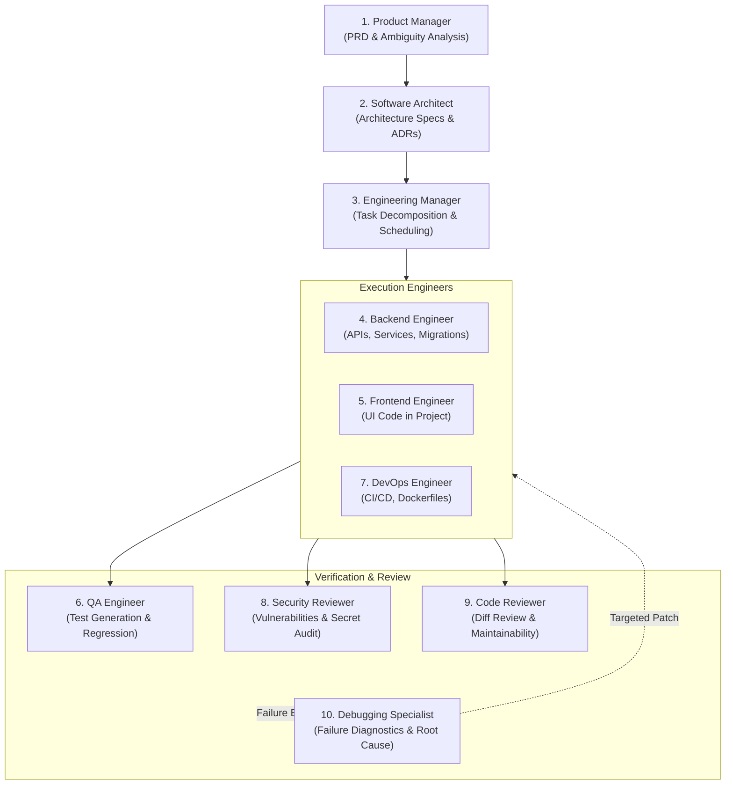

# DevSwarm Multi-Agent Architecture

## 1. Core Principle: Role Invocations, Not Chatbots
In DevSwarm, agents are not ten continuously running chatbots chatting aimlessly. Agents are **stateless role configurations invoked by the orchestrator** to perform specific units of work.

Each agent invocation requires a formal contract:
```json
{
  "invocation_id": "inv-9a8b7c",
  "mission_id": "mis-1234",
  "task_id": "tsk-5678",
  "agent_role": "backend_engineer",
  "model_config": {
    "model": "gemini-2.5-flash",
    "temperature": 0.1,
    "max_output_tokens": 8192
  },
  "skill_references": ["backend-api-development", "test-driven-development"],
  "authorized_tools": ["filesystem.read", "filesystem.write_scoped", "sandbox.run_tests"],
  "input_artifact_ids": ["art-arch-spec-01", "art-prd-01"],
  "output_schema": "BackendImplementationProposal",
  "token_budget": 50000,
  "cost_limit_usd": 0.25,
  "deadline": "2026-10-15T01:30:00Z",
  "trace_id": "trace-uuid-112233"
}
```

---

## 2. The 10 Specialized Engineering Personas



### Role Matrix

| # | Role | Responsibilities | Permitted Tools | Assigned Skills |
|---|---|---|---|---|
| 1 | **Product Manager** | Interprets user goals, extracts acceptance criteria, identifies ambiguities, produces PRDs. | Project context, artifact reader. | `requirements-analysis` |
| 2 | **Software Architect** | Defines system boundaries, data models, schemas, and Architecture Decision Records (ADRs). | Project context, artifact submitter. | `system-architecture`, `database-engineering` |
| 3 | **Engineering Manager** | Decomposes architecture into DAG tasks, sets priorities, detects blockers, plans iterations. | Task manager, blocker reporter. | `task-decomposition` |
| 4 | **Backend Engineer** | Implements service logic, FastAPI routes, database models, and unit tests. | Scoped filesystem, sandbox runner, Git worktree. | `backend-api-development`, `test-driven-development` |
| 5 | **Frontend Engineer** | Implements client-side code inside target repositories (does not build DevSwarm UI). | Scoped filesystem, sandbox runner, Git worktree. | `frontend-development` |
| 6 | **QA Engineer** | Formulates test proposals, verifies acceptance criteria, executes regression suites. | Sandbox test runner, artifact reader. | `integration-testing`, `api-contract-testing` |
| 7 | **DevOps Engineer** | Writes Dockerfiles, CI/CD pipeline definitions, verifies build configurations. | Scoped filesystem, build runner. | `devops-and-ci` |
| 8 | **Security Reviewer** | Scrutinizes diffs for injection flaws, secret leakage, and permission escalations. | Code search, security scanner. | `security-review` |
| 9 | **Code Reviewer** | Inspects unified diffs for style, correctness, architectural alignment, and quality. | Diff reader, review submitter. | `code-review` |
| 10 | **Debugging Specialist**| Analyzes failing test stderr/stdout, formulates root-cause hypotheses, proposes fixes. | Log reader, debugger sandbox. | `debugging-and-root-cause-analysis` |

---

## 3. Skills System & Progressive Disclosure
DevSwarm avoids prompt bloat by loading only the skill packages explicitly assigned to an agent's active task:
- Skills are stored in `skills/<skill-name>/` with `manifest.yaml` and `SKILL.md`.
- When an agent is invoked, the `SkillRegistry` validates dependencies and injects only the relevant execution guidelines and schemas into working memory.
- Skills cannot grant tool permissions; permissions are granted strictly by the Control Plane's capability policy.
