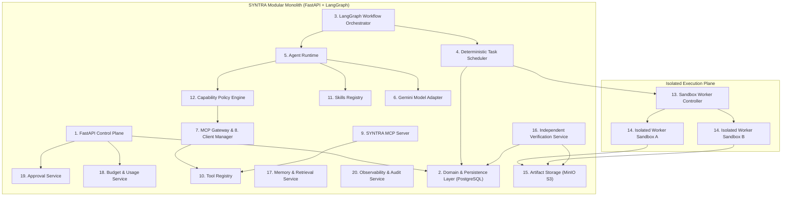

# SYNTRA Component Boundaries & Subsystem Specifications

**SYNTRA: Synchronized Intelligence for Autonomous Engineering**  
*Architecture Model: Modular Monolith with Isolated Execution Workers*

---

## 1. Architectural Philosophy & Monolith Boundaries

SYNTRA is structured as a **modular monolith** with clear internal package boundaries, rather than a fragmented distributed microservices mesh. The only truly isolated processes are the **Execution Workers**, which run ephemeral sandboxes to execute untrusted code without endangering the core control plane.

---

## 2. Comprehensive Subsystem Specifications (20 Components)

### 1. FastAPI Control Plane
- **Responsibility**: Authenticates incoming user/client requests, exposes REST and WebSocket endpoints for missions, sessions, approvals, and telemetry, and enforces HTTP rate limits.
- **Inputs**: HTTP requests (JSON / multipart), WebSocket connection requests, Bearer tokens.
- **Outputs**: HTTP JSON responses, WebSocket event frames, OpenAPI 3.1 documentation.
- **Dependencies**: Domain and Persistence Layer, Approval Service, Budget Service, Observability Service.
- **Trust Boundary**: Public / Semi-Public ingress. Treats all client requests as untrusted.
- **Persistence Requirements**: None directly (delegates all persistence to Domain Layer).
- **Failure Behavior**: Returns RFC 7807 problem details; crashes restart via process supervisor (systemd / docker).
- **Interfaces**: Public REST API (`/v1/...`), WebSocket (`/v1/events/stream`).
- **Security Requirements**: TLS 1.3 termination, OIDC / JWT token validation, CORS allowlists, rate limiting.

### 2. Domain and Persistence Layer
- **Responsibility**: Houses pure business domain models, transactional integrity, and PostgreSQL repositories via SQLAlchemy 2.x.
- **Inputs**: Domain commands, queries, entity updates.
- **Outputs**: Authoritative domain entities, transactional outbox events, database query results.
- **Dependencies**: PostgreSQL 16, asyncpg driver.
- **Trust Boundary**: Core Trusted Monolith.
- **Persistence Requirements**: PostgreSQL relational storage with ACID transactions and optimistic concurrency (`version_id`).
- **Failure Behavior**: Transaction rollback on error; connection pool reconnects with exponential backoff.
- **Interfaces**: Internal Python repository protocols (`MissionRepository`, `TaskRepository`, etc.).
- **Security Requirements**: Parameterized queries (SQL injection immunity), encrypted credentials at rest, tenant isolation enforced in every query.

### 3. LangGraph Workflow Orchestrator
- **Responsibility**: Drives mission lifecycle state machines, manages cyclic task execution, and executes durable checkpointing.
- **Inputs**: Mission initiation requests, task completion events, human approval decisions.
- **Outputs**: Mission state transitions, task scheduling triggers, checkpoint records.
- **Dependencies**: Domain and Persistence Layer, Task Scheduler, Agent Runtime, PostgreSQL Checkpointer.
- **Trust Boundary**: Core Trusted Monolith.
- **Persistence Requirements**: LangGraph checkpoints written to dedicated PostgreSQL checkpoint tables.
- **Failure Behavior**: Resumes execution from last saved checkpoint upon process restart.
- **Interfaces**: Internal Python workflow API (`MissionWorkflow.run()`, `MissionWorkflow.resume()`).
- **Security Requirements**: Graph state modifications require validated domain commands; rejects unauthorized state transitions.

### 4. Deterministic Task Scheduler
- **Responsibility**: Traverses the task DAG, resolves dependency constraints, calculates critical paths, reserves budgets, and assigns tasks to workers via distributed leases.
- **Inputs**: Task DAG from Engineering Manager, worker heartbeat signals, task completion notifications.
- **Outputs**: Dispatched task leases, concurrency throttles, stale worker eviction notices.
- **Dependencies**: Domain Layer, Redis Streams, Worker Controller.
- **Trust Boundary**: Core Trusted Monolith.
- **Persistence Requirements**: PostgreSQL task status tables and worker lease records (`worker_leases`).
- **Failure Behavior**: Stale lease detection re-queues tasks if a worker fails to send heartbeats within lease timeout (60s).
- **Interfaces**: Internal Scheduler API (`schedule_next_ready_tasks()`, `renew_lease()`, `release_lease()`).
- **Security Requirements**: Strict lease fencing tokens prevent duplicate task execution and race conditions.

### 5. Agent Runtime
- **Responsibility**: Manages the agent execution lifecycle, context assembly, prompt template rendering, and structured response parsing.
- **Inputs**: `AgentInvocationRequest` specifying role, objective, loaded skills, and context artifacts.
- **Outputs**: `AgentInvocationResult` containing structured proposal, unified diff, or tool call requests.
- **Dependencies**: Gemini Model Adapter, Capability Policy Engine, Skills Registry, Memory Service.
- **Trust Boundary**: Internal Monolith orchestrator.
- **Persistence Requirements**: Logs invocation attempts and token usage to `agent_executions`.
- **Failure Behavior**: Bounded retries (maximum 3 attempts) with exponential backoff; escalates to Debugging Specialist on unrecoverable failures.
- **Interfaces**: Internal Python runtime interface (`AgentRunner.invoke()`).
- **Security Requirements**: Strictly limits token generation windows; enforces context window truncation and credential scrubbing.

### 6. Gemini Model Adapter
- **Responsibility**: Encapsulates all interactions with the Google Gen AI SDK (`google-genai`), managing model routing, rate limits, schema-enforced structured generation, and fallback doubles.
- **Inputs**: Prompt strings, system instructions, Pydantic response schemas, temperature settings.
- **Outputs**: Strongly typed Pydantic instances, raw token counts, latency metrics.
- **Dependencies**: Google Gen AI SDK (`google-genai>=2.30.0`), HTTPX transport.
- **Trust Boundary**: External Provider Boundary.
- **Persistence Requirements**: None (token/cost telemetry recorded via Observability Service).
- **Failure Behavior**: Handles HTTP 429 (rate limits) and 503 (transient overload) with jittered exponential backoff; falls back to reasoning model when fast model fails schema validation.
- **Interfaces**: Internal `ModelAdapterInterface` (`generate_structured()`, `generate_text()`).
- **Security Requirements**: API keys passed exclusively via environment secrets; never printed in logs or included in prompt context.

### 7. MCP Gateway
- **Responsibility**: Mediates all agent tool requests, validating signatures, checking capability grants, and dispatching calls to MCP clients.
- **Inputs**: Tool call invocation payloads `(server_name, tool_name, arguments)`.
- **Outputs**: Validated tool execution results or standardized JSON-RPC error frames.
- **Dependencies**: Capability Policy Engine, MCP Client Manager, Tool Registry.
- **Trust Boundary**: Security Perimeter between Agents and Tools.
- **Persistence Requirements**: None (tool execution events logged to `events` table).
- **Failure Behavior**: Returns standard MCP error codes (`-32601` tool not found, `-32000` permission denied) without crashing agent runtime.
- **Interfaces**: Internal Gateway API (`MCPGateway.invoke_tool()`).
- **Security Requirements**: Validates tool arguments against registered JSON schemas before dispatch.

### 8. MCP Client Manager
- **Responsibility**: Manages active client connections to local stdio and remote SSE MCP server instances, handling handshake protocols and heartbeats.
- **Inputs**: MCP server registration records, client connection lifecycles.
- **Outputs**: Active MCP client sessions, tool catalog snapshots.
- **Dependencies**: Official MCP Python SDK (`mcp>=1.1.2`).
- **Trust Boundary**: Internal Monolith integration component.
- **Persistence Requirements**: Cached tool definitions and capabilities.
- **Failure Behavior**: Automatically restarts crashed stdio subprocesses; marks unresponsive remote servers as degraded.
- **Interfaces**: Internal Client Manager API (`get_client_session(server_id)`).
- **Security Requirements**: Subprocess spawning for stdio servers runs under restricted user privileges.

### 9. SYNTRA MCP Server
- **Responsibility**: Exposes SYNTRA platform capabilities (workspace search, file reading, patch submission) as a standard Model Context Protocol server.
- **Inputs**: JSON-RPC 2.0 requests via stdio or HTTP SSE.
- **Outputs**: JSON-RPC 2.0 tool lists, resource templates, and execution responses.
- **Dependencies**: Tool Registry, Sandbox Worker Controller.
- **Trust Boundary**: Internal Tool Provider Boundary.
- **Persistence Requirements**: None.
- **Failure Behavior**: Returns JSON-RPC error envelopes on failure.
- **Interfaces**: Stdio stream (`stdin`/`stdout`), HTTP SSE (`/mcp/sse`).
- **Security Requirements**: Enforces strict path validation on all file operations; rejects paths outside active workspace.

### 10. Tool Registry
- **Responsibility**: Maintains the authoritative catalog of all available local and remote tools, their JSON Schema contracts, and execution handlers.
- **Inputs**: Tool registration manifests, MCP tool discovery snapshots.
- **Outputs**: Tool catalog listings, schema validation engines.
- **Dependencies**: Pydantic v2.
- **Trust Boundary**: Internal Monolith Registry.
- **Persistence Requirements**: Stored in `mcp_tool_versions` table in PostgreSQL.
- **Failure Behavior**: Rejects duplicate or malformed tool registrations during startup.
- **Interfaces**: Internal Registry API (`register_tool()`, `get_tool()`, `list_tools()`).
- **Security Requirements**: Tool definitions are immutable once registered for a specific version.

### 11. Skills Registry
- **Responsibility**: Discovers, validates, and loads the 16 standardized engineering skill manifests, enabling progressive disclosure of guidelines and schemas.
- **Inputs**: File system paths to `skills/<skill_name>/manifest.yaml` and `SKILL.md`.
- **Outputs**: Validated `SkillManifest` objects and parsed instruction prompts.
- **Dependencies**: PyYAML, Pydantic v2.
- **Trust Boundary**: Internal Monolith Registry.
- **Persistence Requirements**: Synchronized to `skills` and `skill_versions` tables.
- **Failure Behavior**: Fails startup if any skill manifest fails schema validation.
- **Interfaces**: Internal Skills API (`get_skill(name)`, `get_prompt_instructions(name)`).
- **Security Requirements**: Skills cannot grant tool capabilities; capabilities are strictly governed by the Policy Engine.

### 12. Capability Policy Engine
- **Responsibility**: Evaluates dynamic authorization rules to determine whether a given agent role executing a specific task is permitted to invoke a requested tool.
- **Inputs**: Subject (Agent Role, Task ID, Mission ID), Action (Tool Name), Object (Target Path, Command).
- **Outputs**: Decision (`ALLOW`, `DENY`, `REQUIRES_HUMAN_APPROVAL`).
- **Dependencies**: Domain Layer (Capability Grants, Checkpoint Policies).
- **Trust Boundary**: Critical Security Enforcement Boundary.
- **Persistence Requirements**: PostgreSQL `capability_grants` table.
- **Failure Behavior**: Default-Deny. If policy lookup fails, access is denied.
- **Interfaces**: Internal Policy API (`evaluate_permission(agent_role, tool_name, context)`).
- **Security Requirements**: Zero privilege bypass; all denials generate high-priority audit events.

### 13. Sandbox Worker Controller
- **Responsibility**: Manages the lifecycle of isolated worker sandboxes, including directory preparation, Git worktree creation, resource monitoring, and cleanup.
- **Inputs**: Task execution jobs, repository snapshot references.
- **Outputs**: Active `SandboxInstance` handles, execution result summaries.
- **Dependencies**: `SandboxProvider` abstraction, Local / Docker worker planes.
- **Trust Boundary**: Bridge between Trusted Monolith and Untrusted Worker Plane.
- **Persistence Requirements**: Tracks active workers in `sandbox_jobs`.
- **Failure Behavior**: Terminated worker jobs trigger workspace cleanup and task rescheduling.
- **Interfaces**: Internal Controller API (`provision_sandbox()`, `destroy_sandbox()`).
- **Security Requirements**: Workspaces isolated inside unique UUID directories; enforces non-root execution.

### 14. Isolated Execution Workers
- **Responsibility**: Runs the actual code generation, testing, and tool commands inside disposable environments with zero access to the host machine.
- **Inputs**: Scoped repository worktree, shell command string, timeout limits.
- **Outputs**: Process stdout, stderr, exit code, execution latency, unified diff patch.
- **Dependencies**: POSIX process runner, Git CLI, test runners (pytest, npm).
- **Trust Boundary**: Untrusted Execution Boundary.
- **Persistence Requirements**: Ephemeral local disk storage; patches uploaded to Artifact Storage.
- **Failure Behavior**: Hard process kill (`SIGKILL`) if execution exceeds timeout (default 120s) or memory limits (512MB).
- **Interfaces**: Worker Execution Protocol (`execute_command()`, `generate_patch()`).
- **Security Requirements**: Restricted environment variables (no host secrets); canonical path traversal barriers (`..` prohibited); network egress restricted.

### 15. Artifact Storage
- **Responsibility**: Provides durable, content-addressable storage for large engineering outputs: unified diffs, test logs, coverage reports, and PRDs.
- **Inputs**: File byte streams, metadata tags, SHA-256 hashes.
- **Outputs**: Download streams, presigned URLs, artifact verification digests.
- **Dependencies**: MinIO / S3 client (`minio>=7.2.10`), PostgreSQL `artifacts` table.
- **Trust Boundary**: Internal Storage Service.
- **Persistence Requirements**: S3-compatible bucket storage (`syntra-artifacts`).
- **Failure Behavior**: Retries failed uploads; marks artifact as `CORRUPTED` if SHA-256 checksum fails.
- **Interfaces**: Internal Storage API (`upload_artifact()`, `download_artifact()`).
- **Security Requirements**: Immutable write-once storage; cryptographic SHA-256 validation on all uploads and reads.

### 16. Independent Verification Service
- **Responsibility**: Executes objective, automated verification of completed tasks against protected regression test suites, ensuring no agent marks its own work as complete without evidence.
- **Inputs**: Proposed unified diff patch, baseline repository, verification test suite.
- **Outputs**: `VerificationRun` entity (PASS / FAIL, test output, coverage delta).
- **Dependencies**: Sandbox Worker Controller, Artifact Storage, Domain Layer.
- **Trust Boundary**: Authoritative Verification Plane.
- **Persistence Requirements**: Records in `verification_runs` table.
- **Failure Behavior**: Any test failure or timeout immediately results in a `FAIL` verdict.
- **Interfaces**: Internal Verification API (`verify_patch(patch_id, test_suite_id)`).
- **Security Requirements**: Uses protected test suites stored outside the worker's writable workspace to prevent test tampering.

### 17. Memory and Retrieval Service
- **Responsibility**: Indexes and retrieves execution lessons, project architecture decisions, and failure root-causes to inform future agent tasks.
- **Inputs**: Completed mission artifacts, failure diagnostic reports, semantic search queries.
- **Outputs**: Ranked context snippets, verified architectural lessons.
- **Dependencies**: PostgreSQL (`memory_records`), future pgvector extension.
- **Trust Boundary**: Internal Monolith Service.
- **Persistence Requirements**: Durable storage in `memory_records`.
- **Failure Behavior**: Memory lookup errors fall back to empty context without blocking execution.
- **Interfaces**: Internal Memory API (`store_memory()`, `retrieve_relevant_context()`).
- **Security Requirements**: Strict tenant isolation prevents cross-organization context leakage.

### 18. Budget and Usage Service
- **Responsibility**: Tracks token consumption, model compute costs, and execution time per mission and organization; enforces hard spend limits.
- **Inputs**: Token count reports from Model Adapter, execution duration from Sandbox Controller.
- **Outputs**: Budget reservations, usage summaries, spend limit alerts.
- **Dependencies**: Domain Layer (`budgets`, `usage_records` tables).
- **Trust Boundary**: Financial & Resource Governance Boundary.
- **Persistence Requirements**: Atomic usage ledger in PostgreSQL.
- **Failure Behavior**: If budget reservation fails due to exhaustion, current task is paused and placed in `AWAITING_APPROVAL` status.
- **Interfaces**: Internal Budget API (`reserve_budget()`, `commit_usage()`, `check_limit()`).
- **Security Requirements**: Atomic database decrements prevent race-condition overspending.

### 19. Approval Service
- **Responsibility**: Manages human-in-the-loop checkpoints, generating cryptographic action digests, dispatching notifications, and recording human decisions.
- **Inputs**: Checkpoint requests from LangGraph or Policy Engine, user decisions (Approve, Reject with guidance, Modify).
- **Outputs**: Resolved checkpoint tokens, state transition triggers.
- **Dependencies**: Domain Layer (`human_approvals` table), Control Plane API.
- **Trust Boundary**: Human Authority Gateway.
- **Persistence Requirements**: Immutable audit trail in `human_approvals`.
- **Failure Behavior**: Checkpoints remain in `PENDING` state until explicitly resolved or timed out.
- **Interfaces**: Internal API (`request_approval()`) and REST API (`POST /v1/approvals/{id}/resolve`).
- **Security Requirements**: Verifies cryptographic HMAC-SHA256 digest on resolution to ensure payload was not modified during review.

### 20. Observability and Audit Service
- **Responsibility**: Collects structured logs, OpenTelemetry distributed traces, and cryptographic event digests for every agent action and system transition.
- **Inputs**: Log records, OpenTelemetry spans, audit events.
- **Outputs**: Structured JSON log stream, OpenTelemetry trace exports, compliance audit reports.
- **Dependencies**: OpenTelemetry SDK, Python `logging`, PostgreSQL `events` table.
- **Trust Boundary**: System-wide Observability.
- **Persistence Requirements**: PostgreSQL `events` table (transactional outbox pattern).
- **Failure Behavior**: Logging failures fail-open to avoid disrupting critical workflows, with local stderr fallback.
- **Interfaces**: Internal Logging & Tracing API (`logger`, `tracer`, `record_audit_event()`).
- **Security Requirements**: Automated scrubbing filters out API keys, passwords, and PII before writing logs or traces.
