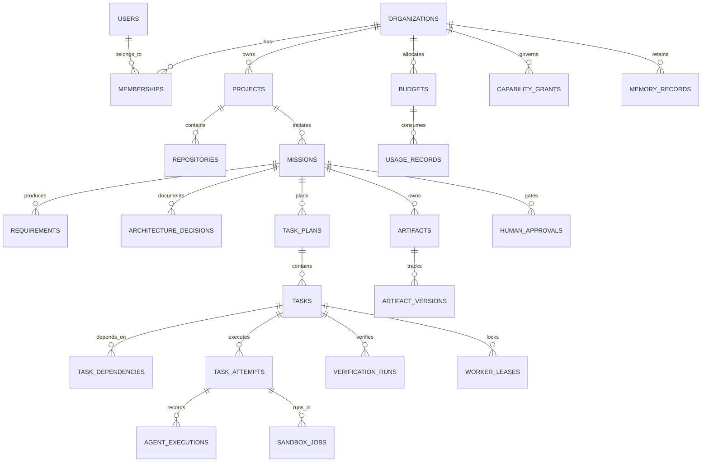

# SYNTRA Database Architecture & Relational Schema Specification

**SYNTRA: Synchronized Intelligence for Autonomous Engineering**  
*Persistence Engine: PostgreSQL 16 with asyncpg and SQLAlchemy 2.x*

---

## 1. Architectural Invariants & Data Governance Principles

1. **Deterministic Identity**: All primary keys are `UUID` (UUIDv7 for time-ordered locality or UUIDv4).
2. **Standardized Temporal Fields**: All timestamps are `TIMESTAMPTZ` recorded strictly in UTC (`timezone.utc`). Every mutable entity includes `created_at` and `updated_at`.
3. **Optimistic Concurrency Control**: All core mutable entities (`missions`, `tasks`, `task_plans`, `budgets`) maintain a `version INTEGER NOT NULL DEFAULT 1` column. State mutations must verify `version = :expected_version` and increment `version = version + 1`.
4. **Strict Multi-Tenant Isolation**: Every project, repository, mission, task, budget, and memory record is scoped to an `org_id`. Database queries must strictly bind `org_id` in `WHERE` clauses.
5. **Transactional Outbox**: Asynchronous events are written within the same database transaction as the state change to the `transactional_outbox` table, preventing dual-write inconsistencies.
6. **Immutable Audit Trails**: `events`, `human_approvals`, `usage_records`, and `verification_runs` are strictly append-only.

---

## 2. Complete Entity-Relationship Overview



---

## 3. Implementable PostgreSQL DDL Specifications (30 Tables)

### 3.1 Tenancy & Identity Layer

#### 1. `organizations`
```sql
CREATE TABLE organizations (
    id UUID PRIMARY KEY DEFAULT gen_random_uuid(),
    name VARCHAR(255) NOT NULL,
    slug VARCHAR(100) NOT NULL UNIQUE,
    created_at TIMESTAMPTZ NOT NULL DEFAULT CURRENT_TIMESTAMP,
    updated_at TIMESTAMPTZ NOT NULL DEFAULT CURRENT_TIMESTAMP
);
CREATE INDEX idx_organizations_slug ON organizations(slug);
```

#### 2. `users`
```sql
CREATE TABLE users (
    id UUID PRIMARY KEY DEFAULT gen_random_uuid(),
    email VARCHAR(255) NOT NULL UNIQUE,
    full_name VARCHAR(255) NOT NULL,
    is_active BOOLEAN NOT NULL DEFAULT TRUE,
    is_service_account BOOLEAN NOT NULL DEFAULT FALSE,
    created_at TIMESTAMPTZ NOT NULL DEFAULT CURRENT_TIMESTAMP,
    updated_at TIMESTAMPTZ NOT NULL DEFAULT CURRENT_TIMESTAMP
);
CREATE INDEX idx_users_email ON users(email);
```

#### 3. `memberships`
```sql
CREATE TYPE membership_role AS ENUM ('owner', 'admin', 'engineer', 'viewer');

CREATE TABLE memberships (
    id UUID PRIMARY KEY DEFAULT gen_random_uuid(),
    org_id UUID NOT NULL REFERENCES organizations(id) ON DELETE CASCADE,
    user_id UUID NOT NULL REFERENCES users(id) ON DELETE CASCADE,
    role membership_role NOT NULL DEFAULT 'engineer',
    created_at TIMESTAMPTZ NOT NULL DEFAULT CURRENT_TIMESTAMP,
    CONSTRAINT uq_membership_org_user UNIQUE (org_id, user_id)
);
CREATE INDEX idx_memberships_org_id ON memberships(org_id);
CREATE INDEX idx_memberships_user_id ON memberships(user_id);
```

#### 4. `projects`
```sql
CREATE TABLE projects (
    id UUID PRIMARY KEY DEFAULT gen_random_uuid(),
    org_id UUID NOT NULL REFERENCES organizations(id) ON DELETE CASCADE,
    name VARCHAR(255) NOT NULL,
    slug VARCHAR(100) NOT NULL,
    description TEXT,
    created_at TIMESTAMPTZ NOT NULL DEFAULT CURRENT_TIMESTAMP,
    updated_at TIMESTAMPTZ NOT NULL DEFAULT CURRENT_TIMESTAMP,
    CONSTRAINT uq_projects_org_slug UNIQUE (org_id, slug)
);
CREATE INDEX idx_projects_org_id ON projects(org_id);
```

#### 5. `repositories`
```sql
CREATE TABLE repositories (
    id UUID PRIMARY KEY DEFAULT gen_random_uuid(),
    project_id UUID NOT NULL REFERENCES projects(id) ON DELETE CASCADE,
    name VARCHAR(255) NOT NULL,
    clone_url TEXT NOT NULL,
    default_branch VARCHAR(100) NOT NULL DEFAULT 'main',
    is_private BOOLEAN NOT NULL DEFAULT TRUE,
    created_at TIMESTAMPTZ NOT NULL DEFAULT CURRENT_TIMESTAMP,
    updated_at TIMESTAMPTZ NOT NULL DEFAULT CURRENT_TIMESTAMP,
    CONSTRAINT uq_repositories_project_name UNIQUE (project_id, name)
);
CREATE INDEX idx_repositories_project_id ON repositories(project_id);
```

---

### 3.2 Mission & Architecture Planning Layer

#### 6. `missions`
```sql
CREATE TYPE mission_state AS ENUM (
    'DRAFT', 'PLANNING', 'AWAITING_APPROVAL', 'READY', 'RUNNING',
    'PAUSED', 'REPLANNING', 'VERIFYING', 'AWAITING_DELIVERY_APPROVAL',
    'COMPLETED', 'FAILED', 'CANCELLED'
);

CREATE TABLE missions (
    id UUID PRIMARY KEY DEFAULT gen_random_uuid(),
    org_id UUID NOT NULL REFERENCES organizations(id) ON DELETE CASCADE,
    project_id UUID NOT NULL REFERENCES projects(id) ON DELETE CASCADE,
    repository_id UUID REFERENCES repositories(id) ON DELETE SET NULL,
    objective TEXT NOT NULL,
    state mission_state NOT NULL DEFAULT 'DRAFT',
    autonomy_mode VARCHAR(50) NOT NULL DEFAULT 'semi_autonomous',
    active_plan_version INTEGER NOT NULL DEFAULT 1,
    version INTEGER NOT NULL DEFAULT 1,
    created_at TIMESTAMPTZ NOT NULL DEFAULT CURRENT_TIMESTAMP,
    updated_at TIMESTAMPTZ NOT NULL DEFAULT CURRENT_TIMESTAMP
);
CREATE INDEX idx_missions_org_state ON missions(org_id, state);
CREATE INDEX idx_missions_project_id ON missions(project_id);
```

#### 7. `requirements`
```sql
CREATE TYPE requirement_type AS ENUM ('functional', 'non_functional', 'security', 'interface');

CREATE TABLE requirements (
    id UUID PRIMARY KEY DEFAULT gen_random_uuid(),
    mission_id UUID NOT NULL REFERENCES missions(id) ON DELETE CASCADE,
    identifier VARCHAR(50) NOT NULL,
    type requirement_type NOT NULL DEFAULT 'functional',
    title VARCHAR(255) NOT NULL,
    description TEXT NOT NULL,
    acceptance_criteria JSONB NOT NULL DEFAULT '[]'::jsonb,
    is_ambiguous BOOLEAN NOT NULL DEFAULT FALSE,
    created_at TIMESTAMPTZ NOT NULL DEFAULT CURRENT_TIMESTAMP,
    CONSTRAINT uq_requirements_mission_identifier UNIQUE (mission_id, identifier)
);
CREATE INDEX idx_requirements_mission_id ON requirements(mission_id);
```

#### 8. `architecture_decisions`
```sql
CREATE TYPE adr_status AS ENUM ('PROPOSED', 'ACCEPTED', 'REJECTED', 'SUPERSEDED');

CREATE TABLE architecture_decisions (
    id UUID PRIMARY KEY DEFAULT gen_random_uuid(),
    mission_id UUID NOT NULL REFERENCES missions(id) ON DELETE CASCADE,
    adr_number INTEGER NOT NULL,
    title VARCHAR(255) NOT NULL,
    status adr_status NOT NULL DEFAULT 'PROPOSED',
    context TEXT NOT NULL,
    decision TEXT NOT NULL,
    consequences TEXT NOT NULL,
    created_at TIMESTAMPTZ NOT NULL DEFAULT CURRENT_TIMESTAMP,
    CONSTRAINT uq_adr_mission_number UNIQUE (mission_id, adr_number)
);
CREATE INDEX idx_adr_mission_id ON architecture_decisions(mission_id);
```

---

### 3.3 Task Graph & Scheduling Layer

#### 9. `task_plans`
```sql
CREATE TYPE task_plan_status AS ENUM ('DRAFT', 'APPROVED', 'ACTIVE', 'SUPERSEDED');

CREATE TABLE task_plans (
    id UUID PRIMARY KEY DEFAULT gen_random_uuid(),
    mission_id UUID NOT NULL REFERENCES missions(id) ON DELETE CASCADE,
    plan_version INTEGER NOT NULL,
    status task_plan_status NOT NULL DEFAULT 'DRAFT',
    total_tasks INTEGER NOT NULL DEFAULT 0,
    estimated_tokens INTEGER NOT NULL DEFAULT 0,
    created_at TIMESTAMPTZ NOT NULL DEFAULT CURRENT_TIMESTAMP,
    CONSTRAINT uq_task_plans_mission_version UNIQUE (mission_id, plan_version)
);
CREATE INDEX idx_task_plans_mission ON task_plans(mission_id);
```

#### 10. `tasks`
```sql
CREATE TYPE task_state AS ENUM (
    'PENDING', 'READY', 'ASSIGNED', 'IN_PROGRESS', 'BLOCKED',
    'REVIEW', 'VERIFYING', 'COMPLETED', 'FAILED', 'CANCELLED'
);

CREATE TABLE tasks (
    id UUID PRIMARY KEY DEFAULT gen_random_uuid(),
    task_plan_id UUID NOT NULL REFERENCES task_plans(id) ON DELETE CASCADE,
    mission_id UUID NOT NULL REFERENCES missions(id) ON DELETE CASCADE,
    org_id UUID NOT NULL REFERENCES organizations(id) ON DELETE CASCADE,
    identifier VARCHAR(50) NOT NULL,
    title VARCHAR(255) NOT NULL,
    description TEXT NOT NULL,
    assigned_role VARCHAR(100) NOT NULL,
    state task_state NOT NULL DEFAULT 'PENDING',
    priority INTEGER NOT NULL DEFAULT 0,
    max_attempts INTEGER NOT NULL DEFAULT 3,
    attempt_count INTEGER NOT NULL DEFAULT 0,
    version INTEGER NOT NULL DEFAULT 1,
    created_at TIMESTAMPTZ NOT NULL DEFAULT CURRENT_TIMESTAMP,
    updated_at TIMESTAMPTZ NOT NULL DEFAULT CURRENT_TIMESTAMP,
    CONSTRAINT uq_tasks_plan_identifier UNIQUE (task_plan_id, identifier)
);
CREATE INDEX idx_tasks_mission_state ON tasks(mission_id, state);
CREATE INDEX idx_tasks_org_state ON tasks(org_id, state);
CREATE INDEX idx_tasks_plan_id ON tasks(task_plan_id);
```

#### 11. `task_dependencies`
```sql
CREATE TABLE task_dependencies (
    id UUID PRIMARY KEY DEFAULT gen_random_uuid(),
    task_id UUID NOT NULL REFERENCES tasks(id) ON DELETE CASCADE,
    depends_on_task_id UUID NOT NULL REFERENCES tasks(id) ON DELETE RESTRICT,
    created_at TIMESTAMPTZ NOT NULL DEFAULT CURRENT_TIMESTAMP,
    CONSTRAINT uq_task_dependency UNIQUE (task_id, depends_on_task_id),
    CONSTRAINT chk_no_self_dependency CHECK (task_id <> depends_on_task_id)
);
CREATE INDEX idx_task_dependencies_task_id ON task_dependencies(task_id);
CREATE INDEX idx_task_dependencies_depends_on ON task_dependencies(depends_on_task_id);
```

#### 12. `task_attempts`
```sql
CREATE TYPE attempt_state AS ENUM (
    'INITIALIZING', 'RUNNING', 'AWAITING_TOOL', 'EVALUATING',
    'SUCCEEDED', 'FAILED', 'TIMED_OUT'
);

CREATE TABLE task_attempts (
    id UUID PRIMARY KEY DEFAULT gen_random_uuid(),
    task_id UUID NOT NULL REFERENCES tasks(id) ON DELETE CASCADE,
    attempt_number INTEGER NOT NULL,
    state attempt_state NOT NULL DEFAULT 'INITIALIZING',
    exit_code INTEGER,
    error_message TEXT,
    started_at TIMESTAMPTZ NOT NULL DEFAULT CURRENT_TIMESTAMP,
    completed_at TIMESTAMPTZ,
    CONSTRAINT uq_task_attempt_number UNIQUE (task_id, attempt_number)
);
CREATE INDEX idx_task_attempts_task_id ON task_attempts(task_id);
```

#### 13. `agent_executions`
```sql
CREATE TABLE agent_executions (
    id UUID PRIMARY KEY DEFAULT gen_random_uuid(),
    task_attempt_id UUID NOT NULL REFERENCES task_attempts(id) ON DELETE CASCADE,
    agent_role VARCHAR(100) NOT NULL,
    prompt_tokens INTEGER NOT NULL DEFAULT 0,
    completion_tokens INTEGER NOT NULL DEFAULT 0,
    total_cost_usd NUMERIC(10, 6) NOT NULL DEFAULT 0.000000,
    duration_ms INTEGER NOT NULL DEFAULT 0,
    created_at TIMESTAMPTZ NOT NULL DEFAULT CURRENT_TIMESTAMP
);
CREATE INDEX idx_agent_executions_attempt ON agent_executions(task_attempt_id);
```

---

### 3.4 Worker & Sandbox Execution Layer

#### 14. `sandbox_jobs`
```sql
CREATE TYPE sandbox_status AS ENUM ('PROVISIONING', 'ACTIVE', 'COMPLETED', 'FAILED', 'TERMINATED');

CREATE TABLE sandbox_jobs (
    id UUID PRIMARY KEY DEFAULT gen_random_uuid(),
    task_attempt_id UUID NOT NULL REFERENCES task_attempts(id) ON DELETE CASCADE,
    worker_id VARCHAR(100) NOT NULL,
    workspace_path TEXT NOT NULL,
    git_worktree_branch VARCHAR(255) NOT NULL,
    status sandbox_status NOT NULL DEFAULT 'PROVISIONING',
    timeout_seconds INTEGER NOT NULL DEFAULT 120,
    started_at TIMESTAMPTZ NOT NULL DEFAULT CURRENT_TIMESTAMP,
    terminated_at TIMESTAMPTZ
);
CREATE INDEX idx_sandbox_jobs_attempt ON sandbox_jobs(task_attempt_id);
CREATE INDEX idx_sandbox_jobs_worker ON sandbox_jobs(worker_id);
```

#### 15. `worker_leases`
```sql
CREATE TABLE worker_leases (
    task_id UUID PRIMARY KEY REFERENCES tasks(id) ON DELETE CASCADE,
    worker_id VARCHAR(100) NOT NULL,
    fencing_token BIGINT NOT NULL,
    lease_expires_at TIMESTAMPTZ NOT NULL,
    acquired_at TIMESTAMPTZ NOT NULL DEFAULT CURRENT_TIMESTAMP
);
CREATE INDEX idx_worker_leases_expires_at ON worker_leases(lease_expires_at);
```

---

### 3.5 Artifact & Verification Layer

#### 16. `artifacts`
```sql
CREATE TYPE artifact_type AS ENUM ('PRD', 'ARCHITECTURE_SPEC', 'UNIFIED_DIFF', 'TEST_REPORT', 'SECURITY_REPORT', 'LOG_ARCHIVE');

CREATE TABLE artifacts (
    id UUID PRIMARY KEY DEFAULT gen_random_uuid(),
    mission_id UUID NOT NULL REFERENCES missions(id) ON DELETE CASCADE,
    task_id UUID REFERENCES tasks(id) ON DELETE SET NULL,
    type artifact_type NOT NULL,
    title VARCHAR(255) NOT NULL,
    current_version INTEGER NOT NULL DEFAULT 1,
    created_at TIMESTAMPTZ NOT NULL DEFAULT CURRENT_TIMESTAMP
);
CREATE INDEX idx_artifacts_mission_type ON artifacts(mission_id, type);
```

#### 17. `artifact_versions`
```sql
CREATE TABLE artifact_versions (
    id UUID PRIMARY KEY DEFAULT gen_random_uuid(),
    artifact_id UUID NOT NULL REFERENCES artifacts(id) ON DELETE CASCADE,
    version INTEGER NOT NULL,
    storage_path TEXT NOT NULL,
    sha256_checksum VARCHAR(64) NOT NULL,
    size_bytes BIGINT NOT NULL,
    created_at TIMESTAMPTZ NOT NULL DEFAULT CURRENT_TIMESTAMP,
    CONSTRAINT uq_artifact_version UNIQUE (artifact_id, version)
);
CREATE INDEX idx_artifact_versions_artifact ON artifact_versions(artifact_id);
```

#### 18. `verification_runs`
```sql
CREATE TYPE verification_verdict AS ENUM ('PASS', 'FAIL', 'ERROR');

CREATE TABLE verification_runs (
    id UUID PRIMARY KEY DEFAULT gen_random_uuid(),
    task_id UUID NOT NULL REFERENCES tasks(id) ON DELETE CASCADE,
    artifact_version_id UUID NOT NULL REFERENCES artifact_versions(id) ON DELETE RESTRICT,
    verdict verification_verdict NOT NULL,
    tests_passed INTEGER NOT NULL DEFAULT 0,
    tests_failed INTEGER NOT NULL DEFAULT 0,
    coverage_percentage NUMERIC(5, 2),
    raw_output TEXT,
    verified_at TIMESTAMPTZ NOT NULL DEFAULT CURRENT_TIMESTAMP
);
CREATE INDEX idx_verification_runs_task ON verification_runs(task_id);
```

---

### 3.6 Tool, MCP & Skills Governance Layer

#### 19. `mcp_servers`
```sql
CREATE TYPE mcp_transport_type AS ENUM ('stdio', 'sse', 'http');

CREATE TABLE mcp_servers (
    id UUID PRIMARY KEY DEFAULT gen_random_uuid(),
    name VARCHAR(100) NOT NULL UNIQUE,
    transport mcp_transport_type NOT NULL DEFAULT 'stdio',
    command_or_url TEXT NOT NULL,
    is_enabled BOOLEAN NOT NULL DEFAULT TRUE,
    created_at TIMESTAMPTZ NOT NULL DEFAULT CURRENT_TIMESTAMP
);
```

#### 20. `mcp_tool_versions`
```sql
CREATE TABLE mcp_tool_versions (
    id UUID PRIMARY KEY DEFAULT gen_random_uuid(),
    mcp_server_id UUID NOT NULL REFERENCES mcp_servers(id) ON DELETE CASCADE,
    tool_name VARCHAR(100) NOT NULL,
    version VARCHAR(50) NOT NULL DEFAULT '1.0.0',
    description TEXT,
    input_schema JSONB NOT NULL,
    is_active BOOLEAN NOT NULL DEFAULT TRUE,
    created_at TIMESTAMPTZ NOT NULL DEFAULT CURRENT_TIMESTAMP,
    CONSTRAINT uq_tool_server_name_version UNIQUE (mcp_server_id, tool_name, version)
);
CREATE INDEX idx_tool_versions_server ON mcp_tool_versions(mcp_server_id);
```

#### 21. `skills`
```sql
CREATE TABLE skills (
    id UUID PRIMARY KEY DEFAULT gen_random_uuid(),
    name VARCHAR(100) NOT NULL UNIQUE,
    description TEXT NOT NULL,
    category VARCHAR(100) NOT NULL,
    created_at TIMESTAMPTZ NOT NULL DEFAULT CURRENT_TIMESTAMP
);
```

#### 22. `skill_versions`
```sql
CREATE TABLE skill_versions (
    id UUID PRIMARY KEY DEFAULT gen_random_uuid(),
    skill_id UUID NOT NULL REFERENCES skills(id) ON DELETE CASCADE,
    version VARCHAR(50) NOT NULL,
    manifest_yaml TEXT NOT NULL,
    instruction_markdown TEXT NOT NULL,
    compatible_roles JSONB NOT NULL,
    required_tools JSONB NOT NULL,
    created_at TIMESTAMPTZ NOT NULL DEFAULT CURRENT_TIMESTAMP,
    CONSTRAINT uq_skill_version UNIQUE (skill_id, version)
);
CREATE INDEX idx_skill_versions_skill ON skill_versions(skill_id);
```

#### 23. `capability_grants`
```sql
CREATE TABLE capability_grants (
    id UUID PRIMARY KEY DEFAULT gen_random_uuid(),
    org_id UUID NOT NULL REFERENCES organizations(id) ON DELETE CASCADE,
    agent_role VARCHAR(100) NOT NULL,
    tool_name_pattern VARCHAR(255) NOT NULL,
    is_allowed BOOLEAN NOT NULL DEFAULT TRUE,
    requires_approval BOOLEAN NOT NULL DEFAULT FALSE,
    created_at TIMESTAMPTZ NOT NULL DEFAULT CURRENT_TIMESTAMP
);
CREATE INDEX idx_capability_grants_org_role ON capability_grants(org_id, agent_role);
```

---

### 3.7 Governance, Budgeting & Approvals Layer

#### 24. `human_approvals`
```sql
CREATE TYPE approval_decision AS ENUM ('PENDING', 'APPROVED', 'REJECTED', 'EXPIRED');

CREATE TABLE human_approvals (
    id UUID PRIMARY KEY DEFAULT gen_random_uuid(),
    mission_id UUID NOT NULL REFERENCES missions(id) ON DELETE CASCADE,
    task_id UUID REFERENCES tasks(id) ON DELETE SET NULL,
    action_type VARCHAR(100) NOT NULL,
    action_digest VARCHAR(64) NOT NULL,
    decision approval_decision NOT NULL DEFAULT 'PENDING',
    feedback TEXT,
    resolved_by UUID REFERENCES users(id) ON DELETE SET NULL,
    expires_at TIMESTAMPTZ NOT NULL,
    created_at TIMESTAMPTZ NOT NULL DEFAULT CURRENT_TIMESTAMP,
    resolved_at TIMESTAMPTZ
);
CREATE INDEX idx_human_approvals_mission_decision ON human_approvals(mission_id, decision);
```

#### 25. `budgets`
```sql
CREATE TABLE budgets (
    id UUID PRIMARY KEY DEFAULT gen_random_uuid(),
    org_id UUID NOT NULL REFERENCES organizations(id) ON DELETE CASCADE,
    mission_id UUID REFERENCES missions(id) ON DELETE CASCADE,
    max_tokens BIGINT NOT NULL DEFAULT 1000000,
    max_cost_usd NUMERIC(10, 4) NOT NULL DEFAULT 50.0000,
    reserved_tokens BIGINT NOT NULL DEFAULT 0,
    consumed_tokens BIGINT NOT NULL DEFAULT 0,
    consumed_cost_usd NUMERIC(10, 4) NOT NULL DEFAULT 0.0000,
    version INTEGER NOT NULL DEFAULT 1,
    created_at TIMESTAMPTZ NOT NULL DEFAULT CURRENT_TIMESTAMP,
    CONSTRAINT uq_budgets_mission UNIQUE (mission_id)
);
CREATE INDEX idx_budgets_org ON budgets(org_id);
```

#### 26. `usage_records`
```sql
CREATE TABLE usage_records (
    id UUID PRIMARY KEY DEFAULT gen_random_uuid(),
    org_id UUID NOT NULL REFERENCES organizations(id) ON DELETE CASCADE,
    mission_id UUID NOT NULL REFERENCES missions(id) ON DELETE CASCADE,
    task_id UUID REFERENCES tasks(id) ON DELETE SET NULL,
    model_name VARCHAR(100) NOT NULL,
    prompt_tokens INTEGER NOT NULL,
    completion_tokens INTEGER NOT NULL,
    cost_usd NUMERIC(10, 6) NOT NULL,
    created_at TIMESTAMPTZ NOT NULL DEFAULT CURRENT_TIMESTAMP
);
CREATE INDEX idx_usage_records_org_mission ON usage_records(org_id, mission_id);
```

---

### 3.8 Observability, Memory & Reliable Messaging Layer

#### 27. `events`
```sql
CREATE TABLE events (
    id UUID PRIMARY KEY DEFAULT gen_random_uuid(),
    org_id UUID NOT NULL REFERENCES organizations(id) ON DELETE CASCADE,
    mission_id UUID REFERENCES missions(id) ON DELETE CASCADE,
    event_type VARCHAR(100) NOT NULL,
    payload JSONB NOT NULL,
    actor_type VARCHAR(50) NOT NULL,
    actor_id VARCHAR(100) NOT NULL,
    created_at TIMESTAMPTZ NOT NULL DEFAULT CURRENT_TIMESTAMP
);
CREATE INDEX idx_events_mission ON events(mission_id, created_at);
CREATE INDEX idx_events_type ON events(event_type);
```

#### 28. `transactional_outbox`
```sql
CREATE TYPE outbox_status AS ENUM ('PENDING', 'PROCESSED', 'FAILED');

CREATE TABLE transactional_outbox (
    id UUID PRIMARY KEY DEFAULT gen_random_uuid(),
    event_type VARCHAR(100) NOT NULL,
    payload JSONB NOT NULL,
    status outbox_status NOT NULL DEFAULT 'PENDING',
    retry_count INTEGER NOT NULL DEFAULT 0,
    created_at TIMESTAMPTZ NOT NULL DEFAULT CURRENT_TIMESTAMP,
    processed_at TIMESTAMPTZ
);
CREATE INDEX idx_outbox_pending ON transactional_outbox(status, created_at) WHERE status = 'PENDING';
```

#### 29. `idempotency_keys`
```sql
CREATE TABLE idempotency_keys (
    key VARCHAR(255) PRIMARY KEY,
    org_id UUID NOT NULL REFERENCES organizations(id) ON DELETE CASCADE,
    response_code INTEGER NOT NULL,
    response_body JSONB NOT NULL,
    created_at TIMESTAMPTZ NOT NULL DEFAULT CURRENT_TIMESTAMP,
    expires_at TIMESTAMPTZ NOT NULL
);
CREATE INDEX idx_idempotency_expires ON idempotency_keys(expires_at);
```

#### 30. `memory_records`
```sql
CREATE TYPE memory_scope AS ENUM ('EXECUTION', 'PROJECT', 'ORGANIZATION');

CREATE TABLE memory_records (
    id UUID PRIMARY KEY DEFAULT gen_random_uuid(),
    org_id UUID NOT NULL REFERENCES organizations(id) ON DELETE CASCADE,
    project_id UUID REFERENCES projects(id) ON DELETE CASCADE,
    scope memory_scope NOT NULL,
    category VARCHAR(100) NOT NULL,
    lesson_key VARCHAR(255) NOT NULL,
    content TEXT NOT NULL,
    provenance_task_id UUID REFERENCES tasks(id) ON DELETE SET NULL,
    confidence_score NUMERIC(3, 2) NOT NULL DEFAULT 1.00,
    created_at TIMESTAMPTZ NOT NULL DEFAULT CURRENT_TIMESTAMP
);
CREATE INDEX idx_memory_records_org_scope ON memory_records(org_id, scope, category);
```

---

## 4. Retention & Archival Policies

| Category | Table(s) | Retention Period | Purge / Archival Strategy |
|---|---|---|---|
| Active State | `missions`, `tasks`, `artifacts`, `task_plans` | Indefinite | Cold storage archival after 1 year of inactivity |
| Ephemeral Workers | `worker_leases`, `sandbox_jobs` | 14 Days | Automatic vacuum job every 24 hours |
| Messaging | `transactional_outbox` | 7 Days (after `PROCESSED`) | Truncated nightly partition pruning |
| API Deduplication | `idempotency_keys` | 24 Hours | TTL cleanup via background cron |
| Telemetry & Logs | `events`, `usage_records` | 90 Days Online | Partitioned by month; offloaded to cold S3 Parquet storage |
