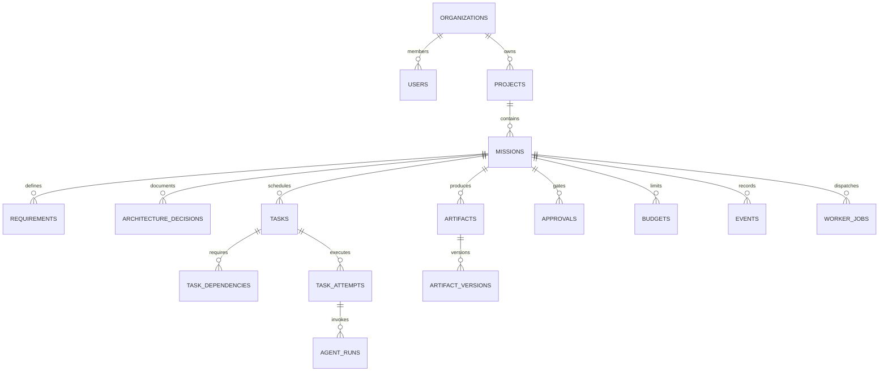

# SYNTRA PostgreSQL Database Design

## 1. Overview & Principles
SYNTRA uses PostgreSQL as its authoritative state store. All schema definitions are managed through SQLAlchemy 2.x and versioned via Alembic migrations.

### Core Database Rules:
1. **UUID Primary Keys**: Every table uses UUIDv4 (`UUID(as_uuid=True)`) primary keys to prevent enumeration attacks and support distributed generation.
2. **Strict Foreign Keys & Cascade Policies**: Explicit foreign keys enforce referential integrity across tenants and missions.
3. **UTC Timestamps**: All timestamp columns are stored in UTC (`DateTime(timezone=True)`).
4. **Tenant Isolation**: High-level domain entities enforce an `organization_id` foreign key.
5. **Transactional Outbox**: State mutations write events atomically to an `outbox` table in the same transaction to guarantee at-least-once delivery.
6. **Task DAG Non-Circularity**: Task dependencies must belong to the same mission and are validated against cycles before insertion.

---

## 2. Entity Relationship Diagram (ERD)

---

## 3. Schema Entity Groups

### 3.1 Identity & Tenancy
- **`organizations`**: `id`, `name`, `slug`, `tier`, `created_at`, `updated_at`.
- **`users`**: `id`, `email`, `full_name`, `is_active`, `created_at`.
- **`memberships`**: `id`, `organization_id`, `user_id`, `role` (`admin`, `engineer`, `auditor`), `created_at`.

### 3.2 Projects & Missions
- **`projects`**: `id`, `organization_id`, `name`, `description`, `git_remote_url`, `default_branch`, `created_at`.
- **`repositories`**: `id`, `project_id`, `clone_url`, `auth_credential_ref`, `is_active`.
- **`missions`**: `id`, `organization_id`, `project_id`, `objective`, `status` (`intake`, `planning`, `awaiting_approval`, `running`, `paused`, `completed`, `failed`), `autonomy_mode`, `plan_version`, `created_at`, `updated_at`.
- **`requirements`**: `id`, `mission_id`, `title`, `content_markdown`, `acceptance_criteria`, `status`.
- **`architecture_decisions`**: `id`, `mission_id`, `adr_number`, `title`, `status`, `context`, `decision`, `consequences`.

### 3.3 Engineering Tasks & Execution DAG
- **`tasks`**: `id`, `mission_id`, `title`, `description`, `assigned_role`, `status` (`pending`, `ready`, `claimed`, `running`, `verifying`, `completed`, `failed`), `priority`, `critical_path_score`, `created_at`.
- **`task_dependencies`**: `id`, `task_id`, `depends_on_task_id`, `created_at` *(Self-referential check prevents cycles)*.
- **`task_attempts`**: `id`, `task_id`, `attempt_number`, `status`, `sandbox_id`, `exit_code`, `error_message`, `started_at`, `finished_at`.
- **`agent_runs`**: `id`, `attempt_id`, `agent_role`, `model_name`, `prompt_tokens`, `completion_tokens`, `cost_usd`, `trace_id`.

### 3.4 Worker Infrastructure & Leases
- **`worker_jobs`**: `id`, `task_id`, `attempt_id`, `status`, `lease_token`, `lease_expires_at`, `heartbeat_at`, `fencing_token`.
- **`tool_executions`**: `id`, `attempt_id`, `tool_name`, `input_payload`, `output_payload`, `is_error`, `duration_seconds`.

### 3.5 Artifacts & Evidence
- **`artifacts`**: `id`, `mission_id`, `task_id`, `artifact_type` (`diff_patch`, `test_report`, `architecture_doc`, `build_bundle`), `name`, `storage_path`, `checksum_sha256`, `size_bytes`, `created_at`.
- **`verification_runs`**: `id`, `artifact_id`, `verifier_type`, `status` (`passed`, `failed`), `output_log`, `created_at`.

### 3.6 Governance & Financial Ledger
- **`approvals`**: `id`, `organization_id`, `mission_id`, `action_type`, `risk_level`, `action_digest`, `status` (`pending`, `approved`, `rejected`), `actor_id`, `feedback`, `expires_at`, `resolved_at`.
- **`budgets`**: `id`, `mission_id`, `max_cost_usd`, `max_input_tokens`, `max_output_tokens`, `max_duration_seconds`, `created_at`.
- **`budget_reservations`**: `id`, `budget_id`, `task_id`, `reserved_amount_usd`, `status` (`reserved`, `settled`, `released`).
- **`usage_records`**: `id`, `mission_id`, `agent_run_id`, `model_name`, `input_tokens`, `output_tokens`, `cost_usd`, `recorded_at`.

### 3.7 Events, Outbox & Idempotency
- **`events`**: `id`, `organization_id`, `mission_id`, `task_id`, `event_type`, `schema_version`, `actor`, `correlation_id`, `payload`, `created_at` *(Immutable)*.
- **`outbox`**: `id`, `event_id`, `topic`, `payload`, `status` (`pending`, `published`), `retry_count`, `created_at`.
- **`idempotency_keys`**: `id`, `key`, `caller_id`, `response_payload`, `expires_at`, `created_at`.
