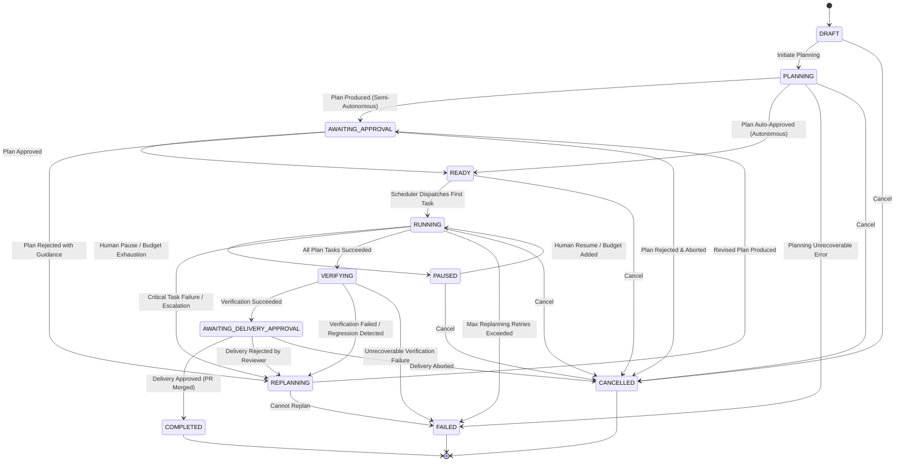

# SYNTRA LangGraph Workflow Architecture & State Machine Specification

**SYNTRA: Synchronized Intelligence for Autonomous Engineering**  
*Orchestration Engine: LangGraph with PostgreSQL Checkpointing*

---

## 1. Mission State Machine Specification

The mission lifecycle is governed by a formal finite state machine containing exactly the 12 required states:



### 1.1 Legal Mission State Transitions Table

| Current State | Permitted Destination States | Trigger / Condition |
|---|---|---|
| `DRAFT` | `PLANNING`, `CANCELLED` | Objective submitted or session cancelled |
| `PLANNING` | `AWAITING_APPROVAL`, `READY`, `FAILED`, `CANCELLED` | PM/Architect plan output generated |
| `AWAITING_APPROVAL`| `READY`, `REPLANNING`, `CANCELLED` | Human approval, rejection with feedback, or abort |
| `READY` | `RUNNING`, `CANCELLED` | Scheduler claims tasks for execution |
| `RUNNING` | `PAUSED`, `REPLANNING`, `VERIFYING`, `FAILED`, `CANCELLED` | Human interrupt, task failure, all tasks done, budget halt |
| `PAUSED` | `RUNNING`, `CANCELLED` | Human unpauses or mission cancelled |
| `REPLANNING` | `AWAITING_APPROVAL`, `FAILED`, `CANCELLED` | EM produces revised task DAG |
| `VERIFYING` | `AWAITING_DELIVERY_APPROVAL`, `REPLANNING`, `FAILED` | Independent QA regression suite pass/fail |
| `AWAITING_DELIVERY_APPROVAL` | `COMPLETED`, `REPLANNING`, `CANCELLED` | Final human signoff for external release |
| `COMPLETED` | *(Terminal)* | Mission deliverables finalized |
| `FAILED` | *(Terminal)* | Irrecoverable mission error |
| `CANCELLED` | *(Terminal)* | Explicit operator abort |

---

## 2. Separate Lifecycle States: Task vs Attempt

To prevent ambiguity between workflow scheduling and transient execution retries, SYNTRA strictly separates **Task States** from **Attempt States**:

### 2.1 Task States (`tasks.state`)
1. `PENDING`: Waiting for upstream task dependencies to complete.
2. `READY`: All upstream dependencies satisfied; available for scheduler dispatch.
3. `ASSIGNED`: Claimed by a worker via active worker lease.
4. `IN_PROGRESS`: Actively executing inside worker sandbox.
5. `BLOCKED`: Blocked by a policy check or missing resource.
6. `REVIEW`: Implementation finished; undergoing peer code and security review.
7. `VERIFYING`: Undergoing independent verification against regression tests.
8. `COMPLETED`: Verified and accepted.
9. `FAILED`: Exceeded maximum retry attempts (`max_attempts`).
10. `CANCELLED`: Upstream dependency failed or mission cancelled.

### 2.2 Attempt States (`task_attempts.state`)
1. `INITIALIZING`: Provisioning isolated sandbox and Git worktree.
2. `RUNNING`: Executing agent ReAct loop and tools.
3. `AWAITING_TOOL`: Blocked waiting for an asynchronous MCP tool response.
4. `EVALUATING`: Running local unit tests and generating unified diff.
5. `SUCCEEDED`: Attempt met local success criteria.
6. `FAILED`: Process error, test failure, or syntax error.
7. `TIMED_OUT`: Hard wall-clock execution limit exceeded (120s default).

---

## 3. LangGraph Checkpoints vs Authoritative Application State

A fundamental architectural principle of SYNTRA is the strict demarcation between **Graph Execution Checkpoints** and **Authoritative Database State**:

```
+-------------------------------------------------------------+
|                      SYNTRA ARCHITECTURE                    |
+------------------------------+------------------------------+
| LangGraph Checkpointer       | PostgreSQL Authoritative DB  |
+------------------------------+------------------------------+
| Purpose: Graph resume & step | Purpose: Business entities & |
| replay after process crash.  | system of record.            |
| Storage: langgraph_checkpoints| Storage: missions, tasks,   |
| blob table.                  | artifacts, audits.           |
| Authority: Internal ephemeral| Authority: Absolute and      |
| execution state.             | authoritative.               |
| Failure Rule: May be evicted | Failure Rule: ACID guaranteed|
| or replayed safely.          | Zero data loss.              |
+------------------------------+------------------------------+
```

### Invariant:
A LangGraph state update must **never** be considered authoritative unless a corresponding PostgreSQL transaction commits the state transition to the `missions` or `tasks` table.

---

## 4. Human Interrupts & Resume Semantics

SYNTRA leverages LangGraph's native `interrupt()` primitive combined with the PostgreSQL Approval Service:

```python
from langgraph.types import interrupt

def plan_approval_node(state: MissionState) -> dict:
    """Pause execution graph and await human decision."""
    # 1. Authoritative record created in PostgreSQL
    approval_record = create_human_approval(
        mission_id=state["mission_id"],
        action_type="TASK_PLAN_APPROVAL",
        action_digest=state["plan_digest"],
    )

    # 2. Yield control via LangGraph interrupt
    decision = interrupt({
        "approval_id": str(approval_record.id),
        "prompt": "Please review the proposed task DAG.",
        "plan_digest": state["plan_digest"],
    })

    # 3. Resume with decision payload
    if decision["action"] == "APPROVE":
        return {"status": "READY"}
    elif decision["action"] == "REJECT":
        return {"status": "REPLANNING", "feedback": decision.get("feedback")}
    else:
        return {"status": "CANCELLED"}
```

---

## 5. Idempotent Nodes & Failure Recovery

1. **Idempotency Keying**: Every workflow step generates a deterministic execution hash:
   $$\text{node\_key} = \text{SHA256}(\text{mission\_id} \parallel \text{task\_id} \parallel \text{step\_name} \parallel \text{attempt\_number})$$
2. **Safe Replay**: If the orchestrator process crashes mid-step, restarting resumes from the last saved LangGraph checkpoint. The node verifies whether the external action was already committed to PostgreSQL before re-dispatching.
3. **Outbox Synchronization**: Node transitions emit events strictly via the `transactional_outbox` table in PostgreSQL, ensuring that message bus delivery (Redis Streams) is strictly guaranteed after transaction commit.
