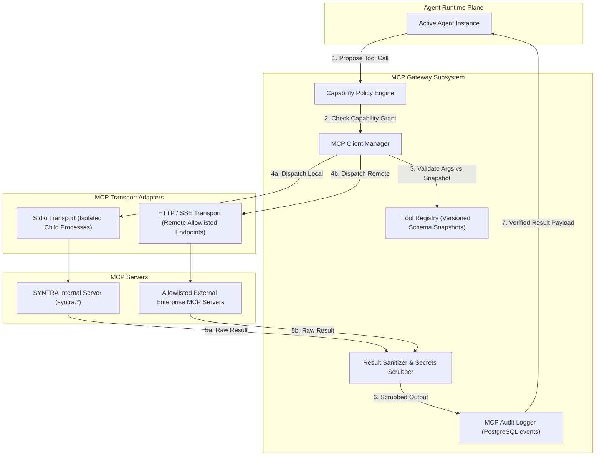

# SYNTRA Model Context Protocol (MCP) Architecture & Gateway Specification

**SYNTRA: Synchronized Intelligence for Autonomous Engineering**  
*Standard: Model Context Protocol (MCP) Specification `2024-11-05`*  
*Python SDK: Official `mcp>=1.1.2` (`mcp==2.3.0`)*

---

## 1. Official MCP Standards & Versioning Verification

SYNTRA strictly integrates with the official Model Context Protocol (MCP) specification:
- **Protocol Version**: `2024-11-05`
- **Target SDK**: Official `mcp` Python SDK (`mcp>=1.1.2`, current PyPI release `2.3.0`)
- **Key Modules**:
  - `mcp.server`: High-level `FastMCP` and low-level `Server` handlers.
  - `mcp.client.session`: `ClientSession` managing JSON-RPC 2.0 lifecycle.
  - `mcp.client.stdio` / `mcp.client.sse`: Asynchronous transport implementations.
  - `mcp.types`: Strongly-typed Pydantic schemas for `Tool`, `CallToolResult`, `TextContent`, `EmbeddedResource`.

### Architectural Invariant:
SYNTRA acts as both an **MCP Tool Host** (running an internal MCP server exposing platform capabilities) and an **MCP Client Gateway** (connecting to approved external MCP servers). LLMs never directly interact with MCP sockets; all calls route through the **MCP Gateway** and the **Capability Policy Engine**.

---

## 2. MCP Subsystem Architecture



---

## 3. Tool Discovery & Versioned Schema Snapshots

1. **Discovery Lifecycle (`tools/list`)**:
   - Upon connection to an allowlisted MCP server, the `MCP Client Manager` sends a `tools/list` JSON-RPC request.
   - The returned tool definitions (name, description, JSON schema) are ingested by the `Tool Registry`.
2. **Schema Snapshotting**:
   - Tool schemas are stored in the `mcp_tool_versions` PostgreSQL table.
   - Schemas are pinned by cryptographic hash: once registered for a version, any drift in the remote server's schema causes an immediate alert and blocks invocation until administrator review.
3. **Progressive Disclosure**:
   - Agents do not receive the entire global catalog of MCP tools in their prompt context.
   - Only tools matching the agent's assigned role and active task skills are formatted into Gemini function declarations.

---

## 4. Capability Policy Enforcement & Invocation Lifecycle

```
[Agent Proposes Tool Call]
          │
          ▼
[Capability Policy Check] ──(DENY)──► [Return MCP Error -32000: Permission Denied]
          │ (ALLOW)
          ▼
[Schema Validation] ──────(INVALID)──► [Return MCP Error -32602: Invalid Arguments]
          │ (VALID)
          ▼
[Execute via Transport] ──(TIMEOUT)─► [Return MCP Error -32001: Execution Timed Out]
          │ (SUCCESS)
          ▼
[Secrets & Path Scrubbing]
          │
          ▼
[Append Audit Log in PostgreSQL]
          │
          ▼
[Deliver Result to Agent]
```

### JSON-RPC 2.0 Error Codes Supported:
| Code | Constant | Meaning in SYNTRA MCP |
|---|---|---|
| `-32700` | `PARSE_ERROR` | Malformed JSON payload received from transport |
| `-32600` | `INVALID_REQUEST` | Payload violates JSON-RPC 2.0 envelope specification |
| `-32601` | `TOOL_NOT_FOUND` | Requested tool name is not registered in active catalog |
| `-32602` | `INVALID_PARAMS` | Arguments fail Pydantic / JSON Schema validation |
| `-32603` | `INTERNAL_ERROR` | Internal server or subprocess crash |
| `-32000` | `CAPABILITY_DENIED` | Agent lacks capability grant for requested tool |
| `-32001` | `EXECUTION_TIMEOUT`| Tool run exceeded execution timeout limit (default 30s) |

---

## 5. Transports, Authentication & Allowlisting

### 5.1 Transport Selection
- **Stdio Transport**: Used for local sandboxed tools (e.g. `syntra` local CLI, ripgrep, tree-sitter). The process is spawned as a restricted subshell with no network access, isolated under a dedicated worker UID.
- **HTTP / SSE Transport**: Used for remote enterprise tools (e.g. Jira, GitHub, Figma, Enterprise Database proxies). Uses persistent HTTP connection with Server-Sent Events (SSE) for streaming responses.

### 5.2 MCP Authentication & Security
- **Server Allowlisting**: Only MCP servers explicitly listed in `mcp_servers` table with `is_enabled = TRUE` can be connected to. Spontaneous or agent-requested MCP server additions are forbidden.
- **Mutual TLS & Bearer Tokens**: All remote SSE connections require HTTPS with Bearer token authentication or mTLS client certificates.
- **Credential Segregation**: Remote MCP API tokens are stored in the host secret store and injected by the `MCP Client Manager` at connection time. No raw API tokens are ever visible to the LLM agent.

---

## 6. Audit Logging & Non-Repudiation

Every tool invocation produces an immutable record in the `events` table:
```json
{
  "event_type": "MCP_TOOL_INVOKED",
  "actor_type": "agent",
  "actor_id": "backend_engineer",
  "payload": {
    "mission_id": "9b1deb4d-3b7d-4bad-9bdd-2b0d7b3dcb6d",
    "task_id": "1b9d6bcd-bbfd-4b2d-9b5d-ab8dfbbd4bed",
    "mcp_server": "syntra",
    "tool_name": "syntra.read_file",
    "arguments": {"path": "src/api/routes.py"},
    "status": "SUCCESS",
    "latency_ms": 14,
    "sha256_result_digest": "e3b0c44298fc1c149afbf4c8996fb92427ae41e4649b934ca495991b7852b855"
  }
}
```
