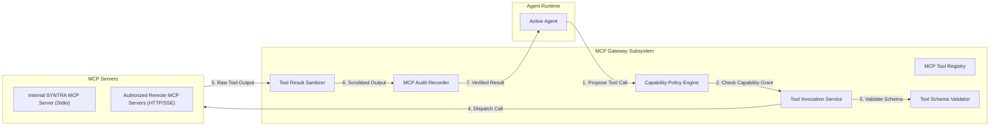

# SYNTRA Model Context Protocol (MCP) Architecture

## 1. Overview & Principles
Model Context Protocol (MCP) is a first-class citizen in SYNTRA. SYNTRA acts as both an **MCP Tool Host** (running an internal MCP server exposing platform capabilities) and an **MCP Client Gateway** (connecting to approved external MCP servers).

### Core Security Rules:
1. **Server-Side Authorization**: The LLM must never authorize its own tool access. Access is determined by capability grants assigned to the specific agent role and task attempt.
2. **Untrusted Tool Output**: Tool outputs are sanitized and credential-scrubbed before insertion into the agent context.
3. **No Database Bypass**: Critical scheduling, financial ledgers, task leases, and state mutations remain direct backend operations and are never routed through MCP.
4. **Network & Process Boundaries**: Remote MCP servers are restricted by origin validation, OAuth token checks, and SSRF defenses. Local MCP servers are launched as sandboxed child processes with restricted paths.

---

## 2. MCP Subsystem Architecture

---

## 3. SYNTRA Standard MCP Toolset

The internal SYNTRA MCP Server exposes the following standard tools:

| MCP Tool Name | Description | Mutation | Policy Gate |
|---|---|---|---|
| `syntra.get_project_context` | Retrieves requirements, ADRs, and repository layout | No | Auto-Approved |
| `syntra.list_tasks` | Lists current mission tasks and statuses | No | Auto-Approved |
| `syntra.get_task` | Fetches details and inputs for an assigned task | No | Auto-Approved |
| `syntra.get_artifact` | Reads an artifact by ID or path | No | Auto-Approved |
| `syntra.submit_artifact` | Submits a patch, diff, or document deliverable | Yes | Scoped Write |
| `syntra.request_review` | Triggers independent code review of a submitted artifact | Yes | State Transition |
| `syntra.report_blocker` | Reports execution impediments to the Engineering Manager | Yes | Escalation |
| `syntra.get_verification_result` | Queries test and verification logs | No | Auto-Approved |

---

## 4. Capability Grants & Policy Enforcement
Every agent invocation receives a list of authorized capability tokens. When an agent attempts a tool invocation:
1. The **Capability Policy Engine** validates that the active `agent_run` holds an active grant for the requested tool.
2. Resource quotas (timeout, max memory, execution count) are checked.
3. The call is dispatched to the corresponding transport (stdio pipe or streamable HTTP client).
4. All inputs, outputs, errors, and latencies are recorded in `mcp_tool_executions` and the audit log.
