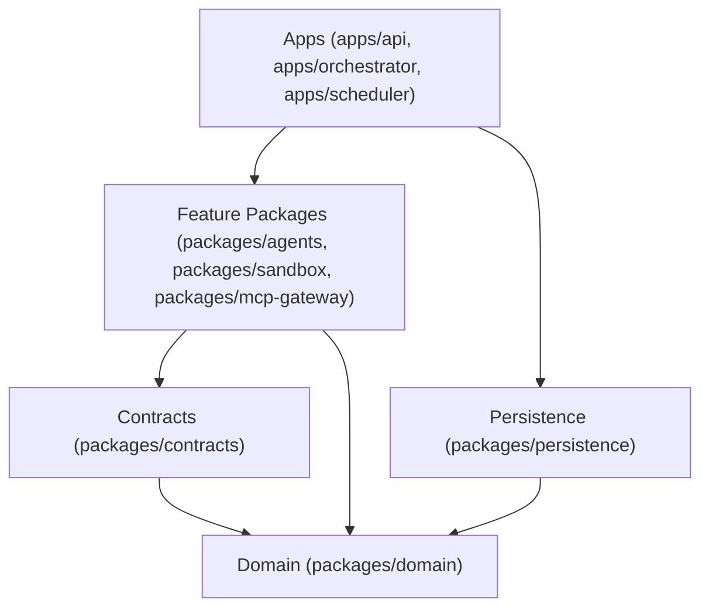

# SYNTRA Module Boundaries & Dependency Architecture

## 1. Monorepo / Package Structure
SYNTRA adheres to clean modular boundaries structured into **Applications** (`apps/`), **Core Packages** (`packages/`), and **Skill Packages** (`skills/`).

```
syntra/
|-- apps/
|   |-- api/                   # FastAPI REST & WebSocket entry point
|   |-- orchestrator/          # LangGraph mission & task execution daemon
|   |-- scheduler/             # Deterministic DAG task scheduler & lease manager
|   |-- worker-controller/     # Sandbox runner & worker supervision daemon
|   |-- mcp-server/            # Stdio / HTTP Model Context Protocol daemon
|
|-- packages/
|   |-- domain/                # Pure business entities & invariants (zero framework dependencies)
|   |-- contracts/             # Pydantic v2 schemas, event schemas, API contracts
|   |-- persistence/           # SQLAlchemy 2.x models, Alembic migrations, Repositories
|   |-- agents/                # 10 Agent role definitions, prompt templates, ReAct loops
|   |-- model-runtime/         # Google Gen AI SDK adapter, router, cost tracker, mocks
|   |-- mcp-gateway/           # MCP client manager, capability grants, tool proxy
|   |-- tool-registry/         # Tool definitions, schemas, execution bindings
|   |-- skill-registry/        # Skill manifest loader, resolver, progressive disclosure
|   |-- sandbox/               # SandboxProvider abstraction, Git worktrees, process isolation
|   |-- memory/                # Execution, project, and organizational memory stores
|   |-- evaluation/            # Independent verification & benchmark execution
|   |-- security/              # Secrets scrubbing, approval verification, input sanitization
|   |-- telemetry/             # OpenTelemetry metrics, audit logs, token ledger
|
|-- skills/                    # 16 Specialized skill packages (SKILL.md, manifest.yaml, schemas/)
|-- config/                    # Versioned YAML configurations (models, tools, agents, skills)
|-- tests/                     # Unit, integration, contract, security, and e2e test suites
```

---

## 2. Dependency Direction Rules



### Architectural Invariants:
1. **Rule of Domain Isolation**: `packages/domain` contains pure Python business logic, entity classes, and state machines. It must **never** import `fastapi`, `langgraph`, `sqlalchemy`, or external cloud SDKs.
2. **Rule of Contract Supremacy**: Inter-process and inter-agent boundaries are strictly governed by Pydantic v2 models in `packages/contracts`.
3. **Rule of Untrusted Model Output**: Output from an LLM is treated as an untrusted proposal. It must pass contract validation before modifying any authoritative domain state.
4. **Rule of Process Segregation**: Generated code executes solely inside disposable sandboxes via `packages/sandbox`. No user/generated code is ever executed inside the FastAPI or Orchestrator runtime.
