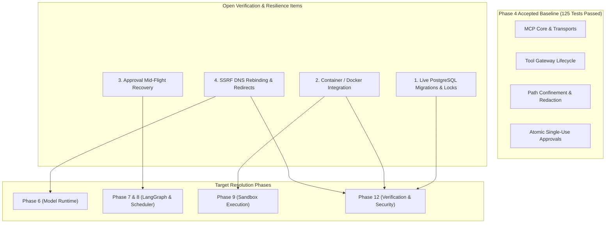

# SYNTRA Open Verification Items & Technical Debt Register

**SYNTRA: Synchronized Intelligence for Autonomous Engineering**  
*Document Version: 1.0.0*  
*Last Updated: October 15, 2026 (Phase 4 Final Handoff)*  
*Status: ACTIVE / UNRESOLVED*  

---

## 1. Executive Summary & Purpose

This register maintains an authoritative, transparent log of deferred verification items, environmental test skips, and structural resilience considerations identified across development phases. In alignment with SYNTRA's evidence-based engineering principles, no capability is marked fully verified without definitive execution evidence.

These items represent deliberate technical-debt disclosures and planned follow-up milestones for future phases; they do not block development progression into **Phase 5 (Skills and Capability Registry)**.

---

## 2. Open Verification Items

### Item 1: Live PostgreSQL Migration and Transaction Tests

- **Status**: `UNVERIFIED_ENVIRONMENTAL_SKIP`
- **Current Evidence**:
  - All 36 SQLAlchemy domain and MCP models successfully compile to PostgreSQL DDL via SQLAlchemy's `postgresql` dialect ([`tests/test_postgres_verification.py`](file:///Users/thedeepakreddy/SYNTRA/tests/test_postgres_verification.py)).
  - Foreign key constraints, composite unique indexes, and PostgreSQL-specific types (`postgresql.UUID`, `JSONB`, `TIMESTAMP(timezone=True)`) compile without syntax errors.
  - Alembic migrations (`0001_initial_schema.py` and `0002_mcp_infrastructure.py`) execute clean upgrade/downgrade lifecycles on in-memory SQLite engines ([`tests/test_migrations.py`](file:///Users/thedeepakreddy/SYNTRA/tests/test_migrations.py)).
- **Missing Verification**:
  - Live execution of Alembic migrations directly against a real running PostgreSQL 16 server instance.
  - Verification of PostgreSQL row-level locking (`SELECT ... FOR UPDATE SKIP LOCKED`) used by lease fencing and outbox dispatch.
  - Concurrency verification under PostgreSQL `READ COMMITTED` and `REPEATABLE READ` transaction isolation levels.
  - Real database verification in [`tests/test_postgres_verification.py::test_live_postgresql_lifecycle`](file:///Users/thedeepakreddy/SYNTRA/tests/test_postgres_verification.py#L90-L130), currently skipped due to no active PostgreSQL daemon on port 5432.
- **Risk**:
  - Dialect discrepancies or syntax edge-cases between SQLite and PostgreSQL (e.g., subtle JSONB containment semantics, enum type migrations, index parameter handling, or transaction rollback edge-cases) that surface only at runtime against PostgreSQL 16.
- **Required Follow-up**:
  - Establish a CI/CD job or test container running PostgreSQL 16 with pre-configured test credentials.
  - Execute full Alembic upgrade and downgrade cycles against the live database.
  - Un-skip and assert all checks in `test_live_postgresql_lifecycle`.
- **Target Development Phase**:
  - **Phase 12 (Verification, Security, Observability)** / CI Environment Provisioning.

---

### Item 2: Docker / Container Infrastructure Integration Tests

- **Status**: `UNVERIFIED_ENVIRONMENTAL_SKIP`
- **Current Evidence**:
  - [`compose.yaml`](file:///Users/thedeepakreddy/SYNTRA/compose.yaml) declares valid definitions for PostgreSQL 16, Redis 7, and MinIO S3 services with health check probes, restart policies, and non-root execution baselines.
  - Configuration structure and Compose file parsing pass in automated tests ([`tests/test_phase1_initialization.py::test_compose_yaml_services`](file:///Users/thedeepakreddy/SYNTRA/tests/test_phase1_initialization.py)).
  - Health probe endpoints (`GET /health` and `GET /health/ready`) correctly report readiness states and handle dependency dropouts ([`tests/unit/test_health_and_readiness_unit.py`](file:///Users/thedeepakreddy/SYNTRA/tests/unit/test_health_and_readiness_unit.py)).
- **Missing Verification**:
  - Live orchestration of Docker containers (`docker compose up -d`) on the local host.
  - Verification of inter-container network connectivity, socket timeouts, volume mount permissions on Linux kernels, and MinIO S3 bucket auto-initialization.
  - Execution of integration tests in [`tests/integration/test_infrastructure_connectivity.py`](file:///Users/thedeepakreddy/SYNTRA/tests/integration/test_infrastructure_connectivity.py) (`test_postgresql_connection`, `test_redis_connection`, `test_minio_connection`), currently skipped because `docker` is not installed on the development machine.
- **Risk**:
  - Configuration drift between Docker Compose definitions and real container runtimes (e.g. file permission mismatches on Linux volume mounts, slow container cold-start delays causing health probe timeouts, or MinIO S3 API credential negotiation changes).
- **Required Follow-up**:
  - Execute the integration test harness on a host or CI runner equipped with Docker Engine (`dockerd`) and Docker Compose v2.
  - Validate that `test_postgresql_connection`, `test_redis_connection`, and `test_minio_connection` execute and pass with 0 skips.
- **Target Development Phase**:
  - **Phase 9 (Sandbox Execution)** and **Phase 12 (Verification, Security, Observability)**.

---

### Item 3: Approval Consumption and External Execution Failure-Recovery Design

- **Status**: `PARTIALLY_VERIFIED_STRUCTURAL_GAP`
- **Current Evidence**:
  - Single-use atomic consumption is implemented in [`ApprovalRepository.verify_and_consume_for_execution`](file:///Users/thedeepakreddy/SYNTRA/src/syntra/persistence/repositories.py#L280-L360) and enforced in Step 6 of [`ToolGateway.execute_tool`](file:///Users/thedeepakreddy/SYNTRA/src/syntra/mcp/gateway.py#L180-L240).
  - 9 approval security tests pass in [`tests/test_mcp_approval_security.py`](file:///Users/thedeepakreddy/SYNTRA/tests/test_mcp_approval_security.py), verifying rejection of expired, wrong mission, wrong tenant, tampered, and replayed approvals, as well as race conditions across 10 concurrent threads.
- **Missing Verification**:
  - **Failure-Recovery Handling**: When an approval is atomically marked `CONSUMED` and committed to the database, if the downstream external tool invocation subsequently fails mid-flight (e.g. external network partition, HTTP 500 error from remote server, worker container crash), the approval remains permanently `CONSUMED`.
  - The agent currently has no built-in mechanism to retry the external action without requesting a completely new human approval, causing operational friction.
  - There is currently no two-phase commit, execution lease, or automatic rollback mechanism for approved external actions that fail during network execution.
- **Risk**:
  - While this behavior is strictly secure and prevents replay attacks (*fail-safe by default*), transient network drops or temporary external service outages could force human operators into repeated approval loops for the same approved action.
- **Required Follow-up**:
  - Design a two-phase approval lease protocol in the orchestration plane:
    1. Mark approval as `CONSUMING` with an expiration lease (e.g. 60 seconds).
    2. If tool execution completes successfully, transition to `CONSUMED`.
    3. If execution fails before tool side-effects occur, transition back to `APPROVED` or notify human with an automatic retry option.
  - Implement idempotent external write reconciliation in the workflow engine.
- **Target Development Phase**:
  - **Phase 7 (LangGraph Workflow Engine)** and **Phase 8 (Task Scheduler and Collaboration)**.

---

### Item 4: Verification of Remote MCP SSRF Protection Across DNS Resolution and Redirects

- **Status**: `PARTIALLY_VERIFIED_ATTACK_SURFACE`
- **Current Evidence**:
  - [`validate_mcp_url`](file:///Users/thedeepakreddy/SYNTRA/src/syntra/mcp/security.py#L40-L100) performs static URL scheme parsing and resolves hostnames to IP addresses via `socket.gethostbyname`.
  - It strictly blocks loopback addresses (`127.0.0.0/8`), private networks (RFC 1918: `10.0.0.0/8`, `172.16.0.0/12`, `192.168.0.0/16`), link-local / cloud metadata (RFC 3927: `169.254.0.0/16`), and multicast spaces.
  - Comprehensive unit and regression tests pass in [`tests/test_mcp_security_hardening.py::test_ssrf_validation_blocks_reserved_and_metadata_ips`](file:///Users/thedeepakreddy/SYNTRA/tests/test_mcp_security_hardening.py).
- **Missing Verification**:
  - **Time-of-Check to Time-of-Use (TOCTOU) / DNS Rebinding**: `validate_mcp_url` validates the IP address during policy evaluation, but the underlying HTTP client (`mcp.client.streamable_http.streamable_http_client` using `httpx`) performs an independent DNS resolution when initiating the socket connection. An attacker controlling an external authoritative DNS server could return a legitimate public IP on the first query and `169.254.169.254` or `127.0.0.1` on the second query.
  - **HTTP Redirects**: If an external allowlisted HTTP server returns an HTTP `301 Moved Permanently` or `302 Found` redirecting to `http://169.254.169.254/latest/meta-data/`, the client could follow the redirect into protected internal infrastructure unless redirect targets are re-validated.
- **Risk**:
  - Potential SSRF bypass if SYNTRA agents are permitted to connect to untrusted community or third-party remote MCP HTTP endpoints that employ DNS rebinding or redirect tricks.
- **Required Follow-up**:
  - Configure a custom transport adapter in `streamable_http_client` that pins the connection to the validated IP address directly (bypassing secondary client DNS lookups).
  - Explicitly configure HTTP client options: disable automatic redirect following (`follow_redirects=False`) or install a redirect hook that runs `validate_mcp_url` on every redirect location before dispatching the request.
- **Target Development Phase**:
  - **Phase 6 (Model Runtime)** and **Phase 12 (Verification, Security, Observability)**.

---

## 3. Summary Matrix

| ID | Title | Status | Severity / Risk | Target Phase |
|---|---|---|---|---|
| **VERIF-001** | Live PostgreSQL Migrations & Locks | `UNVERIFIED_ENVIRONMENTAL_SKIP` | Medium (Dialect & Concurrency Quirks) | Phase 12 (CI Infrastructure) |
| **VERIF-002** | Docker / Container Integration | `UNVERIFIED_ENVIRONMENTAL_SKIP` | Medium (Configuration & Runtime Drift) | Phase 9 & Phase 12 |
| **VERIF-003** | Approval Recovery & Failure Lease | `PARTIALLY_VERIFIED_STRUCTURAL_GAP` | Low (Operational Friction on Failures) | Phase 7 & Phase 8 |
| **VERIF-004** | Remote MCP SSRF DNS Rebinding & Redirects | `PARTIALLY_VERIFIED_ATTACK_SURFACE` | High (Remote Untrusted Endpoints Only) | Phase 6 & Phase 12 |

---

## 4. Phase 5 Readiness

The core MCP subsystem meets all criteria for development handoff. No production Phase 4 files require modification. All 125 active tests remain passing with zero lint warnings and zero type errors.

Proceeding to **Phase 5: Skills and Capability Registry**.
