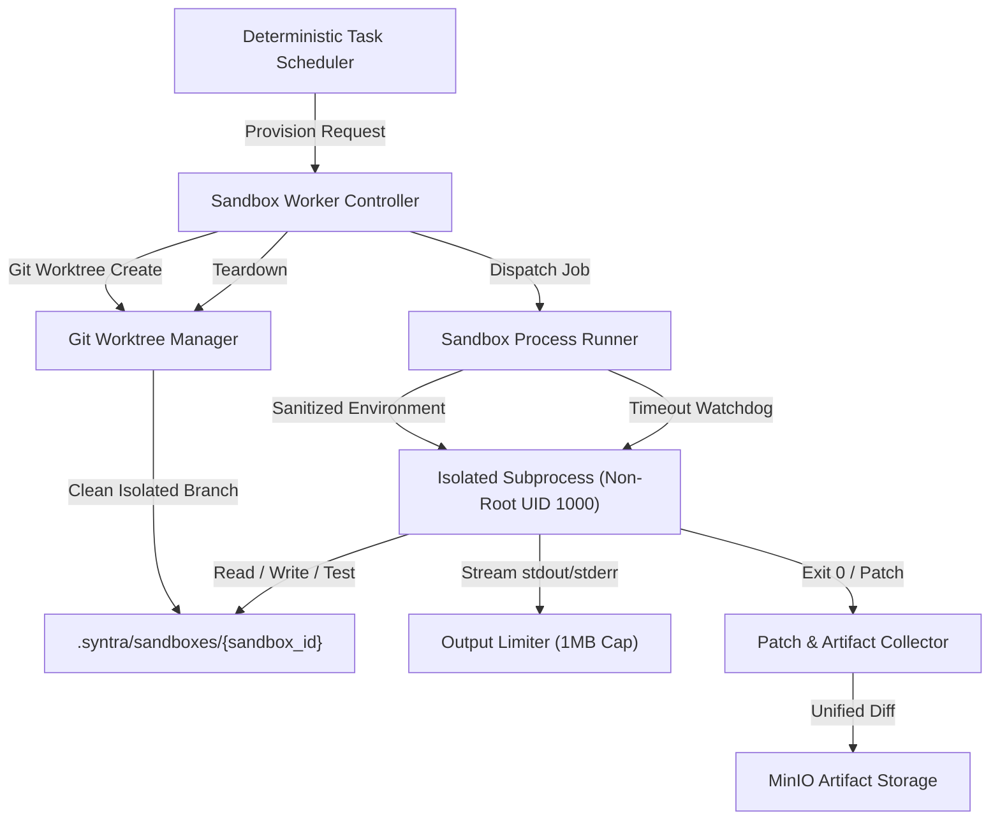

# SYNTRA Sandbox Execution & Worker Isolation Architecture

**SYNTRA: Synchronized Intelligence for Autonomous Engineering**  
*Execution Plane: Isolated SandboxProvider & Git Worktree Manager*

---

## 1. Sandbox Architecture Principles

The SYNTRA control plane never executes generated code or arbitrary shell commands within the primary application process. All execution is offloaded to the **Execution Plane** governed by the `SandboxProvider` abstraction.



---

## 2. The `SandboxProvider` Interface

The `SandboxProvider` defines the formal contract for ephemeral execution environments:

```python
from abc import ABC, abstractmethod
from pathlib import Path
from pydantic import BaseModel
from typing import Mapping


class ExecutionResult(BaseModel):
    exit_code: int
    stdout: str
    stderr: str
    duration_ms: int
    timed_out: bool
    output_truncated: bool


class SandboxInstance(ABC):
    sandbox_id: UUID
    workspace_root: Path

    @abstractmethod
    async def execute_command(
        self,
        command: str,
        env: Mapping[str, str] | None = None,
        timeout_seconds: int = 120,
    ) -> ExecutionResult:
        """Run a shell command inside the sandbox."""
        pass

    @abstractmethod
    async def read_file(self, relative_path: str) -> str:
        """Read a file safely within sandbox root."""
        pass

    @abstractmethod
    async def write_file(self, relative_path: str, content: str) -> None:
        """Write a file safely within sandbox root."""
        pass

    @abstractmethod
    async def get_unified_diff(self) -> str:
        """Extract unified git diff of all modifications."""
        pass

    @abstractmethod
    async def cleanup(self) -> None:
        """Tear down worktree and delete temporary files."""
        pass


class SandboxProvider(ABC):
    @abstractmethod
    async def create_sandbox(
        self,
        repository_path: Path,
        base_commit: str,
        timeout_seconds: int = 120,
    ) -> SandboxInstance:
        """Provision a clean, isolated sandbox worktree."""
        pass
```

---

## 3. Git Worktree Isolation & Ephemeral Branching

1. **Atomic Branching**: Every task execution runs in a dedicated Git worktree branched from the mission's base commit:
   ```bash
   git worktree add -b "syntra/task-{task_id}-{attempt}" ".syntra/sandboxes/{sandbox_id}" "{base_commit}"
   ```
2. **Zero Pollution of Host Repo**: The host repository remains completely unmodified while the agent works on the isolated worktree.
3. **Patch Generation**: Upon successful task completion, the worker runs:
   ```bash
   git diff -u "{base_commit}" HEAD
   ```
   The resulting unified diff is validated and uploaded to Artifact Storage as an immutable deliverable.

---

## 4. Hard Defense Limits

| Parameter | Default Value | Enforcement Mechanism |
|---|---|---|
| Execution Timeout | `120 seconds` | `asyncio.wait_for()` with OS `SIGKILL` |
| Max Output Size | `1 MB` | Stream reader buffer limit; truncates with warning |
| Max Memory | `512 MB` | `ulimit -v` / Linux cgroups memory limit |
| User Privileges | Non-Root (UID 1000) | Process spawned under unprivileged system user |
| Path Traversal | Forbidden | Strict `Path.resolve().is_relative_to(sandbox_root)` check |
| Network Access | Restricted | Network namespace filtering; host loopback access denied |
