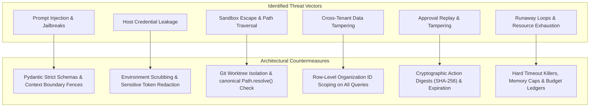

# SYNTRA Security Architecture & Threat Defense

## 1. Security Philosophy: Zero-Trust AI Execution
In SYNTRA, LLMs are considered untrusted probabilistic reasoning components. Under no circumstance does an LLM output directly alter authoritative database records or host filesystem state without validation, authorization, and audit recording.

---

## 2. Threat Vector Defense Matrix

---

## 3. Defense Mechanisms in Detail

### 3.1 Untrusted Model Output & Prompt Injection
- **Structural Fencing**: System instructions and user context are segmented using distinct delimiters.
- **Contract Enforcement**: Model completions must validate against strongly-typed Pydantic schemas. Unparseable responses are rejected and trigger bounded corrective retries.
- **Tool Grant Verification**: The agent cannot execute tools not explicitly granted in its execution capability token.

### 3.2 Host Credential Isolation
- Coding agents operate inside isolated worktrees.
- Host credentials (`AWS_SECRET_ACCESS_KEY`, `GEMINI_API_KEY`, SSH keys, etc.) are stripped from the environment before launching subprocesses.
- No production database credentials or cloud deployment keys are ever exposed to the sandbox worker.

### 3.3 Sandbox Isolation & Path Traversal Guards
- Every file access is resolved to canonical form via `Path.resolve()`.
- The target path must verify `path.relative_to(sandbox_root)`. Any escape attempts (`../../../etc/passwd`) raise `SandboxSecurityViolationError` immediately.
- Execution runs under a non-root user (UID 1000) with no access to the host Docker daemon or socket.

### 3.4 Cryptographically Bound Human Approvals
- Checkpoint approvals are bound to a cryptographic SHA-256 digest of the proposed payload:
  $$\text{ActionDigest} = \text{SHA256}(\text{mission\_id} \,\|\, \text{action\_type} \,\|\, \text{proposed\_payload} \,\|\, \text{plan\_version})$$
- Approvals include mandatory expiration timestamps.
- Once approved, the record is marked `RESOLVED` and cannot be replayed or reused for any subsequent action.

### 3.5 Resource Limits & Loop Breakers
- Step limit: Agents are capped at a maximum number of ReAct steps (default 30).
- Subprocess timeout: Commands automatically terminate after `sandbox_timeout_seconds` (default 120s).
- Buffer truncation: Subprocess stdout/stderr captures truncate at 1MB to prevent out-of-memory crashes.
- Budget ledger: Invocations halt immediately once the approved token or USD budget is exhausted.
