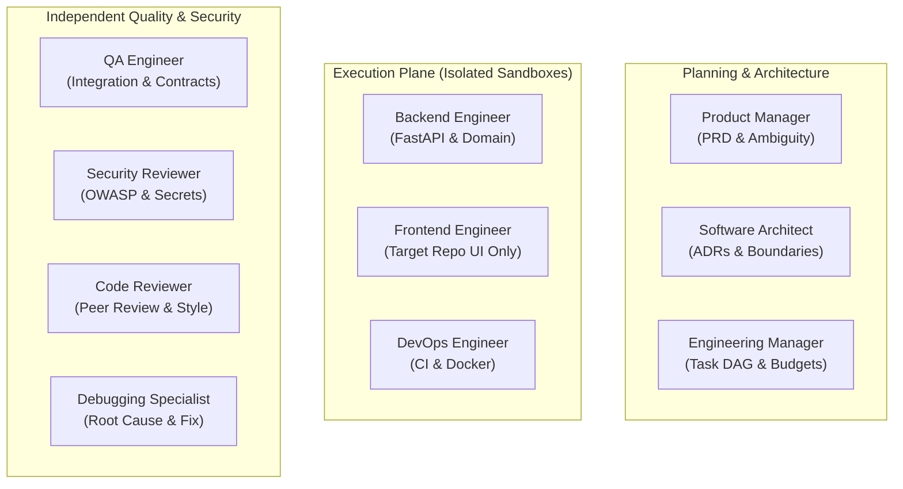

# SYNTRA Skills Registry Architecture & Capability Manifest Specification

**SYNTRA: Synchronized Intelligence for Autonomous Engineering**  
*Capability Extension Model: Progressive Disclosure, Contract Enforcement & Dynamic Skills Registry*  
*Document Version: 2.0.0 (Phase 5 Delivery)*  

---

## 1. Skills System Overview

Skills in SYNTRA represent reusable, modular units of specialized engineering procedures, guidelines, methodologies, and output schemas. Rather than flooding an LLM's system prompt with encyclopedic guidelines, SYNTRA uses **progressive disclosure**:
1. When an agent is invoked for a specific task, only the skills explicitly declared for that task's domain and supported by the agent's role are loaded into working memory.
2. Skills are stored on disk in `skills/<skill-id>/` adhering to a uniform package standard:
   - `manifest.yaml`: Machine-readable metadata, input/output schemas, capability requirements, dependencies, and evaluation test cases.
   - `SKILL.md`: Human- and AI-readable step-by-step methodologies, required inputs, tool prerequisites, verification checklists, and escalation rules.
   - `references/`: Authoritative checklists, style guides, and industry specifications.
   - `schemas/`: Formal JSON schema contracts for inputs and outputs.
   - `tests/`: Deterministic test fixtures for automated skill evaluation.

### Fundamental Security Invariant:
> [!IMPORTANT]
> **Skills do NOT grant permissions.** A skill may declare `required_capabilities` and `required_tools`, but tool execution is strictly governed at runtime by the **Capability Policy Engine**. If an agent invokes a tool required by a skill without holding an active capability grant in the database, the call is rejected immediately.

---

## 2. Skill Package Standard Layout

Every skill in SYNTRA adheres to the following directory structure:

```text
skills/<skill-id>/
├── SKILL.md                # Substantive engineering methodology and checklists
├── manifest.yaml           # Pydantic v2 SkillManifest contract
├── references/             # Authoritative reference standards and checklists
│   └── checklist.md
├── schemas/                # JSON Schema contracts for input/output payloads
│   └── output.json
└── tests/                  # Deterministic evaluation test case fixtures
    └── test_case.yaml
```

---

## 3. Skill Manifest Schema Specification (`manifest.yaml`)

Every skill package must contain a strictly validated `manifest.yaml` adhering to the following Pydantic v2 schema:

```yaml
id: "backend-api-development"
name: "backend-api-development"
version: "1.0.0"
description: "Implements robust, strongly typed FastAPI endpoints, pure domain business services, and database persistence."
category: "implementation"

# Role Compatibility
supported_roles:
  - "backend_engineer"
compatible_roles:
  - "backend_engineer"

# Required Input Evidence
required_inputs:
  - "task_specification"
  - "api_contracts"
  - "sandbox_workspace"

# Required Capabilities (Evaluated by Policy Engine, NOT granted by Skill)
required_capabilities:
  - "syntra.read_file"
  - "syntra.write_file"
  - "syntra.run_command"
  - "syntra.git_diff"

# Required Tools
required_tools:
  - "syntra.read_file"
  - "syntra.write_file"
  - "syntra.run_command"
  - "syntra.git_diff"

# Output Contract Schema
output_schema:
  type: "object"
  required: ["unified_diff", "changed_files", "unit_test_results"]
  properties:
    unified_diff:
      type: "string"
    changed_files:
      type: "array"
    unit_test_results:
      type: "object"

# Verification Checklist
verification_rules:
  - "All endpoints must use Pydantic v2 models for request and response validation."
  - "All business logic must reside in domain services or entities, not in route handlers."
  - "Local unit tests must pass with 100% success inside the worker sandbox."

# Dependencies
dependencies:
  - "task-decomposition>=1.0.0"

# Authoritative References
references:
  - title: "FastAPI Production Best Practices"
    uri: "https://fastapi.tiangolo.com/"
  - title: "Pydantic v2 Documentation"
    uri: "https://docs.pydantic.dev/latest/"

# Deterministic Evaluation Cases
evaluation_cases:
  - name: "create_item_endpoint"
    input_data:
      task: "implement POST /items"
    expected_status: "SUCCESS"
```

---

## 4. The 16 Standard Skill Packages

| # | Skill Directory | Domain / Category | Compatible Agent Roles | Key Output Artifact |
|---|---|---|---|---|
| 1 | `requirements-analysis` | Specification | Product Manager | `PRDDocument` |
| 2 | `system-architecture` | Architecture | Software Architect | `ArchitectureSpec`, `ADR` |
| 3 | `task-decomposition` | Planning | Engineering Manager | `TaskPlan` DAG |
| 4 | `backend-api-development` | Implementation | Backend Engineer | Unified Diff (FastAPI/Python) |
| 5 | `frontend-development` | Implementation | Frontend Engineer | Unified Diff (Target Repo UI) |
| 6 | `database-engineering` | Persistence | Backend Engineer, Architect | SQLAlchemy Models & Migrations |
| 7 | `test-driven-development` | Quality | QA Engineer, Backend Engineer, Debugger | Pytest Test Suites |
| 8 | `debugging-and-root-cause-analysis` | Remediation | Debugging Specialist | Root Cause Report & Fix Patch |
| 9 | `code-review` | Governance | Code Reviewer | `ReviewVerdict` (Approved/Rejected) |
| 10 | `security-review` | Security | Security Reviewer | `SecurityAuditReport` |
| 11 | `git-workflow` | Platform | DevOps Engineer, EM | Worktree Branches & Commits |
| 12 | `devops-and-ci` | Infrastructure | DevOps Engineer | Dockerfiles & CI Pipelines |
| 13 | `api-contract-testing` | Testing | QA Engineer | Contract Verification Logs |
| 14 | `dependency-management`| Platform | DevOps, Backend Engineer | `uv.lock` & Audit Logs |
| 15 | `integration-testing` | Testing | QA Engineer | Multi-Service E2E Evidence |
| 16 | `technical-documentation` | Documentation | Product Manager, Architect, Reviewer | Markdown Docs & Diagrams |

---

## 5. Agent Capability Profiles

In accordance with `AGENTS.md`, each of the 10 specialized engineering personas declares a formal `AgentCapabilityProfile`:



### Detailed Capability Matrix

1. **Product Manager**:
   - Supported Skills: `requirements-analysis`, `technical-documentation`
   - Allowed Capabilities: `syntra.workspace_search`, `syntra.read_file`, `syntra.list_directory`, `syntra.artifact_read`, `syntra.artifact_write`
   - Hard Limitations: Must never modify source code, execute bash commands, or approve pull requests.

2. **Software Architect**:
   - Supported Skills: `system-architecture`, `database-engineering`, `technical-documentation`
   - Allowed Capabilities: `syntra.workspace_search`, `syntra.read_file`, `syntra.list_directory`, `syntra.artifact_read`, `syntra.artifact_write`
   - Hard Limitations: Must never write implementation code directly into repositories or execute unverified shell scripts.

3. **Engineering Manager**:
   - Supported Skills: `task-decomposition`, `git-workflow`, `technical-documentation`
   - Allowed Capabilities: `syntra.workspace_search`, `syntra.read_file`, `syntra.list_directory`, `syntra.validate_dag`, `syntra.artifact_write`
   - Hard Limitations: Must never execute engineering tasks directly or bypass DAG cycle validation.

4. **Backend Engineer**:
   - Supported Skills: `backend-api-development`, `database-engineering`, `test-driven-development`, `dependency-management`
   - Allowed Capabilities: `syntra.read_file`, `syntra.write_file`, `syntra.run_command`, `syntra.workspace_search`, `syntra.git_diff`
   - Hard Limitations: Must never access host filesystem, self-review own diffs, or execute outside worker sandbox.

5. **Frontend Engineer**:
   - Supported Skills: `frontend-development`, `test-driven-development`, `api-contract-testing`
   - Allowed Capabilities: `syntra.read_file`, `syntra.write_file`, `syntra.run_command`, `syntra.workspace_search`, `syntra.git_diff`
   - Hard Limitations: Modifications strictly restricted to target repositories (never SYNTRA core).

6. **QA Engineer**:
   - Supported Skills: `test-driven-development`, `integration-testing`, `api-contract-testing`
   - Allowed Capabilities: `syntra.read_file`, `syntra.write_file`, `syntra.run_command`, `syntra.workspace_search`, `syntra.artifact_write`
   - Hard Limitations: Must never modify production source code to make tests pass artificially.

7. **DevOps Engineer**:
   - Supported Skills: `devops-and-ci`, `git-workflow`, `dependency-management`
   - Allowed Capabilities: `syntra.read_file`, `syntra.write_file`, `syntra.run_command`, `syntra.git_branch`, `syntra.git_diff`
   - Hard Limitations: Must never deploy to production or push to external Git remotes without human authorization.

8. **Security Reviewer**:
   - Supported Skills: `security-review`, `code-review`
   - Allowed Capabilities: `syntra.read_file`, `syntra.workspace_search`, `syntra.list_directory`, `syntra.security_scan`, `syntra.artifact_write`
   - Hard Limitations: Must never modify source code; cannot approve patches with unresolved Critical/High findings.

9. **Code Reviewer**:
   - Supported Skills: `code-review`, `technical-documentation`
   - Allowed Capabilities: `syntra.read_file`, `syntra.workspace_search`, `syntra.list_directory`, `syntra.artifact_write`
   - Hard Limitations: May not review code authored by itself (Anti-Collusion Invariant).

10. **Debugging Specialist**:
    - Supported Skills: `debugging-and-root-cause-analysis`, `test-driven-development`, `backend-api-development`
    - Allowed Capabilities: `syntra.read_file`, `syntra.write_file`, `syntra.run_command`, `syntra.workspace_search`, `syntra.git_diff`
    - Hard Limitations: Must not disable or weaken existing test assertions to bypass failures.

---

## 6. Skill Installation Policy & Trust Governance

A runtime skill may be activated only if:
1. **Source Authorization**: Source must be explicitly allowlisted (`core`, `internal`, `syntra-official`, `trusted-partner`). Unapproved external sources are blocked with `SkillSecurityError`.
2. **Manifest Validation**: Must parse cleanly into `SkillManifest` with valid Semantic Versioning.
3. **Dependency Satisfaction**: All dependencies declared in `dependencies` must be registered and compatible.
4. **Integrity Validation**: The cryptographic SHA-256 digest of `manifest.yaml` and `SKILL.md` must match the expected checksum.
5. **No Arbitrary Script Execution**: Skills contain declarative instructions, references, and schemas; they do not execute arbitrary shell scripts upon discovery or installation.

---

## 7. Deterministic Evaluation Harness (`SkillEvaluator`)

The `SkillEvaluator` validates execution readiness without relying on non-deterministic LLM output comparisons:
- Checks required inputs against `manifest.required_inputs`.
- Checks calling role compatibility against `manifest.supported_roles`.
- Checks required tools against available tools.
- Checks required capability permissions against active capability grants.
- Validates proposed output payloads against `manifest.output_schema`.
- Stores evaluation outcomes in an append-only audit trail.
