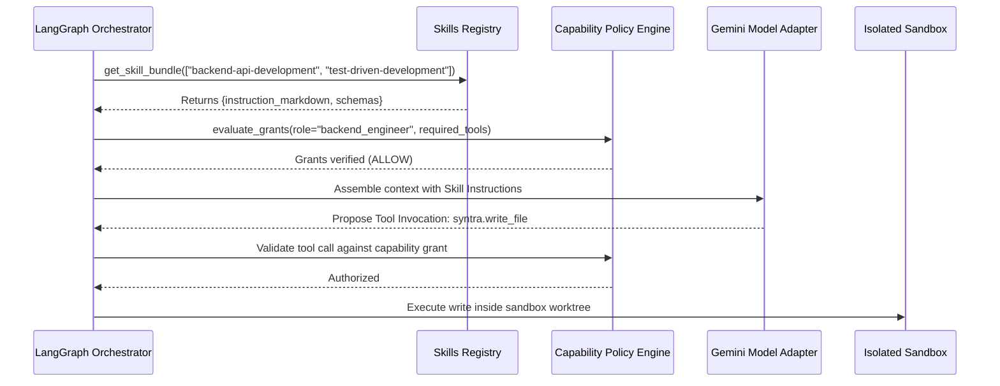

# SYNTRA Skills Registry Architecture & Manifest Specification

**SYNTRA: Synchronized Intelligence for Autonomous Engineering**  
*Capability Extension Model: Progressive Disclosure & Schema Validation*

---

## 1. Skills System Overview

Skills in SYNTRA represent reusable, modular units of specialized engineering knowledge, guidelines, workflows, and output contracts. Rather than flooding the LLM's system prompt with encyclopedic guidelines, SYNTRA uses **progressive disclosure**:
1. When an agent is invoked for a specific task, only the skills explicitly declared for that task's domain are loaded into working memory.
2. Skills are stored on disk in `skills/<skill_name>/` containing:
   - `manifest.yaml`: Machine-readable metadata, input/output schemas, capability requirements, and evaluation tests.
   - `SKILL.md`: Human- and AI-readable step-by-step methodologies, edge-case guidance, and architectural checklists.

### Fundamental Security Invariant:
**Skills do NOT grant permissions.** A skill may declare `required_capabilities`, but tool execution is strictly evaluated at runtime by the **Capability Policy Engine**. If an agent invokes a tool required by a skill without holding an active capability grant in the database, the call is immediately rejected.

---

## 2. Skill Manifest Schema Specification (`manifest.yaml`)

Every skill package must contain a strictly validated `manifest.yaml` adhering to the following schema:

```yaml
# 1. Identity & Versioning
id: "backend-api-development"
version: "1.0.0"
name: "Backend API Development"
description: "Implements robust, strongly typed FastAPI endpoints, domain services, and database persistence."
category: "implementation"

# 2. Role Compatibility
supported_roles:
  - "backend_engineer"

# 3. Required Capabilities (Evaluated by Policy Engine, NOT granted by Skill)
required_capabilities:
  - "syntra.read_file"
  - "syntra.write_file"
  - "syntra.run_command"

# 4. Input & Output Schemas (JSON Schema / Pydantic Contracts)
input_schemas:
  type: "object"
  required: ["task_specification", "api_contracts"]
  properties:
    task_specification:
      type: "string"
      description: "Detailed engineering instructions from the task plan."
    api_contracts:
      type: "string"
      description: "Path to OpenAPI spec or Pydantic models."

output_schemas:
  type: "object"
  required: ["unified_diff", "local_test_results"]
  properties:
    unified_diff:
      type: "string"
      description: "Standard unified diff patch against repository baseline."
    local_test_results:
      type: "object"
      properties:
        exit_code: {type: "integer"}
        passed: {type: "integer"}
        failed: {type: "integer"}

# 5. Verification Requirements
verification_requirements:
  - "All new endpoints must have corresponding pytest integration tests."
  - "No raw SQL string concatenation allowed (use SQLAlchemy ORM/Core)."
  - "Code must pass ruff check without errors."

# 6. Authoritative References & Standards
references:
  - title: "FastAPI Production Guidelines"
    uri: "https://fastapi.tiangolo.com/tutorial/"
  - title: "SQLAlchemy 2.0 Async Guide"
    uri: "https://docs.sqlalchemy.org/en/20/orm/extensions/asyncio.html"

# 7. Evaluation & Benchmark Tests
evaluation_tests:
  - test_name: "test_endpoint_creation_satisfies_contract"
    fixture_path: "benchmarks/fixtures/fastapi_sample_task.yaml"
    expected_exit_code: 0
    min_coverage_percent: 85.0
```

---

## 3. The 16 Standard Skill Packages

| # | Skill Directory | Domain / Category | Compatible Agent Roles | Key Output Artifact |
|---|---|---|---|---|
| 1 | `requirements-analysis` | Specification | Product Manager, Architect | `PRDDocument` |
| 2 | `system-architecture` | Architecture | Software Architect | `ArchitectureSpec`, `ADR` |
| 3 | `task-decomposition` | Planning | Engineering Manager, Architect | `TaskPlan` DAG |
| 4 | `backend-api-development` | Implementation | Backend Engineer | Unified Diff (FastAPI/Python) |
| 5 | `frontend-development` | Implementation | Frontend Engineer | Unified Diff (Target Repo UI) |
| 6 | `database-engineering` | Persistence | Backend Engineer, Architect | SQLAlchemy Models & Migrations |
| 7 | `test-driven-development` | Quality | QA Engineer, Backend Engineer | Pytest Test Suites |
| 8 | `debugging-and-root-cause-analysis` | Remediation | Debugging Specialist | Root Cause Report & Fix Patch |
| 9 | `code-review` | Peer Review | Code Reviewer | `ReviewVerdict` (Approved/Rejected) |
| 10 | `security-review` | Security | Security Reviewer | `SecurityAuditReport` |
| 11 | `git-workflow` | Platform | DevOps Engineer, EM | Worktree Branches & Commits |
| 12 | `devops-and-ci` | Infrastructure | DevOps Engineer | Dockerfiles & CI Pipelines |
| 13 | `api-contract-testing` | Testing | QA Engineer | Contract Verification Logs |
| 14 | `dependency-management`| Platform | DevOps, Backend Engineer | `uv.lock` & Audit Logs |
| 15 | `integration-testing` | Testing | QA Engineer | Multi-Service E2E Evidence |
| 16 | `documentation-generation` | Documentation | Product Manager, Architect | Markdown Docs & Diagrams |

---

## 4. Progressive Disclosure Runtime Flow


