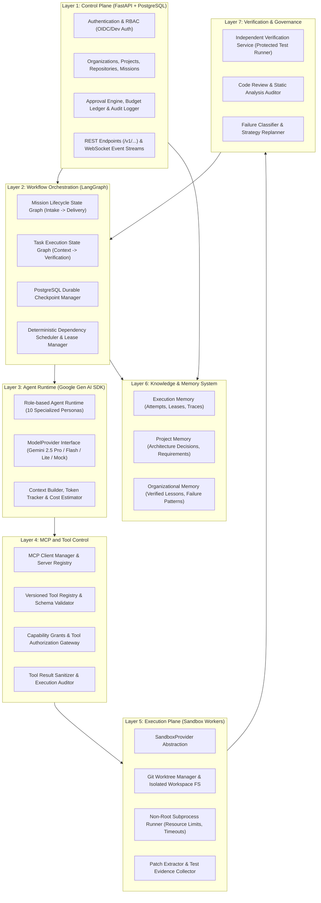

# SYNTRA System Architecture Overview

## 1. Executive Summary
**SYNTRA** is an enterprise-grade, autonomous multi-agent software engineering platform. It ingests high-level, human-formulated software engineering objectives and orchestrates specialized AI agents to autonomously analyze requirements, produce technical designs, compute dependency-aware execution graphs, write code, run isolated tests, perform independent reviews, and deliver verified project artifacts.

SYNTRA enforces a **backend-first, modular monolith architecture** paired with **isolated execution workers**, a **deterministic LangGraph state machine**, a **first-class Model Context Protocol (MCP) gateway**, a **versioned Skills system**, and a **hybrid autonomy governance model**.

---

## 2. Seven-Layer Architecture Model

---

## 3. Layer Descriptions & Responsibilities

### Layer 1: Control Plane
- **Tech Stack**: FastAPI, Pydantic v2, PostgreSQL (SQLAlchemy 2.x asyncpg).
- **Responsibilities**:
  - Central entry point for all API consumers, CLI clients, and external webhooks.
  - Organization, user identity, project, and mission lifecycle management.
  - Authoritative financial and token budget ledger with pre-execution reservations.
  - Cryptographically bound Human-in-the-Loop approvals (digest, actor, expiry).
  - Production-ready OIDC validation with restricted local development auth mode.

### Layer 2: Workflow Orchestration
- **Tech Stack**: LangGraph, PostgreSQL Checkpointing.
- **Responsibilities**:
  - Two-level workflow engine: **Mission Graph** (macro lifecycle) and **Task Execution Graph** (micro lifecycle).
  - Interrupts workflow execution for human authorization at critical risk checkpoints.
  - Deterministic DAG task scheduler enforcing dependency completion, leases, and concurrency limits.
  - Transactional task claiming with lease heartbeats and fencing tokens.

### Layer 3: Agent Runtime
- **Tech Stack**: Google Gen AI SDK (`google-genai`), Pydantic schema validation.
- **Responsibilities**:
  - Manages 10 specialized agent roles: Product Manager, Software Architect, Engineering Manager, Backend Engineer, Frontend Engineer (in-project), QA Engineer, DevOps Engineer, Security Reviewer, Code Reviewer, and Debugging Specialist.
  - Context construction and token budget budgeting per invocation.
  - Strict separation between reasoning, tool requests, tool executions, and state transitions.

### Layer 4: MCP and Tool Control
- **Tech Stack**: Official MCP Python SDK, SYNTRA Custom MCP Server.
- **Responsibilities**:
  - Manages stdio and streamable HTTP connections to approved MCP servers.
  - Enforces server-side capability policies; an agent or LLM can never authorize its own tool access.
  - Tool result sanitization and credential scrubbing before returning to context.

### Layer 5: Execution Plane
- **Tech Stack**: SandboxProvider interface, Git Worktrees, Subprocess isolation.
- **Responsibilities**:
  - Disposable execution environments isolated from the host OS and API server.
  - Repository checkouts, scoped file modifications, dependency installation inside sandboxes.
  - Resource quotas: CPU, memory, disk, network policies, and execution timeouts.
  - Unified patch artifact generation and test evidence collection.

### Layer 6: Knowledge & Memory System
- **Tech Stack**: PostgreSQL (SQLAlchemy 2.x), pgvector (when semantic search is enabled).
- **Responsibilities**:
  - **Execution Memory**: Ephemeral mission state, task attempts, and tool results.
  - **Project Memory**: Approved requirements, Architecture Decision Records (ADRs), schemas.
  - **Organizational Memory**: Verified reusable engineering approaches and failure patterns.

### Layer 7: Verification & Governance
- **Responsibilities**:
  - Independent verification: An agent cannot certify its own implementation.
  - Regression testing against protected benchmark suites.
  - Evidence-driven self-correction: failure classification, cause analysis, and bounded revision.
