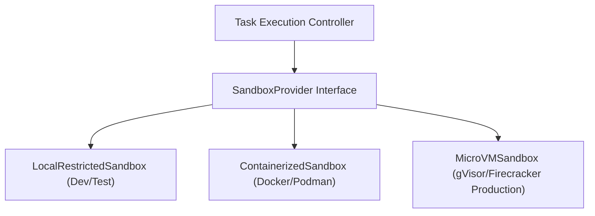
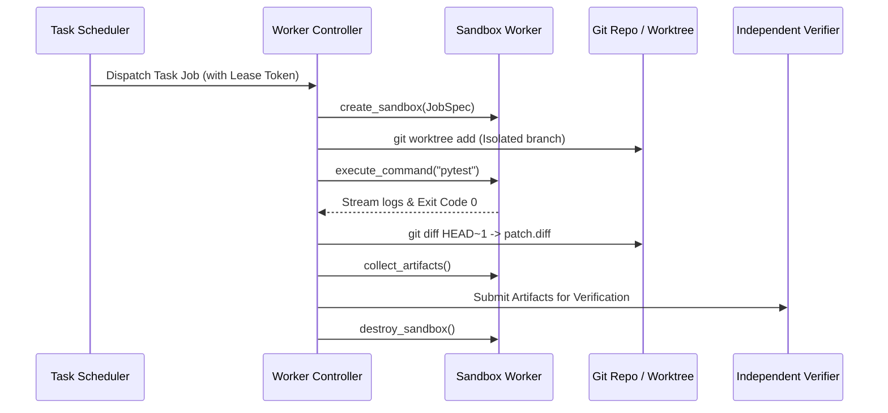

# SYNTRA Sandbox Worker & Execution Plane Design

## 1. Overview & Abstraction Philosophy
Agents perform real engineering work (compilation, package installation, test execution, file mutations) exclusively inside disposable, isolated sandbox workers.

To prevent vendor lock-in and enable environment-appropriate security tiers, SYNTRA introduces the **`SandboxProvider` abstraction**.



> [!WARNING]
> **Production Isolation Notice**: Ordinary Docker containers share the host Linux kernel and are **not** sufficient protection against arbitrary hostile code execution in multi-tenant production. The `SandboxProvider` architecture is engineered to plug into virtualization-level isolation (e.g. Firecracker MicroVMs or gVisor sandboxed runtimes) without modifying agent business logic.

---

## 2. SandboxProvider Interface Specification

```python
class SandboxProvider(abc.ABC):
    @abc.abstractmethod
    async def create_sandbox(self, job_spec: SandboxJobSpec) -> SandboxInstance:
        """Provision a disposable workspace with CPU, memory, and timeout quotas."""

    @abc.abstractmethod
    async def prepare_repository(self, sandbox_id: str, repo_url: str, base_commit: str) -> None:
        """Check out repository using isolated Git worktrees."""

    @abc.abstractmethod
    async def execute_command(self, sandbox_id: str, command: str, timeout: float) -> ExecutionResult:
        """Run a command inside the sandbox, streaming logs and enforcing quotas."""

    @abc.abstractmethod
    async def collect_artifacts(self, sandbox_id: str) -> list[ArtifactPayload]:
        """Extract unified git diff patches, test logs, and build outputs."""

    @abc.abstractmethod
    async def destroy_sandbox(self, sandbox_id: str) -> None:
        """Tear down and securely erase all sandbox storage and temporary processes."""
```

---

## 3. Sandbox Job Lifecycle



---

## 4. Execution Sandbox Security Controls
1. **Disposable Workspaces**: Each task attempt operates in its own newly provisioned worktree directory. Upon completion or failure, the directory is securely removed.
2. **Resource Constraints**:
   - Time limit: strict `timeout` parameter terminating hanging processes.
   - Buffer limit: stdout and stderr capped at 1MB to prevent out-of-memory crashes.
   - Non-root user: tasks execute with restricted permissions.
3. **Environment Sanitization**: Host secrets are stripped before execution.
4. **Verification Separation**: A successful exit code from the sandbox does not automatically mark a task as verified; verification is conducted independently by the QA and Verification Service.
