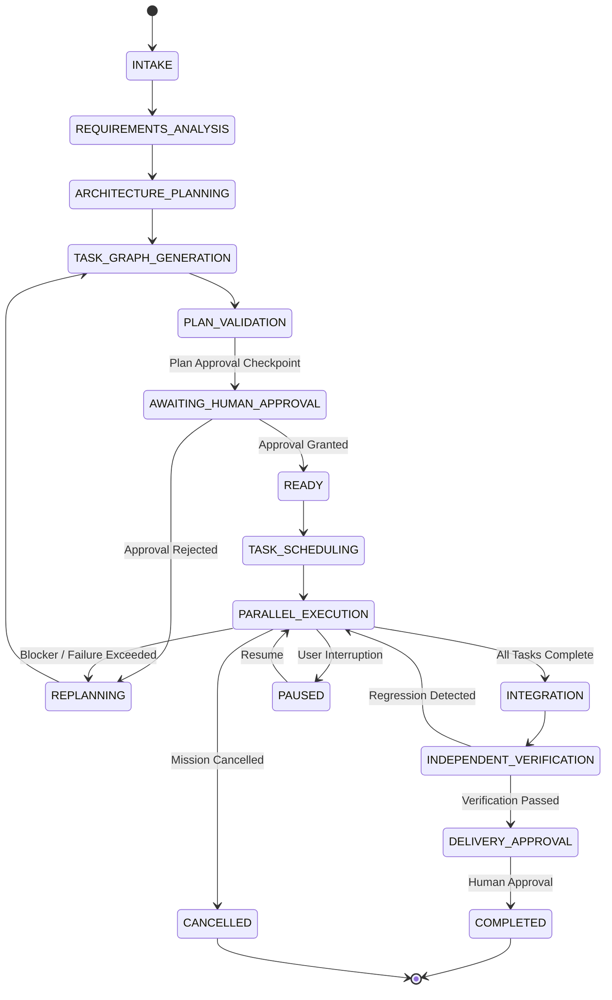
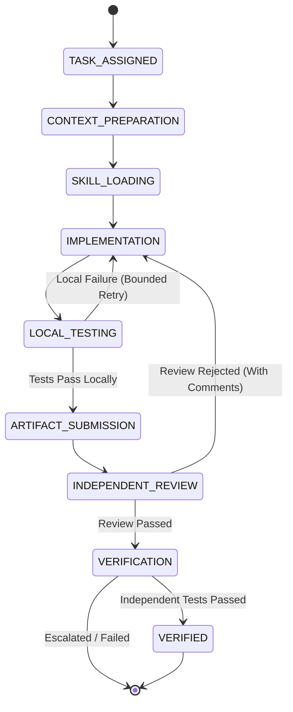

# SYNTRA LangGraph Workflow State Machine Design

## 1. Overview
SYNTRA uses **LangGraph** for durable workflow orchestration. Workflows are organized hierarchically into two decoupled state graphs:
1. **Mission Graph**: Governs the macro lifecycle from objective intake to final delivery approval.
2. **Task Execution Graph**: Governs the micro execution lifecycle for an individual task assigned to an agent.

All state transitions persist checkpoints in PostgreSQL, ensuring that crashes, restarts, or human approval delays never result in state loss.

---

## 2. Mission Graph (Macro Lifecycle)

---

## 3. Task Execution Graph (Micro Lifecycle)

---

## 4. Key Orchestration Invariants
1. **Durable Human Interrupts**: When entering `AWAITING_HUMAN_APPROVAL` or `DELIVERY_APPROVAL`, the graph execution halts cleanly and persists the state checkpoint. Execution resumes only when the approval decision record is committed.
2. **Idempotent Side Effects**: Nodes interacting with the filesystem, sandbox, or external Git repositories write idempotency tokens to avoid duplicate effects during retries.
3. **Mission Cancellation Semantics**: Cancelling a mission prevents new tasks from being scheduled, revokes active worker leases, and triggers sandbox cleanup.
