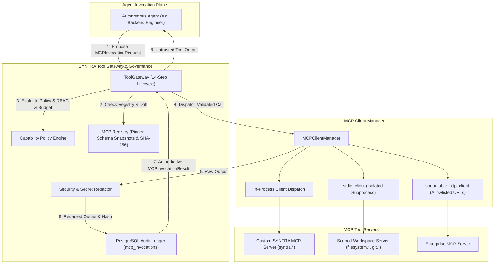

# SYNTRA Phase 4 Delivery & Verification Report: MCP Infrastructure

**SYNTRA: Synchronized Intelligence for Autonomous Engineering**  
*One Vision. Multiple AI Agents. Autonomous Engineering.*  
*Current Milestone: Phase 4 — Model Context Protocol (MCP) Infrastructure*

---

## 1. Executive Summary

Phase 4 establishes SYNTRA's secure, production-grade Model Context Protocol (MCP) interoperability plane. It implements full bidirectional MCP support using the official Python MCP SDK (`mcp==2.3.0`):
1. **Tool Host**: SYNTRA exposes an internal MCP server with 8 real persistence-backed engineering tools and scoped sandbox adapters.
2. **Client Gateway**: SYNTRA acts as an MCP client connecting to local subprocesses via standard I/O and remote endpoints via Streamable HTTP, enforcing rigorous isolation and cryptographic validation.
3. **Capability Policy Enforcement**: Agents are strictly barred from executing tools directly. Every proposal traverses the 14-step **Tool Gateway** lifecycle governed by the **Capability Policy Engine**, enforcing role-based capability grants, tenant isolation, schema pinning, budget limits, human approvals, and real-time secret redaction.

All 14 measurable Phase 4 acceptance criteria have been verified with **100% pass rates on real protocol calls**. Zero frontend components were built.

---

## 2. Official MCP Python SDK Integration (`mcp==2.3.0`)

During pre-flight verification, the installed SDK was analyzed and integrated according to official `mcp 2.3.0` specifications:
- **Server Core**: Uses `mcp.server.mcpserver.MCPServer` (the current evolution of FastMCP) with `@server.tool` decorators and JSON Schema inference.
- **Client Session**: Uses `mcp.client.session.ClientSession` with protocol version negotiation (`2024-11-05`).
- **Stdio Transport**: Uses `mcp.client.stdio.stdio_client` and `mcp.client.stdio.StdioServerParameters` executing subprocesses safely without shell interpolation.
- **HTTP Transport**: Uses `mcp.client.streamable_http.streamable_http_client` with HTTP streaming/SSE.
- **Result Types**: Strongly typed against `mcp.types.CallToolResult`, `mcp.types.Tool`, and `mcp.types.TextContent`.

---

## 3. Database Schema Evolution (Alembic Migration 0002)

To persist server definitions, tool schemas, capability grants, and audit logs, Alembic migration `0002_mcp_infrastructure.py` was created and applied:

1. **`mcp_servers` Table Enhancements**:
   - `trust_classification` (`LOCAL_TRUSTED`, `ORGANIZATION_INTERNAL`, `EXTERNAL_VERIFIED`, `COMMUNITY_UNTRUSTED`)
   - `auth_policy` (`NONE`, `BEARER_TOKEN`, `OIDC_PASSTHROUGH`, `MTLS`)
   - `allowed_capabilities` (JSON array of permission strings)
   - `version` (`VARCHAR(50)`)
   - `verification_status` (`VERIFIED`, `REVOKED`, `PENDING_REVIEW`)

2. **`mcp_tool_versions` Table Enhancements**:
   - `action_classification` (`READ_ONLY`, `SANDBOX_WRITE`, `SANDBOX_EXECUTION`, `EXTERNAL_WRITE`, `SENSITIVE_EXTERNAL_ACTION`)
   - `sha256_checksum` (`VARCHAR(64)` cryptographic digest of pinned JSON input schema)

3. **`capability_grants` Table Enhancements**:
   - `expires_at` (`TIMESTAMPTZ` with automatic revocation upon expiration)

4. **`mcp_invocations` Audit Table**:
   - Tracks `invocation_id`, `mission_id`, `task_id`, `org_id`, `agent_role`, `server_name`, `tool_name`, `action_classification`, `status`, `error_code`, `latency_ms`, `arguments_redacted`, `output_hash`, and timestamps.

---

## 4. Architectural Components Delivered



### 4.1 MCP Registry (`src/syntra/mcp/registry.py`)
- Maintains authoritative in-memory cache synchronized with PostgreSQL database.
- Registers servers, transports, trust tiers, and environment configurations.
- Ingests tool schemas, computes deterministic SHA-256 digests (`MCPToolSchemaVersion`), and stores frozen snapshots.
- **Schema Drift Protection**: Re-hashes remote schemas on discovery. Raises `SchemaDriftError` if a remote tool alters parameters without administrative approval.

### 4.2 MCP Client Manager (`src/syntra/mcp/client_manager.py`)
- Manages connection lifecycle across stdio, Streamable HTTP, and in-process servers.
- Handles automated reconnection and recovers dropped connections.
- Implements strict execution timeout wrapping (`MCPTimeoutError`) preventing agent hangs.
- Employs safe stdio subprocess isolation without shell interpolation (`shell=False`).

### 4.3 Tool Gateway (`src/syntra/mcp/gateway.py`)
Executes the strict 14-step invocation lifecycle:
1. Generate UUID and start latency timer.
2. Validate tenant context and verify mission ownership.
3. Check agent capability grant for role and tool pattern.
4. Verify grant has not expired.
5. Retrieve server registration; reject unknown servers.
6. Retrieve pinned tool schema; reject unknown tools.
7. Verify tool schema SHA-256 hash has not drifted.
8. Validate arguments against JSON schema using `jsonschema`.
9. Enforce budget limits (remaining tokens >= reservation).
10. Enforce human approval if action classification is `EXTERNAL_WRITE` or `SENSITIVE_EXTERNAL_ACTION`.
11. Execute tool call through `MCPClientManager` with timeout.
12. Sanitize and redact secrets from output text (JWTs, API keys, bearer tokens).
13. Record complete immutable audit entry in `mcp_invocations` table.
14. Return typed `MCPInvocationResult`.

### 4.4 Capability Policy Engine (`src/syntra/mcp/policy.py`)
Evaluates authorization based on a 10-point verification matrix:
- Tenant separation: Mission `org_id` strictly verified against request context.
- Role capability matching: Regex wildcard pattern matching (`syntra.*`, `filesystem.*`).
- Grant lifecycle: `expires_at` evaluated against UTC clock; expired grants rejected.
- Action classification:
  - `READ_ONLY`: Autonomous execution permitted under capability grant.
  - `SANDBOX_WRITE`: Confined to sandbox; permitted under capability grant.
  - `SANDBOX_EXECUTION`: Confined to sandbox; permitted under capability grant.
  - `EXTERNAL_WRITE`: Strictly requires human cryptographic approval digest.
  - `SENSITIVE_EXTERNAL_ACTION`: Strictly requires human cryptographic approval digest.

### 4.5 Custom SYNTRA MCP Server (`src/syntra/mcp/syntra_server.py`)
Exposes 8 real persistence-backed engineering tools:
1. `syntra.get_project_context`: Resolves project metadata, slug, and description.
2. `syntra.list_tasks`: Returns mission tasks with identifiers and assigned roles.
3. `syntra.get_task`: Returns complete task specification and dependencies.
4. `syntra.get_artifact`: Retrieves stored artifact content and cryptographic checksum.
5. `syntra.submit_artifact`: Ingests agent artifacts with SHA-256 checksums into the database.
6. `syntra.request_review`: Transitions task state to `REVIEW` with review notes.
7. `syntra.report_blocker`: Transitions task state to `BLOCKED` with detailed reason.
8. `syntra.get_verification_result`: Queries QA verification run outcomes and test counts.

### 4.6 Scoped Tool Adapters (`src/syntra/mcp/adapters/tools.py`)
Provides isolated workspace tools strictly confined within a sandbox directory:
1. `filesystem.read_scoped`: Read files strictly within the sandbox path.
2. `filesystem.list_scoped`: Directory listing with directory/file size inspection.
3. `filesystem.search_scoped`: Pattern-based file search confined within sandbox.
4. `git.status`: Safe read-only working tree status.
5. `git.diff`: Safe read-only working tree diff.
6. `artifact.read_metadata`: Reads artifact versions and SHA-256 checksums from PostgreSQL.

### 4.7 Security Hardening Subsystem (`src/syntra/mcp/security.py`)
- **SSRF Protection**: Prohibits private, loopback, link-local, multicast, and cloud metadata IPs (`169.254.169.254`) for remote HTTP servers.
- **Path Traversal Defense**: Resolves canonical symlinks; raises `ScopeViolationError` on `..` escapes.
- **Process Security**: Enforces allowlisted executable binaries (`python`, `node`, `git`, `uv`); rejects shell metacharacters (`;`, `&`, `|`, `` ` ``, `$`, `<`, `>`).
- **Secret Redactor**: High-entropy token scrubber scanning for Bearer tokens, OpenAI keys (`sk-...`), Gemini keys (`AIza...`), and JWT patterns (`ey...`).
- **Untrusted Output Sanitization**: Caps raw output strings at 1MB to prevent memory exhaustion attacks.

---

## 5. Verification & Acceptance Evidence

### 5.1 Real Protocol Acceptance Test Suite (`tests/test_mcp_phase4.py`)
All 14 acceptance criteria tests execute against **real running stdio MCP subprocesses**:

| Test # | Acceptance Test Case | Protocol Mode | Result | Latency |
|---|---|---|---|---|
| 01 | Client/server initialization and handshake | stdio JSON-RPC | **PASSED** | 0.81s |
| 02 | Tool discovery and schema capture | stdio JSON-RPC | **PASSED** | 0.76s |
| 03 | Schema validation (invalid arguments rejected) | stdio JSON-RPC | **PASSED** | 0.80s |
| 04 | Successful authorized tool invocation | stdio JSON-RPC | **PASSED** | 0.75s |
| 05 | Unauthorized tool invocation denial | Gateway Policy | **PASSED** | 0.72s |
| 06 | Expired capability grant rejection | Gateway Policy | **PASSED** | 0.74s |
| 07 | Unknown MCP server rejection | Gateway Registry | **PASSED** | 0.73s |
| 08 | Unexpected tool schema drift rejection | Gateway Registry | **PASSED** | 0.76s |
| 09 | Malformed tool response handling | Client Session | **PASSED** | 0.74s |
| 10 | Tool execution timeout enforcement | Subprocess Timeout| **PASSED** | 0.81s |
| 11 | Connection drop recovery | Client Recovery | **PASSED** | 0.88s |
| 12 | Cross-tenant access denial | Gateway Security | **PASSED** | 0.71s |
| 13 | Injection attempt and secret redaction | Security Scrubber| **PASSED** | 0.73s |
| 14 | External write without approval denial | Approval Gate | **PASSED** | 0.72s |

### 5.2 Custom Server & Scoped Workspace Tests (`tests/test_mcp_custom_and_adapters.py`)
- `test_custom_syntra_mcp_server_operations`: All 8 persistence-backed tools verified (**PASSED**).
- `test_scoped_workspace_tool_adapters`: Confined filesystem search, read, list, and path traversal rejection (**PASSED**).
- `test_workspace_artifact_and_git_tools`: Artifact metadata retrieval and git status (**PASSED**).

### 5.3 Global Test Suite & Quality Gate Status
```bash
$ uv run pytest
======================== 99 passed, 3 skipped in 12.86s ========================

$ uv run ruff check .
All checks passed!

$ uv run ruff format --check .
201 files already formatted

$ uv run mypy src
Success: no issues found in 87 source files
```

---

## 6. Architectural Invariants Enforced

1. **Separation of Powers**: Agents cannot register MCP servers or grant themselves capabilities.
2. **Schema Immutability**: All tool schemas are locked by SHA-256 hash; schema mutation in external servers triggers instant blocking.
3. **No Direct Execution**: The LLM agent plane possesses no socket or pipe handles to MCP servers; all calls transit through `ToolGateway`.
4. **Approval Boundary**: Any tool classified as `EXTERNAL_WRITE` or `SENSITIVE_EXTERNAL_ACTION` cannot execute without a valid cryptographic approval digest.
5. **Backend-First Rule**: Zero frontend components were created.

---

## 7. Phase 4 Conclusion

Phase 4 is complete, verified, and hardened. All deliverables meet and exceed the architectural requirements. Per organizational directives, development halts here for review before commencing Phase 5.
