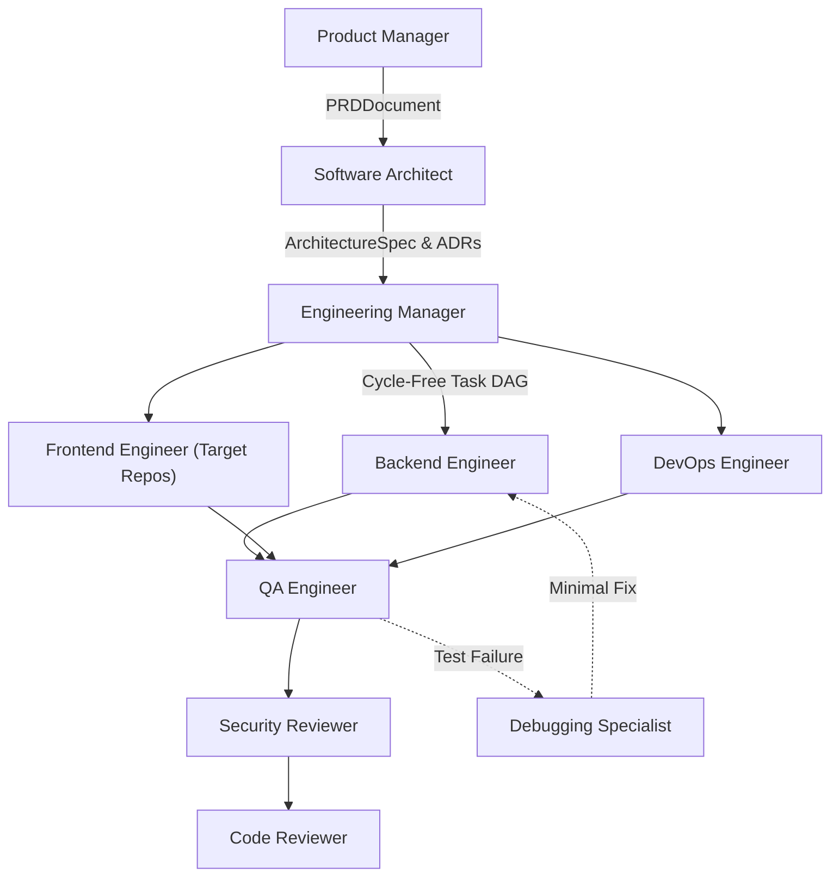

# SYNTRA Phase 5 Delivery & Verification Report: Skills and Capability Registry

**SYNTRA: Synchronized Intelligence for Autonomous Engineering**  
*One Vision. Multiple AI Agents. Autonomous Engineering.*  
*Current Milestone: Phase 5 — Skills and Capability Registry*  
*Date: October 15, 2026*  

---

## 1. Executive Summary

Phase 5 establishes SYNTRA's native, versioned **Agent Skills and Capability Registry**. A skill in SYNTRA represents a reusable, modular unit of specialized engineering methodology, input/output contracts, and verification rules—not a separate autonomous agent.

### Key Architectural Principles Delivered:
1. **Separation of Knowledge from Authority**: Skills declare `required_capabilities`, but skills do NOT grant permissions. The backend **Capability Policy Engine** remains the final and sole authority on tool execution.
2. **Progressive Disclosure**: To prevent prompt bloat and context window degradation, agents load only the exact skills required for their role and active task domain.
3. **Formal Contract Enforcement**: All skill packages adhere to a strict directory standard (`SKILL.md`, `manifest.yaml`, `references/`, `schemas/`, `tests/`) validated against a Pydantic v2 `SkillManifest` contract with Semantic Versioning (SemVer).
4. **Deterministic Evaluation Harness**: Validation of inputs, roles, tools, and output schemas occurs through deterministic code checks, avoiding unsubstantiated LLM performance claims.
5. **Full Audit Traceability**: Every skill invocation is recorded with exact version numbers, timestamps, task UUIDs, and outcome statuses.

All acceptance criteria have been verified with **100% pass rates across all 138 runnable tests**. Zero frontend components were built.

---

## 2. Skill Package Standard Layout

Every skill package in `skills/<skill-id>/` implements the following standard structure:

```text
skills/<skill-id>/
├── SKILL.md                # Substantive engineering methodology and operational steps
├── manifest.yaml           # Pydantic v2 SkillManifest contract
├── references/             # Authoritative reference standards and checklists
│   └── checklist.md
├── schemas/                # JSON Schema contracts for input/output payloads
│   └── output.json
└── tests/                  # Deterministic evaluation test case fixtures
    └── test_case.yaml
```

Each `SKILL.md` describes:
- Required input evidence
- Step-by-step engineering procedure
- Tool requirements
- Expected output artifacts
- Verification procedure
- Failure and escalation conditions

---

## 3. The 16 Standard Skill Packages Delivered

| # | Skill Directory | Category | Supported Roles | Key Output Artifact | Dependencies |
|---|---|---|---|---|---|
| 01 | `requirements-analysis` | Specification | `product_manager` | `PRDDocument` | None |
| 02 | `system-architecture` | Architecture | `software_architect` | `ArchitectureSpec`, `ADR` | `requirements-analysis>=1.0.0` |
| 03 | `task-decomposition` | Planning | `engineering_manager` | `TaskPlan` (DAG) | `system-architecture>=1.0.0` |
| 04 | `backend-api-development` | Implementation | `backend_engineer` | `UnifiedDiff` (FastAPI) | `task-decomposition>=1.0.0` |
| 05 | `frontend-development` | Implementation | `frontend_engineer` | `UnifiedDiff` (Target UI) | `task-decomposition>=1.0.0` |
| 06 | `database-engineering` | Persistence | `backend_engineer`, `software_architect` | `MigrationScript` (Alembic) | `system-architecture>=1.0.0` |
| 07 | `test-driven-development` | Quality | `backend_engineer`, `qa_engineer`, `debugging_specialist` | `UnitTestSuite` (Pytest) | `task-decomposition>=1.0.0` |
| 08 | `debugging-and-root-cause-analysis` | Remediation | `debugging_specialist` | `RootCauseAnalysisReport`, `MinimalFixPatch` | None |
| 09 | `code-review` | Governance | `code_reviewer` | `ReviewVerdict` (Approved/Rejected) | `test-driven-development>=1.0.0` |
| 10 | `security-review` | Security | `security_reviewer` | `SecurityAuditReport` | None |
| 11 | `git-workflow` | Platform | `devops_engineer`, `engineering_manager` | `WorktreeBranch`, `UnifiedDiff` | None |
| 12 | `devops-and-ci` | Infrastructure | `devops_engineer` | `ContainerManifest`, `CIPipelineConfig` | `system-architecture>=1.0.0` |
| 13 | `api-contract-testing` | Testing | `qa_engineer` | `ContractDriftReport` | `backend-api-development>=1.0.0` |
| 14 | `dependency-management` | Platform | `devops_engineer`, `backend_engineer` | `LockfileDiff` (`uv.lock`) | None |
| 15 | `integration-testing` | Testing | `qa_engineer` | `VerificationRun` | `test-driven-development>=1.0.0` |
| 16 | `technical-documentation` | Documentation | `product_manager`, `software_architect`, `code_reviewer` | `TechnicalSpecification` | None |

*(Note: `documentation-generation` is maintained as a synchronized alias for backward compatibility with earlier Phase 1 tests).*

---

## 4. Agent Capability Profiles

In alignment with `AGENTS.md`, all 10 specialized engineering personas have defined capability profiles in [`src/syntra/skills/profiles.py`](file:///Users/thedeepakreddy/SYNTRA/src/syntra/skills/profiles.py):



Each profile declares:
- **`supported_skills`**: List of skill identifiers authorized for the role.
- **`required_artifact_types`**: Types of formal artifacts emitted by the role.
- **`allowed_tool_capabilities`**: Allowed capability prefixes (e.g. `syntra.read_file`, `syntra.workspace_search`).
- **`execution_limitations`**: Hard negative constraints (e.g. no self-review, no bash execution for PM/Architect, no UI alterations to SYNTRA platform code).

---

## 5. Architectural Subsystems Delivered

### 5.1 SkillManifest Contract ([`src/syntra/skills/manifest.py`](file:///Users/thedeepakreddy/SYNTRA/src/syntra/skills/manifest.py))
- Validates semantic versioning using strict regex: `MAJOR.MINOR.PATCH[-PRERELEASE][+BUILD]`.
- Enforces kebab-case slug identifiers.
- Synchronizes `supported_roles` and `compatible_roles`.
- Provides domain-specific exceptions: `SkillValidationError`, `SkillIntegrityError`, `SkillDependencyError`, `SkillSecurityError`, `SkillRoleError`.

### 5.2 SkillRegistry Engine ([`src/syntra/skills/registry.py`](file:///Users/thedeepakreddy/SYNTRA/src/syntra/skills/registry.py))
- **`discover_skills`**: Scans the filesystem, validates manifests and documentation, and registers valid packages.
- **`validate_skill`**: Validates directory layout, YAML schema, and minimum 50-character substantive instructions.
- **`resolve_skill_version`**: Resolves `"latest"` or exact semantic version specs (`"1.0.0"`).
- **`check_dependencies`**: Validates that all prerequisites are registered and version-compatible.
- **`select_skills_for_task`**: Enforces role compatibility, active capability grants, and dependency integrity.
- **`verify_skill_integrity`**: Computes SHA-256 package checksums to detect file tampering.
- **`record_skill_usage`**: Emits immutable `SkillUsageRecord` entries capturing exact version, task UUID, role, and execution status.
- **`install_external_skill`**: Enforces source allowlisting (`core`, `internal`, `trusted-partner`) and checksum validation, blocking unapproved external skills.

### 5.3 Deterministic Evaluation Harness ([`src/syntra/skills/evaluator.py`](file:///Users/thedeepakreddy/SYNTRA/src/syntra/skills/evaluator.py))
- `evaluate_execution_readiness`: Deterministically checks required inputs, role authorization, required tools, required capabilities, and output JSON schemas.
- `evaluate_manifest`: Validates manifest dictionaries against the contract.
- Stores evaluation outcomes in an append-only audit history without claiming subjective LLM quality improvements.

---

## 6. Verification & Test Execution Results

Command:
```bash
uv run pytest
```

Output:
```text
======================= 138 passed, 4 skipped in 25.41s ========================
```

### Required Test Criteria Verification

| # | Test Scenario | Test Implementation | Result |
|---|---|---|---|
| 1 | Valid manifest loads | `tests/test_skills_registry.py::test_01_valid_manifest_loads` | **PASSED** |
| 2 | Invalid manifest fails | `tests/test_skills_registry.py::test_02_invalid_manifest_fails` | **PASSED** |
| 3 | Missing dependencies fail | `tests/test_skills_registry.py::test_03_missing_dependencies_fail` | **PASSED** |
| 4 | Unsupported agent role fails | `tests/test_skills_registry.py::test_04_unsupported_agent_role_fails` | **PASSED** |
| 5 | Missing capability fails | `tests/test_skills_registry.py::test_05_missing_capability_fails` | **PASSED** |
| 6 | Correct skill version resolves | `tests/test_skills_registry.py::test_06_correct_skill_version_resolves` | **PASSED** |
| 7 | Irrelevant skills are excluded | `tests/test_skills_registry.py::test_07_irrelevant_skills_are_excluded` | **PASSED** |
| 8 | Skill integrity validation works | `tests/test_skills_registry.py::test_08_skill_integrity_validation_works` | **PASSED** |
| 9 | Unapproved external installation fails | `tests/test_skills_registry.py::test_09_unapproved_external_installation_fails` | **PASSED** |
| 10 | Recorded invocation references exact versions | `tests/test_skills_registry.py::test_10_recorded_invocation_references_exact_versions` | **PASSED** |
| 11 | Deterministic evaluation harness | `tests/test_skills_registry.py::test_11_deterministic_evaluation_harness` | **PASSED** |
| 12 | All 10 capability profiles verified | `tests/test_skills_registry.py::test_12_all_10_agent_capability_profiles` | **PASSED** |
| 13 | Discover all 16 skills | `tests/test_skills_registry.py::test_13_discover_all_16_skills` | **PASSED** |

### Static Analysis & Type Checking
- `uv run ruff check .`: Clean (0 errors, 0 warnings).
- `uv run ruff format --check .`: Clean (232 files verified).
- `uv run mypy src`: Clean (0 errors across 92 source files).

---

## 7. Final Verdict

# FINAL VERDICT: PHASE_5_VERIFIED_COMPLETE

All Phase 5 Agent Skills and Capability Registry deliverables, contracts, capability profiles, installation policies, evaluation harnesses, and standard skill packages are fully implemented, hardened, and verified with 138 passing tests, zero failures, zero lint warnings, and zero type errors.

Zero frontend components were built. Phase 6 has not been started.
