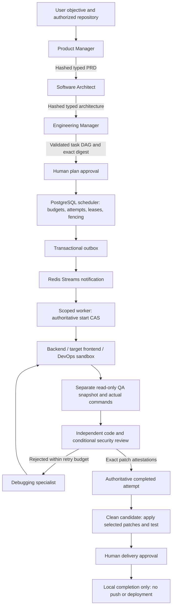

# Phase 10: Autonomous Engineering Organization

Date: 2026-10-15 (Europe/Budapest). Verdict: **PHASE_10_REQUIRES_WORK**.

The implementation exists. Authorized recovery restored existing image reads,
and fresh infrastructure/QA selections passed, but ext4 still reports a required
filesystem check. The full suite was interrupted and further work stopped.
See the [controlled recovery outcome](../testing/phase-10-controlled-recovery-2026-10-16.md).
Earlier successful runs are not a substitute for a passing final run. Live Gemini remains
UNVERIFIED because credentials are unavailable. See the [delivery report](../testing/phase-10-verification.md),
[independent audit](../testing/phase-10-independent-audit.md), and
[operator guide](../testing/phase-10-manual-testing.md).

## Architecture and authority

Phase 10 extends the existing model runtime, skills registry, mission graph,
PostgreSQL scheduler, Redis notifications, and Docker adapter. It does not add a
second scheduler or let model-generated status replace authoritative task state.

Planning can inspect an operator-authorized repository through a read-only,
network-isolated Docker snapshot. Only read/list/search declarations are exposed.
The CLI requires an explicit repository for start/advance/decide. Supplying only
repository context to the Python service remains supported, but is not proof of
repository inspection. The newly wired planning snapshot has policy/lifecycle
test coverage; its final live rerun is blocked by Docker's current I/O failure.

## Specialist contracts and master skills

All ten definitions use the canonical `AgentRole`, `AgentInvocation`,
`SpecialistAgent`, and existing `ModelRuntime`. These are executable policies
with role-specific contracts, not ten unrelated provider wrappers.

| Role | Primary skill | Master responsibilities | Validated output |
|---|---|---|---|
| Product Manager | requirements-analysis | Requirements, scope, ambiguity, Given-When-Then criteria | RequirementsAnalysis |
| Software Architect | system-architecture | Component contracts, persistence, security invariants, tradeoffs | ArchitectureProposal |
| Engineering Manager | task-decomposition | Atomic tasks, cycle-free DAG, ownership, estimates, verification | TaskPlanProposal |
| Backend Engineer | backend-api-development | Python/FastAPI, persistence, TDD, actual patch | AgentFinalResult plus captured diff |
| Frontend Engineer | frontend-development | Target-repository UI/client changes, accessibility, tests/build | AgentFinalResult plus captured diff |
| QA Engineer | integration-testing | Independent requirement-derived acceptance plan and negative cases | QAProposal plus actual command evidence |
| DevOps Engineer | devops-and-ci | Container/CI configuration, reproducibility, rollback boundaries | AgentFinalResult plus captured diff |
| Code Reviewer | code-review | Scope, compatibility, coverage and blocking findings | CodeReviewProposal |
| Security Reviewer | security-review | Threats, injection, authorization, secret/dependency risks | SecurityReport |
| Debugging Specialist | debugging-and-root-cause-analysis | Failure evidence, root cause, surgical correction and regression | FailureAnalysis |

Registration intersects the existing capability profile with each skill
manifest's supported roles. Missing, incompatible, or unapproved skills fail
before model invocation. Progressive context includes skill/prompt versions.
The registry also validates schemas, model configuration, and positive limits.

## Capabilities actually exposed

| Execution context | Exposed operations | Hard boundary |
|---|---|---|
| PM / Architect / Manager planning snapshots | read_file, list_directory, workspace_search | Read-only mount; no model shell or source writes |
| Backend / target frontend / DevOps implementation | Granted subset of read_file, write_file, workspace_search, run_command, git_diff | Assigned organization/project, active lease, isolated worktree/container |
| QA in engineering review loop | Structured acceptance proposal; runner executes proposed plus operator commands | Coding container paused; independent read-only review container |
| Code/Security review in engineering loop | Structured review of complete bounded patch and actual evidence | No implementation tools; distinct role and invocation |
| Debugging in engineering loop | Structured diagnosis from actual failure/review evidence | Cannot approve the implementation; bounded rework |

These are narrower than the complete Phase 5 capability profiles. For example,
profile entries such as `security_scan`, `artifact_write`, and `validate_dag` are
not magically model tools here: trusted code persists artifacts and validates
DAGs; a full deterministic security-scanner service is not implemented in this
phase. `workspace_search` currently lists bounded directory entries rather than
providing a full-text search index.

The in-process MCP server still passes through `MCPClientManager`, `ToolGateway`,
and `CapabilityPolicyEngine`. Each call reloads database grants and checks the
bound organization, mission, task, role, deadline, budget, and lease guard.
Model file operations run through isolated Python inside the container, not a
host filesystem adapter. Host-side Git/worktree management remains trusted
infrastructure; model-generated shell commands never run on the host.

## Handoffs, approvals, and recovery

`ArtifactHandoff` pins organization, mission, producer/consumer, invocation,
task, plan version, artifact version, and SHA-256. `RoleArtifact` carries typed
output. Consumers recheck ownership, active plan version, byte size, checksum,
and producer contract. Small bodies are durably stored in the existing
PostgreSQL artifact-version locator as base64 inline content, capped at 1 MiB.
This is actual persistence, not an invented UUID or missing file path.

Planning invocation IDs are deterministic per mission/version/role. Completed
replays reuse validated artifacts without a second model call. An interrupted
claim without a completed artifact fails closed instead of silently duplicating
spend; operator recovery of such claims remains a limitation.

Plan approval binds the task DAG, execution specifications and estimates to the
exact digest. Delivery approval binds the candidate manifest digest. The
operational engine requires an active human organization admin/owner, not a
service account. Approvals are single-use. Every transition rechecks locked
database state, including replayed same-state transitions, so cancelled missions
cannot be resurrected by checkpoint state. Rejected plans advance the
authoritative version and rebuild the immutable PM → Architect → Manager chain.

The scheduler owns reservations, attempts and fencing. Redis only wakes workers.
The consumer checks repository scope before claiming; only an INITIALIZING
attempt can start. Heartbeats and before-effect guards stop revoked execution.
Expired dispatches are reconciled and replacement dispatches persisted before
the old notification is acknowledged. The scoped CLI loop also reconciles
without depending on Redis retaining a notification. Cancellation sweeps revisit
already-cancelled tasks to settle disappeared workers after lease expiry.

## Real coding, review, and integration

The worker runs baseline commands, uses bounded tools to inspect/edit/test,
captures the actual Git diff and base commit, and compares any model-supplied
diff against it. QA derives its own proposal; actual commands run in a separate
read-only snapshot while the coding container is paused. Code review and
conditional security review use distinct invocations. Debugging returns a
diagnosis to the implementer; the default is one rework, with a maximum of three.
Repeated failure fingerprints and exhausted budgets stop the loop.

Review attestations bind author/reviewer invocation IDs and roles to the exact
patch hash and task attempt. Completion and integration validate persisted typed
attestations; a dictionary saying `QA: PASS` cannot certify a patch. High/critical
security findings or blocking code review reject acceptance. Review context
over 20,000 characters fails closed instead of silently dropping patch content.

Integration selects only active-plan COMPLETED tasks with latest SUCCEEDED
attempts and valid review evidence. Failed-attempt patches are excluded. Patches
must share a base commit; multiple patches require an authorized integration
repository, clean application, and actual verification commands. Conflicting
patches block delivery. This is a Phase 10 gate, not Phase 12's complete verifier.

## Runtime, accounting, and limits

Defaults: 12 model turns, 30 tool calls, 120-second specialist deadline,
100,000 tokens and USD 0.25 per specialist ceiling; worker deadline 300 seconds;
individual verification command limit 30 seconds. Shared task metering prevents
review/debugging from receiving a fresh unlimited budget. Operational command
output is bounded to 4 KiB. Failed and cancelled calls retain measured usage;
unknown billable usage is conservatively classified, not reported as free.
Negative worker usage is schema-invalid. Settlement is idempotent per attempt;
abandoned started attempts conservatively consume the reservation, while
not-started attempts release it.

The existing Gemini provider and ModelRouter are reused. Runtime requests cap
output from remaining tokens/cost and disable ambiguous provider retries.
Thinking tokens count as output. Configured standard text prices were corrected
against [Google's official pricing](https://ai.google.dev/gemini-api/docs/pricing):
Flash USD 0.30/2.50 and Pro USD 1.25/10.00 input/output per million tokens, with
Pro's configured long-context tier USD 2.50/15.00 above 200,000 input tokens.
Costs remain estimates from usage, not reconciled provider invoices.

## Verification boundaries and remaining work

- Ten-role contracts, skill policies, cancellation, provenance, review separation,
  budget accounting and audit regressions have deterministic test coverage.
- Historical real PostgreSQL/Redis/Docker missions produced actual patches and
  tests using scripted model decisions. That is **MOCK_VERIFIED** autonomy evidence.
- Current Docker image-store I/O errors prevent a clean final infrastructure run.
  Do not skip those failures to obtain a green release report.
- Newly added read-only planning container integration needs a successful live
  rerun after Docker repair; simulated-container checks are not equivalent.
- Real Gemini calls, autonomous arbitrary-bug success, and live provider costs
  remain **BLOCKED_BY_DEPENDENCY / UNVERIFIED** without credentials.
- Real Node/React/Next.js frontend builds and DevOps image builds were not
  exercised. The local Python acceptance image has no Node toolchain or Docker
  socket. Network isolation must not be relaxed to hide missing dependencies.
- Artifact bodies over 1 MiB require an object-store path not completed here.
  Dependent implementation tasks do not yet automatically preload predecessor
  patches into their worker snapshots; this limits general multi-task missions.
- Model security analysis and redaction are not a complete dependency-CVE audit,
  formal proof, or protection from every prompt-injection strategy.

No SYNTRA frontend, production deployment, remote repository, or GitHub push was
created by this work. Phases 11–13 remain out of scope and require explicit
authorization. The next action is Phase 10 repair and re-verification, not Phase 11.
