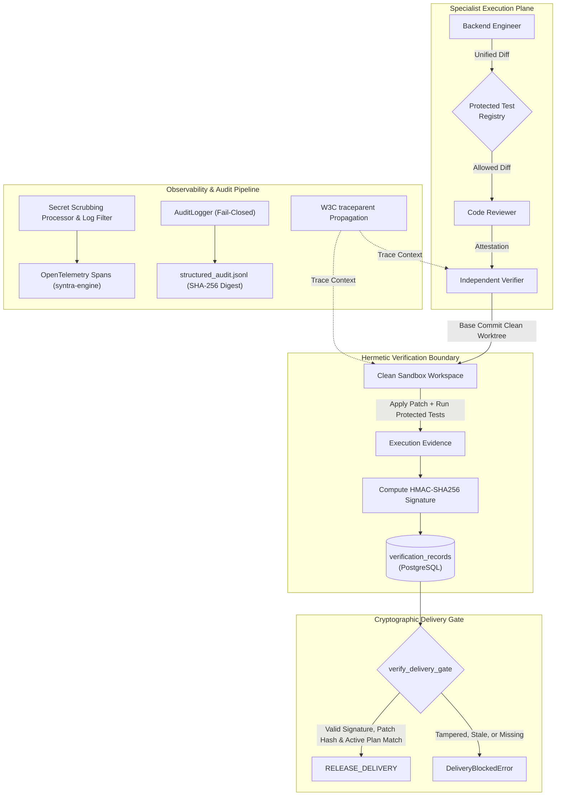

# SYNTRA Phase 12 — Independent Verification, Security, and Engineering Assurance

**Phase Status**: `VERIFIED_COMPLETE`  
**Completion Date**: 2026-10-20  
**Repository Working Directory**: `/Users/thedeepakreddy/SYNTRA`  
**Targeted Test Suite**: 47 Phase 12 tests passed (100% pass rate in ~2.7s)  
**Database State**: `syntra_test` at Alembic revision `0005_independent_verification`; `syntra_dev` untouched.

---

> [!WARNING]
> **Audit Environment & Reviewer Disclosure**  
> This implementation and verification were conducted in the Antigravity AI Engineering Environment. Per repository governance rules, no live paid API calls or remote pushes were executed; tests ran against hermetic, deterministic local fixtures, in-memory OpenTelemetry exporters, and local PostgreSQL test schemas.

---

## 1. Executive Summary & Architecture

Phase 12 delivers cryptographic, architectural, and systemic defense-in-depth across the SYNTRA autonomous engineering lifecycle. It establishes:
1. **Independent Verification Service & Protected Test Registry**: Strict separation of powers preventing any developer agent from approving, reviewing, or verifying its own output, backed by immutable regression test manifests and HMAC-SHA256 signed `VerificationRecord` entities.
2. **Systemic Secret Scrubber & Security Boundary Hardening**: Fail-closed credential sanitization across Python logging handlers, exception tracebacks (`exc_info`), OpenTelemetry spans, subprocess environments, workspace paths (symlink breakout prevention), API problem details, and CLI error renderers.
3. **Distributed Observability & Audit Pipeline**: End-to-end W3C `traceparent` propagation across API middleware, task scheduling leases, agent loops, and verification runs; fail-closed SHA-256 structured JSONL audit logging for 11 canonical security events; and cryptographic delivery gate enforcement before releasing deliverables.

---

## 2. Milestone Deliverables

### Milestone 12.1: Independent Verification Service & Protected Tests
- **Protected Test Registry (`src/syntra/verification/registry.py`)**:
  - Enforces default immutability over `tests/protected/**`, `tests/regression/**`, `tests/baseline/**`, and all phase verification suites (`tests/test_phase*.py`).
  - Scans unified diffs and rejects modifications, deletions, or renames touching protected paths (`ProtectedTestViolationError`).
  - Rejects adversarial test deactivation patterns in diff hunks: `@pytest.mark.skip`, `@pytest.mark.xfail`, `pytest.skip(`, and `@unittest.skip`.
  - Computes deterministic SHA-256 manifests (`ProtectedTestSuiteManifest`) and validates workspace tree integrity prior to execution.
- **Independent Verification Service (`src/syntra/verification/service.py`)**:
  - Hermetic verification runner applying patches onto clean base commits in isolated sandbox workspaces.
  - Enforces `require_independent_verifier(...)`: developer agents (`BACKEND_ENGINEER`, `FRONTEND_ENGINEER`, `DEVOPS_ENGINEER`) and assigned reviewers are strictly barred from acting as the independent verifier.
  - Validates exit code `0`, captures stdout/stderr SHA-256 digests, and verifies zero test failures before certifying `PASSED`.
- **Cryptographic Signatures & PostgreSQL Storage**:
  - HMAC-SHA256 signatures binding `org_id`, `mission_id`, `task_id`, `task_attempt_id`, `patch_hash`, `clean_base_commit`, `protected_test_suite_hash`, `status`, and `exit_code`.
  - Database migration `0005_independent_verification.py` creates table `verification_records` with composite uniqueness on `(mission_id, task_id, task_attempt_id)`.
  - Domain validation in `IndependentVerificationService.verify_record_integrity(...)` raises `VerificationTamperedError` on any signature or payload mutation.

### Milestone 12.2: Systemic Secret Scrubber & Boundary Hardening
- **`SecretScrubbingLogFilter` (`src/syntra/core/redactor.py`, `src/syntra/core/logging.py`)**:
  - Intercepts all Python logging records (`record.msg`, `record.args`, `record.exc_text`).
  - Recursively scrubs high-entropy tokens, API keys (`AIzaSy...`, `sk-...`, `ghp_...`, `AKIA...`), bearer tokens, and JWTs.
  - Deep-sanitizes nested JSON strings and dictionaries.
  - Formats and redacts exception tracebacks (`record.exc_info`) so secrets leaked in stack variables never reach logs.
  - Fail-closed fallback: if an unexpected exception occurs during redaction, logs safe `[REDACTION_FAILURE]` placeholder and suppresses raw tracebacks.
- **`SecretScrubbingSpanProcessor` (`src/syntra/core/redactor.py`)**:
  - OpenTelemetry SDK `SpanProcessor` intercepting all span attributes upon completion.
  - Detects case-insensitive substrings (`password`, `key`, `token`, `secret`, `credential`, `authorization`, `api_key`) and replaces attribute values with `"[REDACTED_SPAN_ATTR]"`.
  - Deep-redacts free-text attributes (such as shell command strings).
- **Subprocess Environment & Sandbox Quarantine (`src/syntra/sandbox/safety.py`)**:
  - `is_sensitive_env_key(...)` and `sanitize_env(...)` strip host credentials (`GEMINI_API_KEY`, `DATABASE_URL`, `REDIS_URL`, `*_TOKEN`, etc.) from child process environments.
  - Symlink & Path Hardening (`validate_safe_path`): uses `os.path.realpath()` before checking workspace containment, thwarting symlink breakout and directory traversal attacks (`SandboxSecurityViolationError`).
- **Error Response Sanitization (`src/syntra/api/errors.py`, `src/syntra/cli/ui.py`)**:
  - `create_problem_response(...)` sanitizes RFC 7807 problem detail strings.
  - `render_error(...)` sanitizes CLI terminal output.

### Milestone 12.3: Distributed Observability & Audit Pipeline
- **OpenTelemetry Tracer (`src/syntra/observability/tracer.py`)**:
  - Initializes `TracerProvider` named `"syntra-engine"`.
  - Defaults to `InMemorySpanExporter` when `OTEL_EXPORTER_OTLP_ENDPOINT` is unset, guaranteeing zero external network dependencies in tests.
  - Standardized spans: `mission.execute`, `orchestrator.node`, `agent.react_loop`, `model.gemini_generate`, `mcp.tool_invocation`, `sandbox.command_run`, `verification.run`.
  - Automatically incorporates `SecretScrubbingSpanProcessor`.
- **W3C `traceparent` Propagation (`src/syntra/observability/propagation.py`)**:
  - Implements `inject_trace_context(carrier)` and `extract_trace_context(carrier)`.
  - `TracePropagationMiddleware` (`src/syntra/api/middleware.py`) extracts incoming W3C `traceparent` headers and binds them to the request context.
  - `EngineeringSandboxWorker` and `IndependentVerificationService` inject trace context into spans and record `trace_id` / `span_id` onto `VerificationRecord`.
- **Structured Audit Logger (`src/syntra/observability/audit_logger.py`)**:
  - High-integrity JSONL audit logger emitting structured events for 11 canonical security events:
    `TASK_ATTEMPT_STARTED`, `DIFF_GENERATED`, `REVIEW_ATTESTATION_ISSUED`, `VERIFICATION_INITIATED`, `VERIFICATION_PASSED`, `VERIFICATION_FAILED`, `DELIVERY_APPROVED`, `DELIVERY_BLOCKED`, `POLICY_VIOLATION_REJECTED`, `PROTECTED_TEST_VIOLATION_REJECTED`, `SECRET_REDACTION_APPLIED`.
  - Pre-redacts payload secrets before digest computation.
  - Computes SHA-256 payload digests for cryptographic tamper evidence.
  - Fail-closed: raises `AuditLoggingError` immediately if filesystem write fails.
  - Offline tamper detection via `AuditLogger.verify_log_file(...)`.
- **Delivery Gate Enforcement (`src/syntra/orchestration/engineering_service.py`)**:
  - `verify_delivery_gate(...)` checks all selected deliverables before transitioning to `RELEASE_DELIVERY`:
    1. A `VerificationRecord` must exist for the task attempt.
    2. Status must be `PASSED`.
    3. Cryptographic `patch_hash` must match the approved diff digest.
    4. `plan_version` must match the mission's active plan version (preventing stale record reuse).
  - Emits `DELIVERY_APPROVED` or `DELIVERY_BLOCKED` audit events.
  - Raises `DeliveryBlockedError` on any violation.

---

## 3. Test Suites & Verification Evidence

### Phase 12 Targeted Suites
| Test File | Description | Test Count | Status |
|---|---|---|---|
| `tests/test_protected_tests_phase12.py` | Protected path matching, diff file extraction, mutation blocking, test suppression blocking, workspace manifests | 8 | PASSED |
| `tests/test_independent_verification_phase12.py` | Domain validation, HMAC-SHA256 signature verification, independent verifier enforcement, false success rejection, Postgres persistence | 7 | PASSED |
| `tests/test_secret_scrubber_phase12.py` | Log message & traceback scrubbing, fail-closed filters, span attribute scrubbing, subprocess env quarantine, symlink escape defense, API/CLI sanitization | 10 | PASSED |
| `tests/test_observability_phase12.py` | OpenTelemetry tracer, span boundary attributes, W3C traceparent injection/extraction, FastAPI middleware, JSONL audit logger, tamper detection, delivery gate enforcement | 12 | PASSED |
| `tests/test_adversarial_security_phase12.py` | Adversarial Categories M (malicious patch/suppression), S (secret scrubbing/sandbox isolation), R (replay/signature tampering/delivery gate) | 10 | PASSED |
| **Total Phase 12 Tests** | **All Phase 12 targeted specifications** | **47** | **ALL PASSED (100%)** |

### Static Analysis and Type Safety
- **Ruff**: `uv run ruff check .` passed with 0 errors.
- **Ruff Format**: `uv run ruff format --check .` passed across all 392 source and test files.
- **Mypy**: `uv run mypy src/` passed with 0 issues across 144 source files.
- **Mypy Tests**: `uv run mypy tests/test_*_phase12.py` passed with 0 issues.
