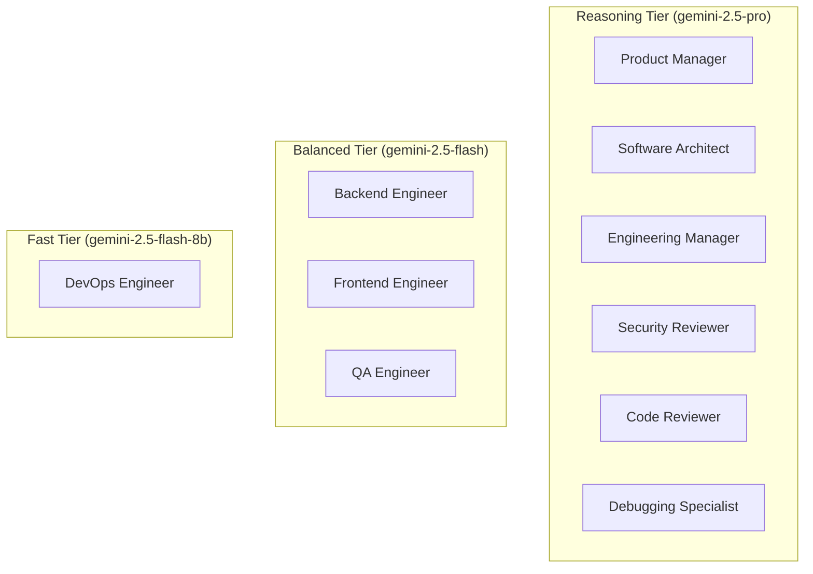

# SYNTRA Phase 14: Model Routing & Decision Traceability Architecture

**SYNTRA: Synchronized Intelligence for Autonomous Engineering**  
*Document Version: 1.0.0 | Date: October 20, 2026*  
*Classification: Architectural Specification & Policy Document*

---

## 1. Executive Summary

Autonomous software engineering organizations require diverse cognitive capabilities across the software development lifecycle. In SYNTRA, tasks range from broad architectural decomposition to granular syntax formatting and regex scrubbing. Assigning a top-tier reasoning model to mundane linting produces unjustified financial expenditure, while assigning a low-latency lightweight model to complex architectural trade-offs risks structural architectural debt.

SYNTRA Phase 14 establishes a transparent, policy-governed **Model Routing and Decision Traceability Engine** that:
1. Dynamically maps engineering personas and task specifications to cognitive performance tiers (`reasoning`, `balanced`, `fast`).
2. Provides a live, interactive simulator in the Control Center UI allowing operators to preview and trace routing decisions.
3. Maintains strict financial governance and fallback handling.
4. Upholds the zero-cost testing invariant ($0.00 spent on external paid Gemini calls during development and automated evaluation).

---

## 2. Model Routing Tiers & Specification Catalog

SYNTRA standardizes model categorization into three canonical tiers:

| Tier | Canonical Model ID | Family | Context Window | Input Cost / 1M | Output Cost / 1M | Primary Architectural Purpose |
| :--- | :--- | :--- | :--- | :--- | :--- | :--- |
| **Reasoning** | `gemini-2.5-pro` | Gemini | 1,000,000 | \$1.25 | \$5.00 | Deep architectural planning, PRD authoring, security reviews, DAG decomposition, root-cause debugging. |
| **Balanced** | `gemini-2.5-flash` | Gemini | 1,000,000 | \$0.075 | \$0.30 | Implementation coding, TDD unit test authoring, acceptance test execution, code review comments. |
| **Fast** | `gemini-2.5-flash-8b` | Gemini | 1,000,000 | \$0.0375 | \$0.15 | CI/CD container configuration, log triage, telemetry attribute tagging, syntax scrubbing. |

### 2.1 Backend Contract Schemas

Model routing metadata is exposed via strictly typed FastAPI v1 endpoints:
- `GET /v1/models`: Returns list of all active registered models (`ModelSpec`).
- `GET /v1/models/routing`: Returns the active routing policy configuration (`ModelRoutingPolicy`).
- `POST /v1/models/routing/simulate`: Evaluates a prospective task and returns resolved model, tier, estimated cost tier, and human-readable rationale (`ModelRoutingSimulationResponse`).

---

## 3. Role-to-Tier Policy Mapping

In accordance with `AGENTS.md`, SYNTRA enforces the following default tier assignments across the 10 engineering personas:

### Policy Rules:
1. **Critical Path Roles (Reasoning)**: Product Manager, Software Architect, Engineering Manager, Security Reviewer, Code Reviewer, and Debugging Specialist default to the `reasoning` tier because defects at these stages compound exponentially.
2. **Implementation & Test Roles (Balanced)**: Backend Engineer, Frontend Engineer, and QA Engineer default to the `balanced` tier, optimizing throughput and cost during iterative TDD and test runs.
3. **Infrastructure Automation Roles (Fast)**: DevOps Engineer defaults to `fast` for deterministic template rendering and script authoring.
4. **Explicit Overrides**: If a task or tenant configuration explicitly requests a specific model ID (e.g., custom fine-tuned evaluation model), the router assigns tier `EXPLICIT` while logging the override in the audit trail.

---

## 4. Decision Traceability & Telemetry

Every routing decision made by the orchestrator is recorded with full provenance:
1. **OpenTelemetry Span Attributes**:
   - `model.assigned_tier`: string (`reasoning` | `balanced` | `fast` | `EXPLICIT`)
   - `model.resolved_id`: string
   - `model.routing_rationale`: string
   - `model.estimated_cost_tier`: string
2. **Audit Trail**: Stored durably in the PostgreSQL audit log and queryable via `GET /v1/audit`.
3. **Secret Scrubbing**: All model prompts and completion tokens pass through the fail-closed `SecretScrubbingLogFilter` and `SecretScrubbingSpanProcessor` to guarantee zero credential leakage.

---

## 5. Control Center Operational UX

The Control Center UI (`frontend/src/pages/ModelRoutingPage.tsx`) provides:
- **Interactive Simulator**: An operator can select any of the 10 agent roles, enter task classification tags, and optionally supply model overrides. Submitting immediately evaluates the live backend routing policy and displays the resolved model, tier, and rationale.
- **Model Catalog Table**: Displays context window sizes, family, active default indicators, and pricing per 1M tokens.
- **Policy Mapping Grid**: High-contrast, color-coded badges mapping every role to its default tier.
