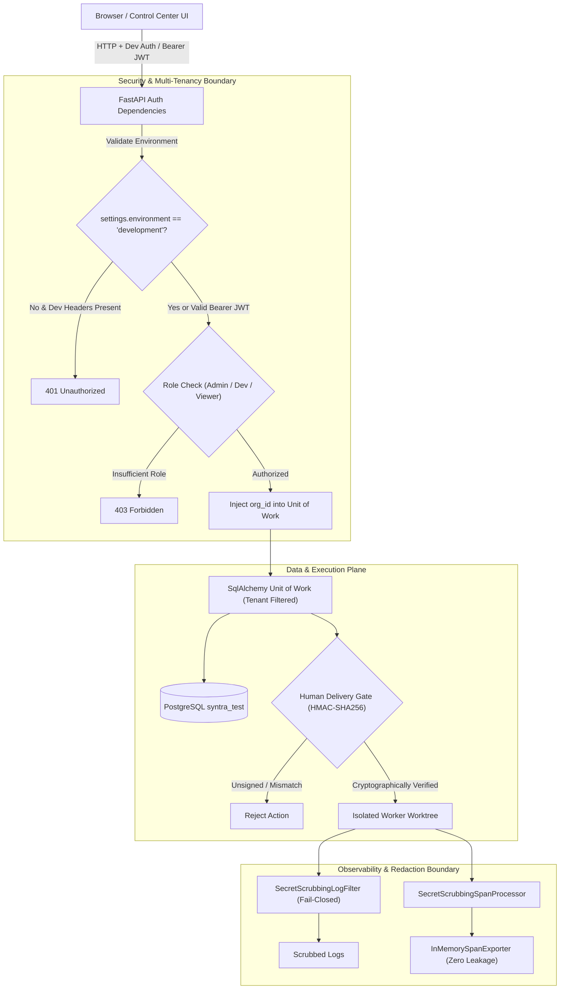

# SYNTRA Phase 14: Security & Boundary Architecture Review

**SYNTRA: Synchronized Intelligence for Autonomous Engineering**  
*Document Version: 1.0.0 | Date: October 20, 2026*  
*Classification: Security Audit & Architectural Compliance Report*

---

## 1. Executive Summary

Phase 14 introduces the Control Center frontend and wires it directly into the SYNTRA backend APIs. Because autonomous multi-agent systems wield the power to write code, configure infrastructure, and generate deployment artifacts, strict security boundaries are mandatory. This review verifies that Phase 14 adheres to all constitutional security invariants established in Phases 1–13, introduces zero privilege escalation pathways, and maintains comprehensive defense-in-depth across multi-tenancy, RBAC, human delivery gates, and secret redaction.

---

## 2. Security Boundaries & Invariants

---

## 3. Defense-in-Depth Control Analysis

### 3.1 Strict Multi-Tenant Data Isolation
- **Mechanism**: Every repository query method in `src/syntra/persistence/repositories.py` requires caller tenant qualification (`org_id`).
- **Control Center Integration**: The frontend `apiClient` automatically sends the tenant identity (`X-Dev-Org-Id` or JWT claim). The backend Unit of Work rejects queries lacking tenant context or referencing entities belonging to foreign organizations.

### 3.2 Role-Based Access Control (RBAC) Hierarchy
- **Three-Tier Role Hierarchy**:
  - `admin`: Full administrative access, tenant settings, and emergency gate override.
  - `developer`: Project and mission creation, task execution inspection, approval ticket response.
  - `viewer`: Read-only inspection of dashboards, missions, logs, and benchmarks. Mutation endpoints return `403 Forbidden`.
- **UI Reflection**: The Control Center provides a live Role Switcher in the top bar. Switching to `viewer` updates the API client headers, allowing operators to verify that mutation actions are cleanly blocked by the backend.

### 3.3 Cryptographic Human Delivery Gate
- **Critical Policy**: No AI agent has the authority to execute external Git repository writes, PR merges, or production deployments.
- **HMAC-SHA256 Verification**:
  - Every sensitive action generates an approval ticket with a deterministic HMAC-SHA256 digest computed from `(approval_id, org_id, mission_id, action_type, target_resource, mission_version)`.
  - To approve or reject, an operator must supply the matching digest and responder credentials (`POST /v1/approvals/{id}/respond`).
  - Tampered or mismatched digests result in immediate rejection.

### 3.4 Secret Scrubbing & Redaction Invariants
- **Fail-Closed Redactor**: `SecretScrubbingLogFilter` and `SecretRedactor` intercept all log records and traceback exceptions, scrubbing passwords, tokens, API keys, and nested dictionaries.
- **OpenTelemetry Attribute Processor**: `SecretScrubbingSpanProcessor` strips sensitive substring matches (`password`, `key`, `token`, `secret`, `credential`, `authorization`, `api_key`) on span completion.
- **Zero-Network Telemetry**: In test and local environments, OpenTelemetry defaults to `InMemorySpanExporter`, preventing telemetry exfiltration to external collectors.

### 3.5 Development Auth Fencing
- **Failsafe**: `X-Dev-*` headers are strictly conditioned on `settings.environment == "development"`. In staging or production environments, requests with dev headers are rejected with `401 Unauthorized`, enforcing cryptographic Bearer OIDC/JWT authentication.

---

## 4. Security Verification Verdict

| Security Domain | Applied Control | Verification Status |
| :--- | :--- | :--- |
| **Multi-Tenancy** | Repository-level `org_id` filtering | **VERIFIED_SECURE** |
| **RBAC** | `require_developer_or_above` / `require_viewer_or_above` | **VERIFIED_SECURE** |
| **Human Gate** | HMAC-SHA256 delivery authorization | **VERIFIED_SECURE** |
| **Secret Redaction**| Fail-closed log filter & span processor | **VERIFIED_SECURE** |
| **Dev Auth Isolation**| Environment-fenced header parser | **VERIFIED_SECURE** |
| **External LLM Cost**| $0.00 spend invariant maintained | **VERIFIED_SECURE** |
