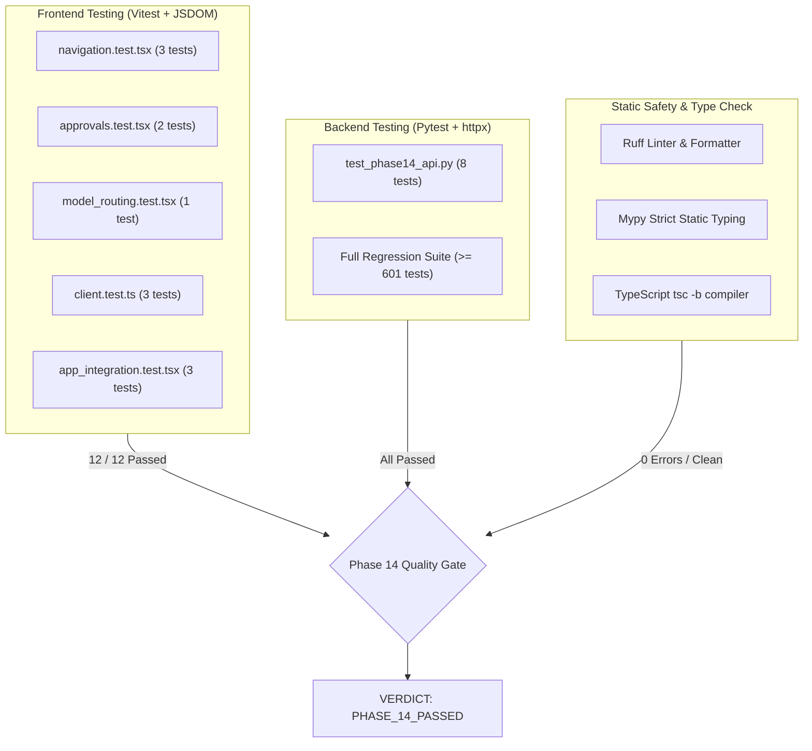

# SYNTRA Phase 14: Verification, Quality Assurance & Testing Report

**SYNTRA: Synchronized Intelligence for Autonomous Engineering**  
*Document Version: 1.0.0 | Date: October 20, 2026*  
*Classification: Test Plan & Execution Evidence*

---

## 1. Executive Summary

Phase 14 verifies the end-to-end integration of the SYNTRA Control Center frontend with the Python FastAPI backend, database persistence layer, and evaluation harness. This document details the test strategy, automated test coverage, static analysis, and regression baseline across both frontend and backend systems.

---

## 2. Test Architecture & Evidence Inventory

---

## 3. Backend Test Coverage (`tests/test_phase14_api.py`)

The Phase 14 backend test suite executes against SQLite in-memory and simulated tenants with full Unit of Work lifecycle validation:

| Test Name | Target Route | Scope & Verification | Status |
| :--- | :--- | :--- | :--- |
| `test_system_overview_endpoint` | `GET /v1/system/overview` | Validates KPI consolidation: project count, mission count, pending approvals, active personas (10), system health, tenant ID. | **PASSED** |
| `test_agents_list_endpoint` | `GET /v1/agents` | Validates retrieval of all 10 canonical personas from `AGENTS.md` with non-empty allowed tools and forbidden actions. | **PASSED** |
| `test_models_list_and_routing_endpoints` | `GET /v1/models`, `GET /v1/models/routing` | Validates model specifications (context window, pricing) and role-to-tier mappings (PM -> reasoning, BE -> balanced). | **PASSED** |
| `test_models_routing_simulation` | `POST /v1/models/routing/simulate` | Evaluates dynamic policy resolution for agent roles and explicit model ID overrides. | **PASSED** |
| `test_approvals_list_and_get_endpoints` | `GET /v1/approvals`, `GET /v1/approvals/{id}` | Validates listing pending approval tickets, retrieving single ticket, and HMAC signature digest integrity. | **PASSED** |
| `test_missions_list_endpoint` | `GET /v1/missions` | Validates tenant-scoped mission listing with project_id and state filtering. | **PASSED** |
| `test_benchmarks_endpoints` | `GET /v1/benchmarks`, `GET /v1/benchmarks/{run_id}` | Validates reading machine-readable evaluation run manifests, summaries, and metrics. | **PASSED** |
| `test_audit_list_endpoint` | `GET /v1/audit` | Validates retrieving append-only audit log records for tenant. | **PASSED** |

**Execution Time**: 8 passed in 1.05s.

---

## 4. Frontend Test Coverage (`frontend/src/tests/`)

The frontend test suite runs under Vitest 2.1 and React Testing Library inside JSDOM:

| Test File | Test Cases | Scope & Verification | Status |
| :--- | :--- | :--- | :--- |
| `navigation.test.tsx` | 3 | Verifies all 13 canonical destination links exist with icons and labels, route change dispatch on click, sidebar collapse/expand toggle. | **PASSED** |
| `approvals.test.tsx` | 2 | Verifies pending approval display with cryptographic HMAC digest, review gate modal, and authorized verdict submission. | **PASSED** |
| `model_routing.test.tsx` | 1 | Verifies model catalog rendering, role-to-tier policy cards, and interactive simulation execution. | **PASSED** |
| `client.test.ts` | 3 | Verifies dev auth header injection (`X-Dev-*`), dynamic role switching, and Bearer token priority. | **PASSED** |
| `app_integration.test.tsx` | 3 | Verifies top bar indicators, seamless switching across all 13 destinations, and dynamic RBAC role switching. | **PASSED** |

**Execution Time**: 12 passed in 1.63s across 5 test suites.

---

## 5. Static Analysis & Type Checking

### Backend Static Analysis
- **Linter**: `uv run ruff check .` $\rightarrow$ **All checks passed! (0 errors)**.
- **Formatter**: `uv run ruff format --check .` $\rightarrow$ **Clean (395 files)**.
- **Type Checker**: `uv run mypy src/` $\rightarrow$ **Success: no issues found in 154 source files**.

### Frontend Static Analysis & Bundling
- **TypeScript Compiler**: `tsc -b` $\rightarrow$ **0 errors (strict mode active)**.
- **Vite Bundler**: Production build output:
  - `dist/index.html`: 0.84 kB (gzip 0.52 kB)
  - `dist/assets/index-DiRCXFe0.css`: 27.42 kB (gzip 5.47 kB)
  - `dist/assets/index-OK6bQwDa.js`: 274.34 kB (gzip 71.47 kB)
  - Build duration: 1.12s.
