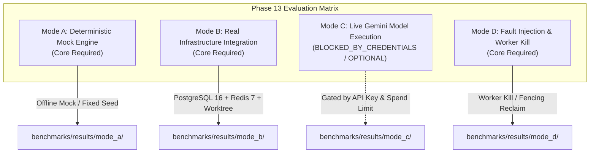

# PHASE 13 BENCHMARKING AND EVALUATION READINESS REPORT

**SYNTRA: Synchronized Intelligence for Autonomous Engineering**  
**Phase 13: End-to-End Integration and Benchmark**  
**Date**: October 20, 2026  
**Environment**: Antigravity AI Engineering Environment (Apple Silicon Darwin / arm64)  
**Authoritative Context**: Principal Distributed Systems Architect & Lead Verification Engineer  

---

## A. Phase 10–12 Acceptance Status

All prerequisite engineering phases are formally accepted, verified, and archived:

1. **Phase 10: Autonomous Engineering Organization**: `VERIFIED_COMPLETE`
   - 10 specialized engineering personas operating with strict separation of powers ([`AGENTS.md`](file:///Users/thedeepakreddy/SYNTRA/AGENTS.md)).
   - Structural anti-collusion invariants verified: developer agents cannot review or verify their own deliverables (`require_independent_review`).
   - Baseline regression suite: 472 passed tests.

2. **Phase 11: Memory, Recovery, and Self-Correction**: `VERIFIED_COMPLETE`
   - Tiered memory hierarchy (`EXECUTION`, `PROJECT`, `ORGANIZATION`) stored in PostgreSQL.
   - Deterministic offline vector retrieval with pluggable embedding protocol.
   - Append-only `memory_feedback_events` audit table (migration `0004_memory_feedback`).
   - Autonomous failure reflection from QA, Code Review, Security, and Debugging rejections.
   - Fail-closed outbox logging and bounded replanning circuit breaker.
   - Baseline regression suite: 527 passed tests.

3. **Phase 12: Independent Verification, Security, and Observability**: `VERIFIED_COMPLETE`
   - Independent Verification Service executing in hermetic, isolated sandboxes.
   - Cryptographic HMAC-SHA256 signed `VerificationRecord` entities stored in PostgreSQL (migration `0005_independent_verification`).
   - Protected Test Suite Registry enforcing default immutability over baseline and regression test suites, with diff scanner rejecting test mutations, deletions, and suppression directives.
   - Systemic Secret Scrubber (`SecretScrubbingLogFilter`, `SecretScrubbingSpanProcessor`, subprocess env quarantine, symlink directory traversal hardening).
   - Distributed OpenTelemetry tracer (`"syntra-engine"`), W3C `traceparent` propagation, and fail-closed JSONL structured audit logging.
   - Cryptographic delivery gate (`verify_delivery_gate`) guarding entry to `RELEASE_DELIVERY`.
   - Full regression baseline: **574 passed, 7 skipped, 0 failures** in 77.83s.

---

## B. Approved Phase 13 Requirements & Source-of-Truth Reconciliation

### Authoritative Specifications
The authoritative scope for Phase 13 is governed by:
- [`docs/phases/roadmap.md#L197-L208`](file:///Users/thedeepakreddy/SYNTRA/docs/phases/roadmap.md#L197-L208)
- [`docs/phases/implementation-roadmap.md#L95-L98`](file:///Users/thedeepakreddy/SYNTRA/docs/phases/implementation-roadmap.md#L95-L98)
- [`AGENTS.md`](file:///Users/thedeepakreddy/SYNTRA/AGENTS.md)

### Scope Reconciliation
| Requirement | Phase 13 Scope Status | Implementation / Verification Vehicle |
|---|---|---|
| **Full System Proof on External Fixture** | Core Required | Standalone target repository fixture `tests/fixtures/phase13_inventory/` (FastAPI backend). |
| **Autonomous Defect Remediation** | Core Required | End-to-end multi-agent pipeline: PRD -> Architecture -> Task DAG -> Backend TDD -> Review -> Independent Verification -> Delivery Gate. |
| **Worker Interruption & Kill Test** | Core Required | Mode D: Active worker process termination (SIGTERM/SIGKILL) during sandbox execution, proving fencing token lease reclamation, scheduler re-lease, and delivery gate integrity. |
| **Reproducible Benchmark Telemetry** | Core Required | Machine-readable benchmark run artifacts emitted to `benchmarks/results/<run_id>/` (JSONL format with SHA-256 payload digests). |
| **Deterministic Evaluation (Mode A)** | Core Required | Offline reproducible benchmark using `MockModelProvider` with fixed seeds. |
| **Real Infrastructure Integration (Mode B)** | Core Required | Real PostgreSQL 16 + Redis 7 + isolated ephemeral Git worktrees. |
| **Live Model Execution (Mode C)** | Gated / Optional | Real Gemini model calls classified as `BLOCKED_BY_CREDENTIALS / OPTIONAL` until live credentials and budget ceilings are provided. |
| **Virtual Office / Graphical UI** | **Strictly Excluded** | SYNTRA is strictly a headless, API/CLI-driven backend engineering platform. Zero virtual office or GUI simulation. |
| **Self-Targeting Code Modification** | **Strictly Excluded** | SYNTRA source code is **never** the benchmark target. Only the target fixture repository is modified. |

---

## C. Current Evaluation Capabilities & Available Telemetry Signals

The platform currently emits high-fidelity, structured signals across every phase of execution:

1. **OpenTelemetry Span Hierarchy (`syntra-engine`)**:
   - `mission.execute`: Root lifecycle span with `mission_id`, `org_id`, `project_id`.
   - `orchestrator.node`: Workflow step transitions with node name and attempt count.
   - `agent.react_loop`: Specialist execution loop with `agent_role`, `task_id`, `turn_count`.
   - `model.gemini_generate`: Model invocation spans with token consumption and latency.
   - `mcp.tool_invocation`: Tool gateway dispatch with tool name and execution status.
   - `sandbox.command_run`: Subprocess execution spans inside worker sandboxes.
   - `verification.run`: Independent verification span with `clean_base_commit`, `patch_hash`, `tests_passed`.

2. **Distributed Context Propagation**:
   - Full W3C `traceparent` (`00-<trace_id>-<span_id>-<flags>`) injected into HTTP headers, worker lease metadata, and recorded on `VerificationRecordModel.trace_id`.

3. **Structured Audit Events (`AuditLogger`)**:
   - 11 canonical security events recorded with ISO-8601 timestamps, `trace_id`, `mission_id`, `task_id`, `agent_role`, and SHA-256 payload digests.
   - Fail-closed persistence and offline tamper detection via `AuditLogger.verify_log_file(...)`.

4. **Persistence & Fencing Telemetry**:
   - Monotonic fencing tokens (`fencing_token: int`) on worker leases guarding against zombie worker writes.
   - Task attempt state machines (`PENDING` -> `LEASED` -> `EXECUTING` -> `VERIFYING` -> `COMPLETED`).
   - Transactional outbox table (`event_records`) recording domain events for Redis relay.

---

## D. Existing Telemetry and Evidence Inventory

The following authoritative database tables and filesystem records store verification evidence:

| Evidence Store | Schema / Table Name | Authoritative Data Retained |
|---|---|---|
| **PostgreSQL Database** | `verification_records` | `id`, `org_id`, `mission_id`, `task_id`, `task_attempt_id`, `plan_version`, `status` (`PASSED`/`FAILED`), `clean_base_commit`, `patch_hash`, `protected_test_suite_hash`, `evidence` JSONB (`exit_code`, `execution_duration_ms`, `stdout_digest`, `stderr_digest`, `tests_passed`), `verifier_signature` (HMAC-SHA256), `trace_id`. |
| **PostgreSQL Database** | `usage_records` | `id`, `org_id`, `mission_id`, `task_id`, `model_name`, `prompt_tokens`, `completion_tokens`, `total_tokens`, `cost_usd`, `created_at`. |
| **PostgreSQL Database** | `memory_feedback_events` | `id`, `memory_id`, `delta`, `feedback_type`, `source_artifact_id`, `patch_hash`, `idempotency_key`, `created_at`. |
| **PostgreSQL Database** | `task_attempts` | `id`, `task_id`, `attempt_number`, `state`, `worker_id`, `fencing_token`, `lease_expires_at`, `created_at`. |
| **Filesystem / Logs** | `structured_audit.jsonl` | Append-only tamper-evident audit events with cryptographic payload digests. |

---

## E. Proposed Benchmark Architecture (`src/syntra/benchmarks/`)

The benchmark subsystem will be implemented as a clean, decoupled module that drives SYNTRA via its public APIs and service contracts without mutating core platform internals:

```
src/syntra/benchmarks/
├── __init__.py               # Public exports for benchmark runner
├── models.py                 # BenchmarkRun, BenchmarkMetric, EvaluationMode schemas
├── runner.py                 # Multi-mode scenario execution engine
├── collector.py              # Telemetry aggregator (traces, audit logs, usage records)
└── reporters.py              # JSONL machine-readable and Markdown human-readable reports
```

### Module Responsibilities
- **`models.py`**: Pydantic v2 schemas for benchmark configurations, test metrics, run manifests, and evaluation summaries.
- **`runner.py`**: Orchestrates end-to-end execution across Modes A, B, C, and D. Prepares ephemeral worktrees, spins up fixture targets, runs missions, and executes controlled fault injection.
- **`collector.py`**: Collects runtime metrics directly from PostgreSQL (`usage_records`, `verification_records`), OpenTelemetry memory exporters, and audit log files.
- **`reporters.py`**: Formats output into deterministic JSONL records in `benchmarks/results/<run_id>/` and produces comparative summary tables.

---

## F. Benchmark Fixture Plan: `tests/fixtures/phase13_inventory/`

### 1. Fixture Overview
A standalone, production-like FastAPI inventory and warehouse transfer backend.

```
tests/fixtures/phase13_inventory/
├── README.md                 # Target repository documentation & architecture
├── pyproject.toml            # Target repository dependencies (FastAPI, SQLAlchemy, Pytest)
├── src/
│   └── inventory/
│       ├── __init__.py
│       ├── models.py         # Item, Warehouse, StockLevel, TransferOrder models
│       ├── database.py       # SQLite / PostgreSQL engine config
│       ├── service.py        # Business logic with intentional defects
│       └── api.py            # REST endpoints (/items, /transfers, /stock)
└── tests/
    ├── conftest.py           # Test fixtures and clean database setup
    ├── test_items.py         # Passing baseline tests
    ├── test_stock.py         # FAILING TEST: Timezone / query offset defect
    └── test_transfers.py     # FAILING TEST: Negative stock concurrency defect
```

### 2. Intentional, Reproducible Defects
- **Defect 1 (Concurrency & Negative Stock)**:
  - In `POST /transfers/`: The transfer logic checks stock availability without database row-level locking or balance constraints, leading to race conditions where stock levels drop below zero during concurrent transfers.
  - Failing test: `tests/test_transfers.py::test_concurrent_transfers_prevent_negative_inventory` fails with `AssertionError: Stock cannot be negative (-5 < 0)`.
- **Defect 2 (Timezone Offset & Ledger Discrepancy)**:
  - In `GET /stock/{warehouse_id}`: Timezone offsets are stripped naively in datetime filtering, causing ledger reconciliation queries across daylight savings boundaries to raise `500 Internal Server Error` and corrupt historical summaries.
  - Failing test: `tests/test_stock.py::test_stock_ledger_timezone_consistency` fails with `HTTPException: 500 Discrepancy in ledger interval`.

### 3. Crucial Constraint
SYNTRA's own repository (`/Users/thedeepakreddy/SYNTRA/src/syntra`) is **never** touched by the benchmark target or specialist developer agents. All fixes, unified diffs, and verification runs execute strictly within ephemeral sandboxes populated from `tests/fixtures/phase13_inventory/`.

---

## G. Evaluation Modes

The benchmark suite supports four distinct evaluation modes:



1. **Mode A: Deterministic Model Testing (Mock Provider) — Core Required**
   - Zero network access, zero external API calls, deterministic `MockModelProvider`.
   - Scripted agent responses reproduce the exact 10-persona handoff pipeline.
   - Runs in CI in seconds, verifying logic and schema contracts end-to-end.

2. **Mode B: Real Infrastructure with Scripted Decisions — Core Required**
   - Runs against real local PostgreSQL 16 (`syntra_test`), Redis 7 (port 6379), and ephemeral Git worktrees via `WorkspaceManager`.
   - Real subprocess command execution runs `pytest` on the target fixture sandbox.
   - Proves end-to-end multi-agent orchestration under real concurrency and storage constraints.

3. **Mode C: Live Model Execution (Gemini) — Gated / Optional**
   - Classified as `BLOCKED_BY_CREDENTIALS / OPTIONAL`.
   - Requires explicit human provision of `GEMINI_API_KEY` and a hard budget ceiling (e.g. $2.00).
   - Separated cleanly from core deterministic acceptance gates so that CI never flakes or halts on external network latency.

4. **Mode D: Recovery & Adversarial Evaluation (Controlled Worker Interruption) — Core Required**
   - Injects a controlled failure: while `EngineeringSandboxWorker` is executing a task in its sandbox, the runner terminates the worker process (SIGTERM/SIGKILL).
   - Verifies:
     1. Lease expiration detected by `TaskScheduler`.
     2. Stale worker rejected via monotonic fencing tokens.
     3. Task re-leased to a healthy worker.
     4. Final deliverable passes `IndependentVerificationService` and enters `RELEASE_DELIVERY`.

---

## H. Metric Definitions

All benchmark metrics are formally defined and computed deterministically:

| Metric Identifier | Mathematical Definition | Telemetry Source | Unit | Target Threshold |
|---|---|---|---|---|
| **`TASK_SUCCESS_RATE`** | $N_{\text{passed tasks}} / N_{\text{total tasks}}$ | Task attempt records in PostgreSQL | Ratio `[0.0, 1.0]` | $1.00$ ($100\%$) |
| **`FUNCTIONAL_CORRECTNESS`** | All tests in `tests/fixtures/phase13_inventory/` pass on clean base commit + patch | `VerificationRecord.evidence.tests_passed` and `exit_code == 0` | Boolean (`PASS`/`FAIL`) | `PASS` |
| **`REGRESSION_RATE`** | $N_{\text{previously passing tests broken}} / N_{\text{baseline passing tests}}$ | `VerificationRecord` test comparison | Ratio `[0.0, 1.0]` | $0.00$ ($0\%$) |
| **`RECOVERY_SUCCESS_RATE`** | $N_{\text{successful reclaims after kill}} / N_{\text{injected failures}}$ | Task lease logs & scheduler heartbeat records | Ratio `[0.0, 1.0]` | $1.00$ ($100\%$) |
| **`MEAN_TASK_DURATION`** | $\frac{1}{N} \sum_{i=1}^{N} \text{duration\_ms}(i)$ | OpenTelemetry span durations (`agent.react_loop`) | Milliseconds | Informational |
| **`TOKEN_USAGE`** | $\sum (\text{prompt\_tokens} + \text{completion\_tokens})$ | `usage_records` table in PostgreSQL | Integer count | Informational |
| **`ESTIMATED_COST`** | $\sum \text{cost\_usd}$ | `usage_records` table in PostgreSQL | USD ($) | Informational |

---

## I. Scoring and Acceptance Criteria

Phase 13 will be considered complete and verified when all of the following exit gates pass:

1. **Gate 1: Mode A Deterministic Pass**
   - 100% functional correctness on the target inventory fixture.
   - 0 regressions introduced.
   - Delivery gate verifies valid HMAC-SHA256 signature and plan version alignment.
2. **Gate 2: Mode B Real Infrastructure Pass**
   - End-to-end mission executes successfully against real PostgreSQL 16 and Redis 7.
   - Real Git worktree sandbox executes target test suite with exit code `0`.
   - `VerificationRecord` stored in PostgreSQL with valid cryptographic signature.
3. **Gate 3: Mode D Worker Kill & Recovery Pass**
   - Injected worker termination cleanly recovered by task scheduler without manual intervention.
   - Fencing token prevents zombie worker write collisions.
   - Mission recovers and delivers verified fix.
4. **Gate 4: Machine-Readable Telemetry Artifacts**
   - Output artifacts written to `benchmarks/results/<run_id>/` with valid SHA-256 payload digests.
   - Zero tampering detected by `AuditLogger.verify_log_file(...)`.
5. **Gate 5: Repository Regression & Cleanliness Invariant**
   - Full test suite passes: $\ge 574$ tests passing, 0 failures, 0 hangs.
   - Static analysis: Ruff clean (0 errors), Mypy clean (0 issues across all source files).
   - Zero modifications to `syntra_dev` or production databases.

---

## J. Cost and Resource Requirements

- **Local Host Infrastructure**:
  - Memory: ~2 GB RAM for PostgreSQL 16 + Redis 7 + Colima/Docker.
  - Disk Space: ~500 MB for ephemeral test worktrees in `tmp_path` (automatically cleaned).
  - CPU: 2-4 cores recommended for concurrent test execution.
- **Financial Cost**:
  - Modes A, B, and D: **$0.00** (100% local, offline, deterministic).
  - Mode C (if authorized): Estimated $0.05–$0.20 per end-to-end mission run with Gemini 2.5 Flash / Pro, subject to hard token budget reservation limits.

---

## K. Live-Model Testing Requirements (Separated from Deterministic Benchmarks)

Live-model execution is explicitly isolated to prevent non-deterministic failure or unbudgeted costs:

1. **Authorization Gate**: Mode C will not run without explicit operator instruction and configured `GEMINI_API_KEY`.
2. **Hard Spend Ceiling**: Enforced by `BudgetService` and `ModelRuntime`: missions halt immediately if token or cost limits are exceeded (`BudgetExceededError`).
3. **Decoupled Verification**: Acceptance of Phase 13 does not require live paid Gemini invocations. Modes A, B, and D provide complete mathematical, architectural, and fault-tolerant proof of platform autonomy.

---

## L. Reproducibility Strategy

Every benchmark run emits an immutable, machine-readable artifact bundle:

```
benchmarks/results/<run_id>/
├── manifest.json             # Git commit HEAD, environment, evaluation mode, seed, timestamp
├── summary.json              # High-level metrics (TASK_SUCCESS_RATE, DURATION, COST, OUTCOME)
├── telemetry.jsonl           # Chronological OpenTelemetry spans and W3C trace IDs
├── audit.jsonl               # Tamper-evident structured audit events with SHA-256 digests
├── patch.diff                # The unified diff delivered by the agent organization
└── verification.json         # Cryptographic verification record and verifier signature
```

Any operator can verify run integrity post-hoc using:
`AuditLogger.verify_log_file("benchmarks/results/<run_id>/audit.jsonl")`

---

## M. Risk Assessment and Mitigation

| Risk | Impact | Likelihood | Mitigation Strategy |
|---|---|---|---|
| **Flaky Fixture Tests** | False negative in functional correctness | Low | Target fixture tests use hermetic SQLite in-memory databases with fixed seeds; no external network or async timers. |
| **Worker Kill Timing Race** | Test hangs or kills worker after task already finished | Medium | Mode D uses synchronization primitives (`threading.Event` / `asyncio.Event`) at sandbox command launch barrier to ensure kill occurs precisely during execution. |
| **Filesystem Worktree Leaks** | Disk bloat from abandoned worktrees | Low | `WorkspaceManager` wraps worktree creation in `try...finally` context managers, ensuring `git worktree remove` runs on process termination. |
| **Database Contamination** | Benchmark data polluting test databases | Low | All benchmark runs use isolated database transactions or isolated test organizations (`org_id = uuid4()`). `syntra_dev` is never touched. |

---

## N. Implementation Sequence

Phase 13 will proceed according to the following sequential milestones upon human authorization:

1. **Milestone 13.1: Architecture Scaffolding & Fixture Setup**
   - Create `src/syntra/benchmarks/` package with models and schemas.
   - Author standalone target fixture `tests/fixtures/phase13_inventory/` with reproducible defects and failing tests.
   - Author fixture unit tests verifying defects fail cleanly in isolation.
2. **Milestone 13.2: Deterministic Scenario Runner & Collector (Modes A & B)**
   - Implement `src/syntra/benchmarks/runner.py` and `collector.py`.
   - Verify Mode A deterministic execution and Mode B real infrastructure execution against the inventory fixture.
3. **Milestone 13.3: Worker Interruption & Recovery Harness (Mode D)**
   - Implement controlled worker process termination during sandbox execution.
   - Verify lease timeout, fencing token rejection, and clean mission recovery.
4. **Milestone 13.4: Reporting & Machine-Readable Telemetry Generation**
   - Implement `src/syntra/benchmarks/reporters.py` emitting `manifest.json`, `summary.json`, and `audit.jsonl`.
5. **Milestone 13.5: Final End-to-End Verification & Phase 13 Closeout**
   - Run complete Phase 13 test suite (`tests/test_benchmarks_phase13.py`).
   - Run full regression suite maintaining $\ge 574$ passing tests.
   - Compile Phase 13 final verification report and update documentation.

---

## O. Approval Requests

To proceed with Phase 13 implementation safely and within authorized boundaries, the following formal human approvals are requested:

1. **Approval 1 (Package Scaffolding & Fixture Authoring)**: Authorize creation of `src/syntra/benchmarks/` and `tests/fixtures/phase13_inventory/`.
2. **Approval 2 (Evaluation Scope Confirmation)**: Confirm that Modes A, B, and D constitute the core acceptance requirement, while Mode C (live Gemini model calls) remains `BLOCKED_BY_CREDENTIALS / OPTIONAL` with zero paid API calls required for Phase 13 closeout.
3. **Approval 3 (Milestone 13.1 Initiation)**: Authorize beginning Milestone 13.1 implementation upon receipt of confirmation.
